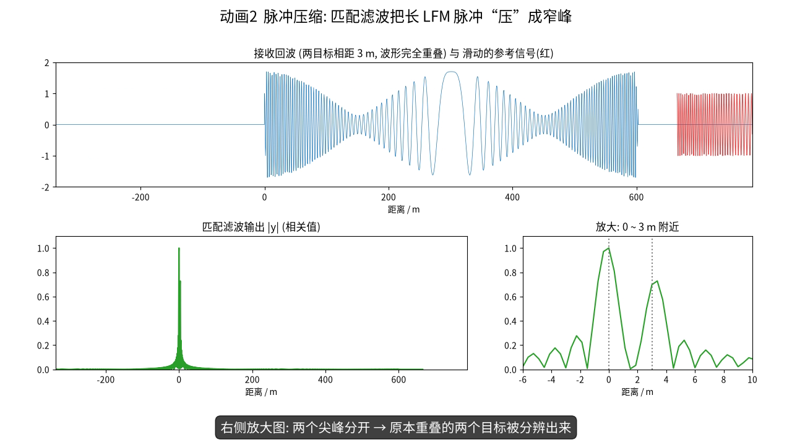
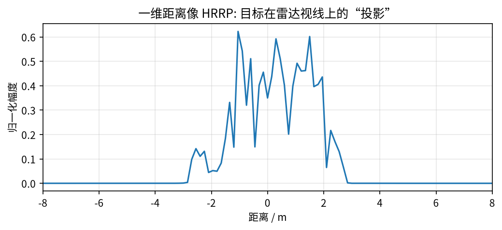

# 第 1 章 雷达基础：回波、LFM 与脉冲压缩

!!! tip "本章目标"

    1. 用“信号与系统”的语言写出雷达回波模型，理解“时延 ↔ 距离”“相位 ↔ 距离的细微变化”；
    2. 理解为什么雷达要发射线性调频（LFM）信号，以及匹配滤波 / 脉冲压缩如何把长脉冲“压”成窄峰（先用一个 3 位码手算，再推导 LFM）；
    3. 一步步推导并记住距离分辨率公式 $\rho_r = c/(2B)$，会用它做数值估算。

!!! note "基础回链"

    **本章用到的基础：** 复数与相位（→ 第 0.1 节）、I/Q 与基带（→ 第 0.2 节）、傅里叶变换的时移性质（→ 第 0.3 节）、相关与卷积（→ 第 0.6 节）。

## 1.1 雷达在做什么：一句话版本

!!! info "直觉"

    **类比：对着山谷喊话。** 你喊一声，过了 2 秒听到回声，声速约 340 m/s，声音来回走了 680 m，所以山崖在 340 m 外。雷达做的是同一件事，只不过“喊”的是电磁波，速度是光速 $c$。

雷达发射一段已知的电磁波 $s_t(t)$。电磁波碰到目标后，有一小部分反射回来。接收机收到的是发射信号的副本：它被**延迟**了、**衰减**了，还**可能带有多普勒频移**。若目标距离为 $R$，电磁波往返一次走 $2R$，所以往返时延为

$$\tau = \frac{2R}{c},\qquad c\approx 3\times10^8\ \mathrm{m/s}. \tag{1.1}$$

所以“测距离”本质上就是“测时延”。例如目标在 300 km 外，$\tau = 2\times 3\times10^5 / (3\times10^8) = 2$ ms；目标距离差 1.5 m，时延差只有 $2\times1.5/(3\times10^8) = 10$ ns。

## 1.2 回波模型

把发射信号写成“复包络 × 载波”的形式。这正是信号与系统里调制的写法：

$$s_t(t) = u(t)\,e^{j2\pi f_c t}, \tag{1.2}$$

各符号的含义：

- $f_c$：载频，如 X 波段 10 GHz。它决定波长 $\lambda = c/f_c$（10 GHz 时为 3 cm）；
- $u(t)$：基带复包络，描述“脉冲长什么样”，变化比载波慢得多；
- $e^{j2\pi f_c t}$：以 $f_c$ 高速旋转的箭头（→ 第 0.1 节）。

设一个散射系数为 $\sigma$ 的点目标（$\sigma$ 是复数：$|\sigma|$ 表示反射强弱，$\angle\sigma$ 是反射引起的固定相移）。它的回波就是发射信号延迟 $\tau$、再乘以 $\sigma$：

$$s_r(t) = \sigma\,s_t(t-\tau) = \sigma\,u(t-\tau)\,e^{j2\pi f_c (t-\tau)}. \tag{1.3}$$

**下变频**就是乘以 $e^{-j2\pi f_c t}$，把载波去掉（对应第 0.2 节的 I/Q 解调）。推导分三步：

$$\begin{aligned}
s_b(t) &= s_r(t)\,e^{-j2\pi f_c t} = \sigma\,u(t-\tau)\,e^{j2\pi f_c t}\,e^{-j2\pi f_c\tau}\,e^{-j2\pi f_c t} \\
&= \sigma\,u(t-\tau)\,e^{-j2\pi f_c\tau} \\
&= \sigma\,u\!\left(t-\frac{2R}{c}\right)\,e^{-j2\pi f_c\frac{2R}{c}}
 = \sigma\,u\!\left(t-\frac{2R}{c}\right)\,e^{-j\frac{4\pi}{\lambda}R}.
\end{aligned} \tag{1.4}$$

第二行中两个 $e^{\pm j2\pi f_c t}$ 抵消了。第三行代入 $\tau = 2R/c$，再用 $f_c/c = 1/\lambda$。

式 (1.4) 里有两个非常重要的“距离信息载体”：

- **包络时延** $u(t-2R/c)$：粗略地告诉我们目标在哪个“距离单元”；
- **相位** $e^{-j4\pi R/\lambda}$：$\lambda$ 只有几厘米，距离变化 $\lambda/4$ 就让相位变化 $\pi$。例题 0.2 算过：半厘米对应 120°。后面 ISAR 的横向成像，利用的正是这个相位随时间的变化（即多普勒）。

!!! info "直觉"

    **一粗一细两把尺子。** 包络是“米尺”，只能量到距离单元（比如 0.15 m）这一级；相位是“游标卡尺”，能感受到毫米级的变化，但读数每隔 $\lambda/2$ 就重复一次（相位缠绕）。ISAR 两把尺子都要用。

!!! warning "易错点"

    **小贴士 / 易错点。** “相位对距离极其敏感”这一点贯穿全文。它是 ISAR 能获得横向分辨率的原因；它也是目标运动不平稳时图像“散焦”的根源；它还是 CV-GNN、CvPGT 坚持使用**复值网络**、保留相位信息的物理动机。

## 1.3 为什么要用线性调频（LFM）信号

我们希望同时做到两件事：

- **距离分辨率高**：两个相距很近的目标，回波要能分开。直觉上脉冲越窄越好；
- **作用距离远**：回波能量要足够。能量 = 功率 × 时长，而发射机峰值功率有限，所以需要脉冲长。

“窄”和“长”是矛盾的。

!!! example "例题"

    **例题 1.1（矛盾有多尖锐）。** 想要 1.5 m 的距离分辨率，两个目标的时延差只有 10 ns（见 1.1 节）。如果用一个简单的矩形脉冲，脉宽也必须约 10 ns。

    若发射机峰值功率 1 kW，单个脉冲的能量只有 $10^3\times10^{-8} = 10^{-5}$ J。改用 $T_p = 10\ \mu\text{s}$ 的长脉冲，能量提高 1000 倍。可是此时脉冲在空间中的长度为 $cT_p/2 = 1500$ m，所有距离差小于 1500 m 的目标回波都会重叠在一起。

解决办法是：发射一个**长而宽带**的信号，再在接收端用信号处理把它“压缩”成窄脉冲。最常用的是线性调频信号（LFM，也叫 chirp）：

$$u(t) = \mathrm{rect}\!\left(\frac{t}{T_p}\right) e^{j\pi K t^2},\qquad K = \frac{B}{T_p}. \tag{1.5}$$

符号说明：

- $\mathrm{rect}(t/T_p)$：矩形窗，$|t|\le T_p/2$ 时为 1，其余为 0，表示脉冲持续 $T_p$；
- $K$：调频斜率（Hz/s），表示“频率每秒升高多少”；
- $B$：扫过的带宽（Hz）。

**为什么叫“线性调频”。** 瞬时频率等于相位对时间的导数再除以 $2\pi$：

$$f(t)=\frac{1}{2\pi}\frac{\mathrm{d}}{\mathrm{d}t}\big(\pi K t^2\big) = \frac{1}{2\pi}\cdot 2\pi K t = Kt,\qquad t\in\left[-\tfrac{T_p}{2},\tfrac{T_p}{2}\right]. \tag{1.6}$$

所以频率从 $-KT_p/2 = -B/2$ 线性升到 $+B/2$，在脉宽 $T_p$ 内扫过带宽 $B$。

!!! info "直觉"

    **类比：鸟叫（chirp）。** 这种信号听起来像“啾——”一声由低到高的鸟鸣。每个时刻的音调不同，所以回波的“每一小段”都带着自己的时间标签。接收机只要把各段“对齐”，就能把长脉冲压成一个窄峰。

!!! example "例题"

    **例题 1.2（LFM 参数）。** $T_p = 10\ \mu\text{s}$，$B = 100$ MHz：

    - 调频斜率 $K = B/T_p = 10^8/10^{-5} = 10^{13}$ Hz/s；
    - 时宽带宽积 $T_pB = 10^{-5}\times10^8 = 1000$；
    - 压缩前脉冲的空间长度 $cT_p/2 = 1500$ m；压缩后分辨率 $c/2B = 1.5$ m，正好缩小到 $1/1000$（式 (1.13) 将证明）。

## 1.4 匹配滤波与脉冲压缩

### 1.4.1 先用一个 3 位码手算

!!! info "直觉"

    **类比：拿钥匙找锁孔。** 你手里有一把形状已知的钥匙（发射码），在一排锁孔（接收信号）上逐个试。只有在完全对齐的位置，钥匙的每个齿都能“卡进去”，此时得分最高。“逐个位置试、对应相乘再相加”就是**相关**（→ 第 0.6 节）。

用最短的 Barker 码 $s = [1, 1, -1]$ 当作“发射信号”。先看它和自己的相关（自相关），即把 $s$ 平移 $n$ 位后与自己对应相乘再求和：

$$r_{ss}[n] = \sum_m s[m+n]\,s[m] = [\,-1,\ 0,\ 3,\ 0,\ -1\,],\qquad n = -2,\dots,2. \tag{1.7}$$

例如 $n=0$ 时 $1\cdot1+1\cdot1+(-1)(-1)=3$；$n=1$ 时 $s[1]s[0]+s[2]s[1] = 1\cdot1 + (-1)\cdot1 = 0$。中间的峰值 3 等于码长（能量），而旁瓣只有 $\pm1$ 和 0。**“对齐时得分最高、错开时得分很低”**，这就是脉冲压缩的全部秘密。

!!! example "例题"

    **例题 1.3（两个目标的匹配滤波）。** 目标 A 延迟 1 个样本、幅度 1；目标 B 延迟 4 个样本、幅度 0.5。接收信号是两段回波之和：

    $$r = [\,0,\ 1,\ 1,\ -1,\ 0.5,\ 0.5,\ -0.5,\ 0\,].$$

    用 $s$ 在 $r$ 上滑动做相关，$y[n] = \sum_{m=0}^{2} r[n+m]\,s[m]$：

    $$\begin{aligned}
    y[0] &= 0\cdot1 + 1\cdot1 + 1\cdot(-1) = 0, \\
    y[1] &= 1\cdot1 + 1\cdot1 + (-1)\cdot(-1) = 3, \\
    y[2] &= 1 + (-1) + 0.5\cdot(-1) = -0.5, \\
    y[3] &= -1 + 0.5 + 0.5\cdot(-1) = -1, \\
    y[4] &= 0.5 + 0.5 + (-0.5)(-1) = 1.5, \\
    y[5] &= 0.5 + (-0.5) + 0 = 0.
    \end{aligned}$$

    输出 $y = [0, 3, -0.5, -1, 1.5, 0]$ 的两个峰正好在 $n=1$ 和 $n=4$，峰高 3 和 1.5 也正比于两个目标的幅度 1 和 0.5（图 1-2a）。原始接收信号里两段回波首尾相接，很难看出边界；相关之后，两个目标一目了然。

### 1.4.2 一般的匹配滤波器

把上面的做法写成连续信号的形式。**匹配滤波器**是在白噪声下使输出信噪比最大的线性滤波器，其冲激响应是发射信号的“共轭翻转”（第 0.6 节说过：与 $u$ 做相关 = 与 $u^*(-t)$ 做卷积）：

$$h(t) = u^*(-t),\qquad H(f) = U^*(f). \tag{1.8}$$

输出等于回波与参考信号的**互相关**：

$$y(t) = s_b(t) * h(t) = \int s_b(\xi)\,h(t-\xi)\,\mathrm{d}\xi = \int s_b(\xi)\,u^*(\xi - t)\,\mathrm{d}\xi . \tag{1.9}$$

### 1.4.3 推导 LFM 的压缩结果与距离分辨率

在频域推导最清楚。共分四步：

**第 1 步：回波的频谱。** 忽略常数相位 $e^{-j4\pi R/\lambda}$（把它并入 $\sigma$），基带回波为 $s_b(t) = \sigma u(t-\tau)$。由时移性质（→ 第 0.3 节），$S_b(f) = \sigma U(f)e^{-j2\pi f\tau}$。

**第 2 步：滤波 = 频域相乘。**

$$Y(f) = S_b(f)\,H(f) = \sigma\,U(f)\,U^*(f)\,e^{-j2\pi f\tau} = \sigma\,|U(f)|^2\,e^{-j2\pi f \tau}. \tag{1.10}$$

$U(f)U^*(f) = |U(f)|^2$ 是实数（→ 第 0.1 节 $zz^*=|z|^2$）。也就是说，匹配滤波把各频率分量原本杂乱的相位全部“拉齐”，只剩下线性相位 $e^{-j2\pi f\tau}$，使它们在 $t=\tau$ 处同相叠加，形成尖峰。

**第 3 步：LFM 的 $|U(f)|^2$ 近似为矩形。** LFM 在每个时刻只占一个频率，扫过 $[-B/2, B/2]$ 时每个频率“停留”的时间相同，所以能量在带宽内近似均匀分布。总能量由 Parseval 定理给出：$\int|U(f)|^2\mathrm{d}f = \int|u(t)|^2\mathrm{d}t = T_p$（因为 $|u(t)|=1$，持续 $T_p$）。把 $T_p$ 均匀摊在宽度 $B$ 上：

$$|U(f)|^2 \approx \frac{T_p}{B}\,\mathrm{rect}\!\left(\frac{f}{B}\right). \tag{1.11}$$

**第 4 步：逆变换回时域。**

$$\begin{aligned}
y(t) &= \int Y(f)\,e^{j2\pi f t}\,\mathrm{d}f \approx \sigma\,\frac{T_p}{B}\int_{-B/2}^{B/2} e^{j2\pi f (t-\tau)}\,\mathrm{d}f \\
&= \sigma\,\frac{T_p}{B}\cdot\frac{\sin\big(\pi B(t-\tau)\big)}{\pi(t-\tau)}
= \sigma\,T_p\,\mathrm{sinc}\big(B(t-\tau)\big),
\end{aligned} \tag{1.12}$$

其中 $\mathrm{sinc}(x) = \sin(\pi x)/(\pi x)$。中间那步积分是（记 $u=t-\tau$，并用欧拉公式 $e^{jx}-e^{-jx} = 2j\sin x$）：

$$\int_{-B/2}^{B/2}e^{j2\pi fu}\,\mathrm{d}f = \frac{e^{j\pi Bu}-e^{-j\pi Bu}}{j2\pi u} = \frac{2j\sin(\pi Bu)}{j2\pi u} = \frac{\sin(\pi Bu)}{\pi u}.$$

**从 sinc 到分辨率。** sinc 峰的第一个零点在 $B(t-\tau) = \pm1$，即 $t-\tau = \pm 1/B$；主瓣宽度（约 $-4$ dB 处）约为 $1/B$。两个目标的时延差 $\Delta\tau$ 至少要达到 $1/B$，两个峰才能分开。时延差与距离差的关系是 $\Delta\tau = 2\Delta R/c$，于是

$$\frac{2\Delta R}{c}\ \ge\ \frac{1}{B}\quad\Longrightarrow\quad \Delta R\ \ge\ \frac{c}{2B}.$$

!!! success "关键公式"

    $$\boxed{\rho_r = \frac{c}{2B}} \tag{1.13}$$

    $\rho_r$：距离分辨率（m）；$c$：光速；$B$：信号带宽（Hz）；分母的 2 来自“往返”。

距离分辨率**只由带宽决定**，与脉宽无关。压缩前后的脉冲宽度之比 $T_p/(1/B) = T_pB$ 称为**时宽带宽积**（压缩比）。式 (1.12) 中峰值为 $\sigma T_p$，说明长脉冲带来的能量全部集中到了峰上。

!!! example "例题"

    **例题 1.4（带宽 → 分辨率）。** $\rho_r = 3\times10^8/(2B)$：

    - $B = 100$ MHz：$\rho_r = 3\times10^8/(2\times10^8) = 1.5$ m；
    - $B = 1$ GHz：$\rho_r = 0.15$ m，本书仿真默认值；
    - $B = 10$ GHz：$\rho_r = 1.5$ cm，DB-SSIT 的太赫兹雷达。

    反过来，想分辨一颗卫星上相距 10 cm 的部件，就需要 $B \ge c/(2\times0.1) = 1.5$ GHz。

| 带宽 $B$ | 距离分辨率 $c/2B$ | 典型场景 |
|---|---|---|
| 20 MHz | 7.5 m | 普通搜索雷达 |
| 300 MHz | 0.5 m | MSN 仿真（5.52 GHz 载频） |
| 1 GHz | 0.15 m | 本文仿真默认值 |
| 2 GHz | 7.5 cm | REMI、MLFR 最大带宽，DCA-Net |
| 5 GHz | 3 cm | CvPGT 仿真（10 GHz 载频） |
| 10 GHz | 1.5 cm | DB-SSIT 太赫兹雷达（220 GHz 载频） |

!!! warning "易错点"

    **易错点。**（1）分辨率不是“能测到的最小距离”，而是“两个目标能被分开的最小距离差”。（2）分辨率由带宽 $B$ 决定，而不是由载频 $f_c$ 决定：220 GHz 太赫兹雷达分辨率高，是因为它的带宽能做到 10 GHz，不是因为载频高。（3）“采样间隔”和“分辨率”是两回事：把频域数据补零后再做 IFFT，曲线会更平滑，但两个点能否分开仍由 $c/2B$ 决定。

<video controls preload="metadata" width="100%" poster="../figures/video_frames/V2_pulse_compression_2.png"><source src="../videos/V2_pulse_compression.mp4" type="video/mp4"></video>

▶ **动画 2 脉冲压缩（35 s）**：参考信号在回波上滑动做相关，对齐时形成尖峰；随后带宽从 15 MHz 扫到 300 MHz，主瓣不断变窄。文件：`videos/V2_pulse_compression.mp4`

**实际系统中的两种实现。**

1. 直接对快时间回波做匹配滤波（如上）。
2. **去斜（dechirp）/ 步进频**：把回波与参考 LFM 混频后，距离信息变成单频信号的频率，做 FFT 就得到距离像。

无论哪种，最终都相当于：**在频率维上有带宽 $B$ 的数据，对它做一次逆傅里叶变换，就得到距离像**。本文的 ISAR 仿真就采用这种**频域描述**。对式 (1.4) 做傅里叶变换（时移性质），每个频率 $f$ 上的回波就是一个复数，其相位正比于距离：

$$s(f) = \sigma\,e^{-j\frac{4\pi f}{c}R},\quad f\in\left[f_c - \tfrac{B}{2},\, f_c+\tfrac{B}{2}\right] \;\xrightarrow{\ \mathrm{IFFT}_f\ }\; \text{一维距离像（HRRP）}. \tag{1.14}$$

!!! info "直觉"

    **为什么 IFFT 就能得到距离？** 式 (1.14) 中，相位随频率 $f$ 线性变化，斜率是 $-4\pi R/c$。这和“时域里以某个频率旋转的箭头”是同一种数学结构，只是 $f$ 和 $t$ 的角色互换了。对 $f$ 做 IFFT，就能把这个“斜率”读成一个峰的位置，峰的位置正比于 $R$。距离越远，相位随频率转得越快。

## 1.5 一维距离像（HRRP）

当目标由许多散射点组成时，每个点在自己的距离上产生一个 sinc 峰，叠加起来就是**高分辨距离像**（High Resolution Range Profile, HRRP），也就是目标在雷达视线方向上的“投影轮廓”。

!!! info "直觉"

    **类比：手电筒照出的影子。** HRRP 像是把一个三维物体压扁到一根线上的“影子”：知道每个距离上有多少反射，却不知道这些反射在横向上来自哪里。两个在同一距离、横向相隔 5 m 的点，在 HRRP 上是同一个峰。

HRRP 只有一维。要把目标“摊开”成二维图像，还需要横向分辨率，这就是下一章 ISAR 的任务。

!!! abstract "小结"

    - 回波 = 发射信号的延迟、衰减副本；**包络**给出粗距离，**相位** $e^{-j4\pi R/\lambda}$ 对距离变化极敏感。
    - LFM 信号兼顾“长脉冲高能量”和“大带宽高分辨”。匹配滤波（互相关）把它压缩成宽约 $1/B$ 的 sinc 峰，3 位 Barker 码例题演示了同样的原理。
    - **距离分辨率 $\rho_r = c/2B$**，只取决于带宽。100 MHz → 1.5 m，1 GHz → 0.15 m，10 GHz（DB-SSIT 的太赫兹雷达）→ 1.5 cm。
    - 频域视角：频率维数据做 IFFT 即得距离像，这是后续 RD 成像仿真的基础。
