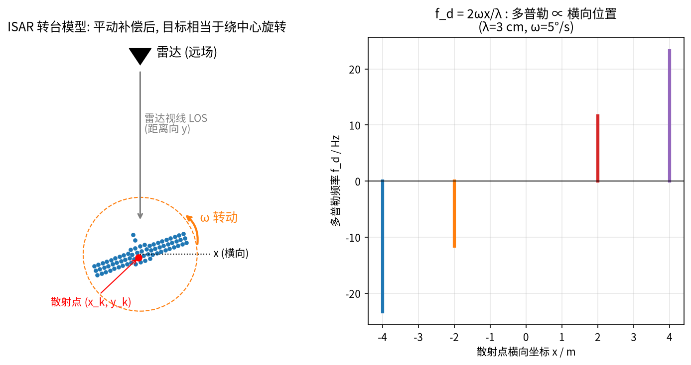
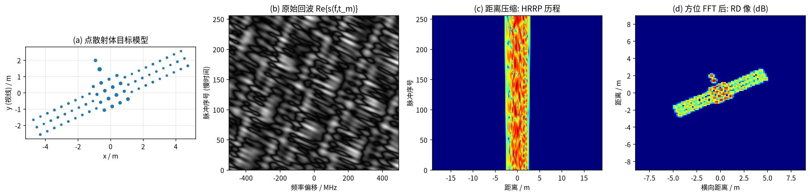
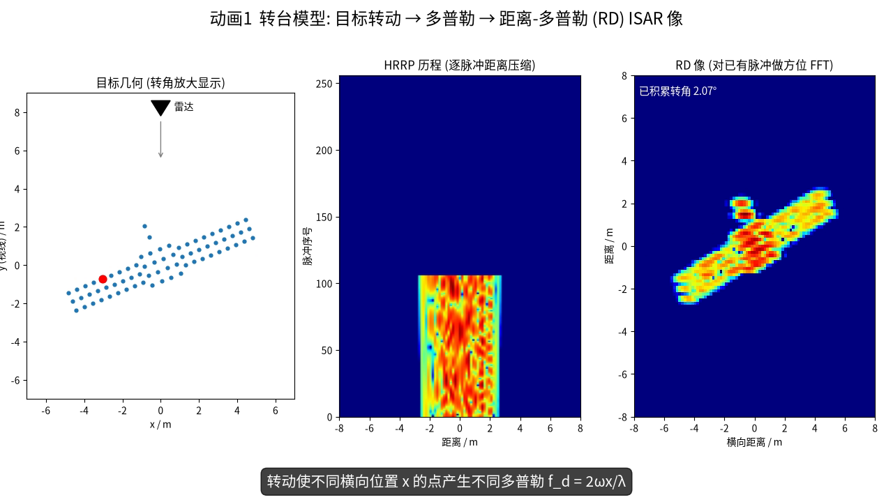
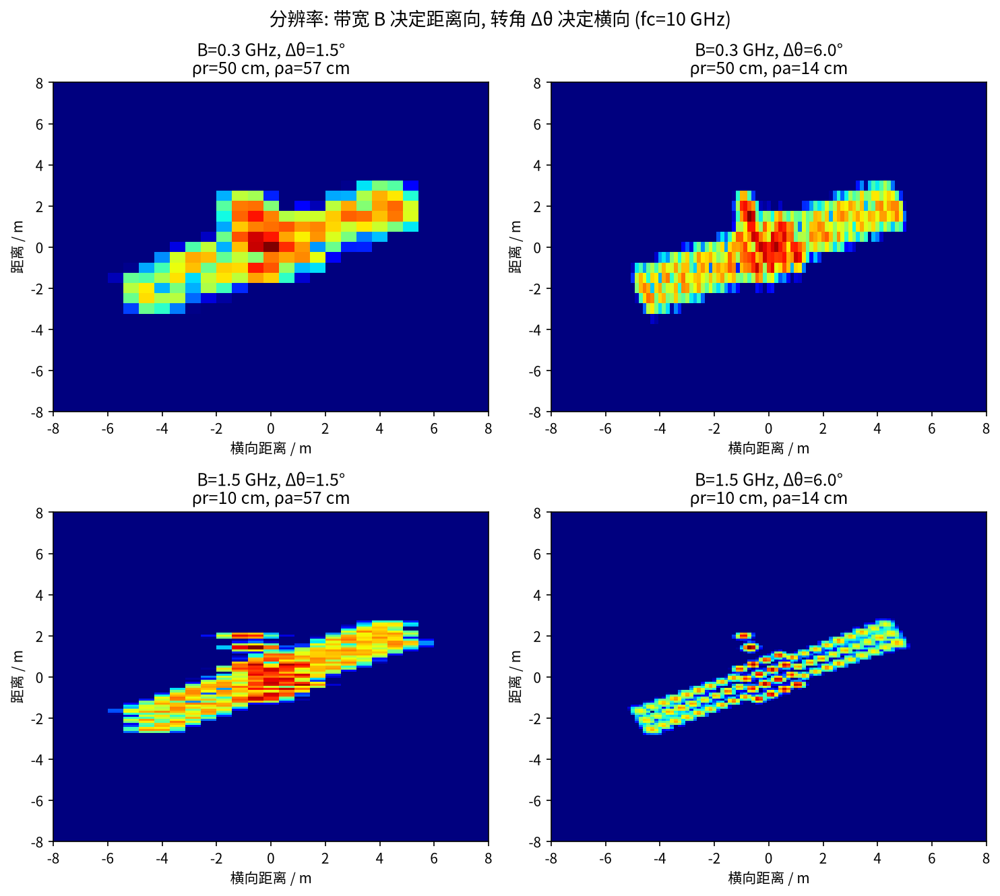
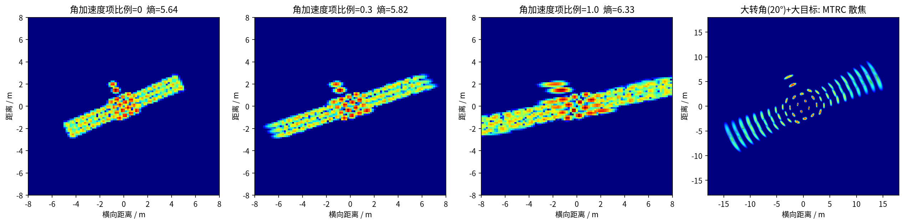
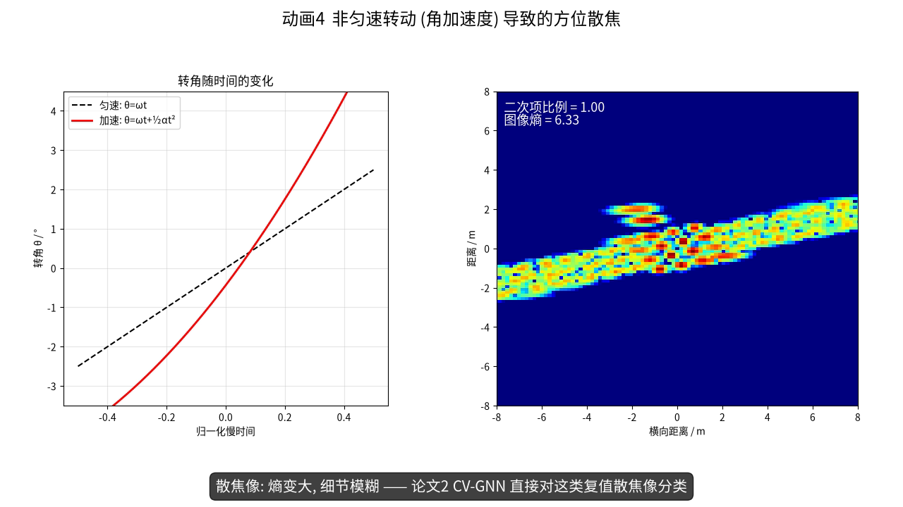

# 第 2 章 ISAR 成像：转台模型、距离-多普勒算法与分辨率

!!! tip "本章目标"

    1. 理解“雷达不动、目标转动”为什么能等效成一个长天线（合成孔径），即 ISAR 的基本原理；
    2. 从多普勒效应出发，一步步推出“多普勒 ∝ 横向坐标”，掌握转台模型与距离-多普勒（RD）成像的完整流程，能用 Python 从点目标仿真出 ISAR 像；
    3. 推导并记住横向分辨率 $\rho_a = \lambda/(2\Delta\theta)$，理解带宽与转角各管哪个方向，会做数值估算；
    4. 直观理解散焦（非匀速转动）、越分辨单元走动（MTRC）和运动补偿，并能用数字估计“糊了几个格子”；了解散射中心模型。

!!! note "基础回链"

    **本章用到的基础：** 相位与距离 $\Delta\varphi = 4\pi\Delta R/\lambda$（→ 第 0.1 节）、傅里叶变换与频率分辨率 $1/T$（→ 第 0.3、0.5 节）、采样与混叠（→ 第 0.4 节）、距离压缩与 $\rho_r = c/2B$（→ 第 1.4 节）。

## 2.1 SAR 与 ISAR：谁在动？

- **SAR（合成孔径雷达）**：雷达装在飞机/卫星上运动，对静止地面成像；
- **ISAR（逆合成孔径雷达）**：雷达通常固定（地基雷达，或论文 2 中的天基雷达），**目标运动**（卫星、飞机、舰船）。真正提供横向分辨率的是目标相对雷达视线的**转动**。

本文 7 篇论文的对象几乎都是**空间目标**（卫星、空间站），论文 5 还用到了飞机数据。

!!! info "直觉"

    **类比：用手机拍全景照。** 一根天线“看一眼”只能看到很粗的横向细节；如果让天线沿一条长长的路径移动、在许多位置分别拍照再“拼起来”，就相当于有了一根很长的天线（合成孔径）。SAR 是雷达自己走，ISAR 是让目标转——相对运动是一样的，就像你站着不动、让转盘上的物体转一圈，也能从各个角度看它。

## 2.2 多普勒效应与转台模型

### 2.2.1 多普勒效应：相位转得越快，频率越高

!!! info "直觉"

    **类比：救护车的鸣笛。** 救护车朝你开来时音调变高，远离时音调变低。雷达里也一样：目标靠近，回波频率略高于发射频率；远离则略低。这个频率差就叫**多普勒频率** $f_d$。

**机理（用相位来理解，不需要相对论）。** 由式 (1.4)，回波相位为 $\varphi(t) = -4\pi R(t)/\lambda$。若目标以径向速度 $v$ 运动，$R(t) = R_0 + vt$，则相位随时间线性变化。第 0.1 节说过，“相位线性变化”就是“箭头匀速旋转”，旋转速度就是频率：

$$f_d = \frac{1}{2\pi}\frac{\mathrm{d}\varphi}{\mathrm{d}t} = \frac{1}{2\pi}\cdot\left(-\frac{4\pi}{\lambda}\right)\frac{\mathrm{d}R}{\mathrm{d}t} = -\frac{2v}{\lambda}. \tag{2.1}$$

符号说明：$v = \mathrm{d}R/\mathrm{d}t$ 为径向速度（远离为正）；$\lambda$ 为波长；负号表示远离时 $f_d<0$、靠近时 $f_d>0$。

!!! example "例题"

    **例题 2.1（多普勒有多大）。** $f_c = 10$ GHz（$\lambda = 3$ cm），飞机以 $v = 300$ m/s 朝雷达飞来：$|f_d| = 2\times300/0.03 = 20\,000$ Hz $= 20$ kHz。相比 10 GHz 的载频只是“零头”，但经过 I/Q 解调去掉载频后（→ 第 0.2 节），就能清楚地测出来。

### 2.2.2 转台模型

目标的运动可以分解为**平动**（整体靠近/远离雷达）和**转动**（绕自身某点旋转）。平动只让所有散射点的距离同时变化，对成像无用且有害，需要先补偿掉（2.6 节）。补偿后，目标就像放在一个**转台**上绕中心旋转。

建立坐标系：雷达在远场，视线（LOS）沿 $y$ 轴；目标上第 $k$ 个散射点坐标 $(x_k, y_k)$，目标转过角度 $\theta(t_m)$（$t_m$ 为**慢时间**，即第 $m$ 个脉冲的发射时刻）。远场近似下该点到转台中心参考面的距离为

$$R_k(t_m) = y_k\cos\theta(t_m) + x_k\sin\theta(t_m). \tag{2.2}$$

式 (2.2) 是二维旋转的投影公式：把点 $(x_k, y_k)$ 转过 $\theta$ 后，它在视线方向（$y$ 轴）上的坐标就是 $y_k\cos\theta + x_k\sin\theta$。

**小角度近似。** 匀速转动时 $\theta = \omega t_m$（$\omega$ 为转速，rad/s）。ISAR 的积累角一般只有几度，$\theta \ll 1$，于是 $\cos\theta\approx 1$、$\sin\theta\approx\theta$（$\theta = 5^\circ = 0.087$ rad 时，$\cos\theta = 0.996$、$\sin\theta = 0.0872$，误差都在 0.4% 以内）：

$$R_k(t_m) \approx y_k + x_k\,\omega t_m . \tag{2.3}$$

这个式子很好读：$y_k$ 是固定不变的部分，决定散射点落在哪个距离单元；$x_k\omega t_m$ 随时间线性增长，等价于一个径向速度 $v_k = x_k\omega$。也就是说，**横向坐标 $x_k$ 越大，这个点“看起来”朝雷达跑得越快**，就像转盘边缘比中心转得快。

代入式 (2.1)，把 $v$ 换成 $x_k\omega$，得到第 $k$ 个点的多普勒频率：

!!! success "关键公式"

    $$\boxed{f_{d,k} = -\frac{2}{\lambda}\frac{\mathrm{d}R_k}{\mathrm{d}t_m} \approx -\frac{2\omega}{\lambda}x_k} \tag{2.4}$$

**关键结论：多普勒频率正比于散射点的横向坐标 $x_k$**（符号取决于约定）。于是：

- 沿 $y$（距离）方向：用带宽 $B$ 分辨（第 1 章）；
- 沿 $x$（横向/方位）方向：用多普勒分辨 —— 对慢时间做 FFT，频率轴就是横向坐标轴。

!!! example "例题"

    **例题 2.2（转台多普勒）。** $\lambda = 3$ cm，卫星以 $\omega = 0.05$ rad/s 转动。横向坐标 $x=2$ m 的点：$f_d = -2\times0.05\times2/0.03 = -6.67$ Hz；$x=-1$ m 的点：$f_d = +3.33$ Hz。两个点的多普勒相差 10 Hz，FFT 后会在频率轴上落到不同位置（图 2-1b）。和例题 2.1 的 20 kHz 相比，转动产生的多普勒只有几赫兹，非常“细”，所以需要较长的观测时间才能分辨（见 2.4 节）。




## 2.3 距离-多普勒（RD）成像算法

把频域（或去斜后）回波写成二维矩阵：快时间对应的频率 $f$ × 慢时间 $t_m$：

$$s(f, t_m) = \sum_k \sigma_k \exp\!\left(-j\frac{4\pi f}{c}R_k(t_m)\right). \tag{2.5}$$

符号说明：$f$ 为快时间频率（在 $[f_c - B/2, f_c + B/2]$ 内取 $N_f$ 个值），$t_m$ 为第 $m$ 个脉冲的时刻（共 $N_p$ 个），$\sigma_k$ 为第 $k$ 个散射点的复散射系数。数据是一个 $N_p\times N_f$ 的复数矩阵。

**为什么两次 FFT 就能成像：一步步推导。** 把式 (2.3) 代入式 (2.5) 的相位：

$$\begin{aligned}
-\frac{4\pi f}{c}R_k(t_m) &\approx -\frac{4\pi f}{c}\big(y_k + x_k\omega t_m\big) \\
&= \underbrace{-\frac{4\pi f}{c}\,y_k}_{\text{只和 } f \text{ 有关}} \;\underbrace{-\;\frac{4\pi f}{c}\,x_k\omega\, t_m}_{\text{和 } f,\ t_m \text{ 都有关}} \\
&\approx -\frac{4\pi f}{c}\,y_k \;-\; 2\pi\left(\frac{2x_k\omega}{\lambda}\right) t_m .
\end{aligned} \tag{2.6}$$

最后一步把第二项里的 $f$ 近似为 $f_c$（因为 $B \ll f_c$，例如 1 GHz $\ll$ 10 GHz），并用 $f_c/c = 1/\lambda$。于是每个散射点的回波**分解成两个因子的乘积**：

$$s(f, t_m) \approx \sum_k \sigma_k\;\underbrace{e^{-j\frac{4\pi f}{c}y_k}}_{\text{因子 ①}}\;\cdot\;\underbrace{e^{\,j2\pi f_{d,k}\,t_m}}_{\text{因子 ②}},\qquad f_{d,k} = -\frac{2\omega x_k}{\lambda}. \tag{2.7}$$

- 因子 ① 只含 $f$：对 $f$ 做 IFFT，峰出现在距离 $y_k$ 处；
- 因子 ② 只含 $t_m$：它是频率为 $f_{d,k}$ 的旋转箭头，对 $t_m$ 做 FFT，峰出现在多普勒 $f_{d,k}$ 处。

因子 ① 就是第 1 章的式 (1.14)；因子 ② 的“频率 → 峰位置”见第 0.3 节。两个峰的位置合起来就是 $(x_k, y_k)$，所以这个点被“画”到了图像的正确位置上。

RD 算法因此只有两步：

1. **距离压缩**：沿 $f$ 做 IFFT → 每个脉冲得到一条 HRRP，排起来就是“HRRP 历程”；
2. **方位压缩**：沿 $t_m$ 对每个距离单元做 FFT → 多普勒（即横向坐标）。

!!! warning "易错点"

    **易错点。**（1）推导中用了两个近似：小转角（$\cos\theta\approx1$）和窄带（第二项中 $f\approx f_c$）。它们不成立时，就会出现 2.5 节的 MTRC。（2）代码中方位向用的是 `ifft` 而非 `fft`，只是为了让图像横轴方向与 $x$ 同号，它和“FFT 后再左右翻转”等价，不影响成像原理。

得到的二维复数矩阵 $I(x, y)$ 就是 **ISAR 像**，它的幅度 $|I|$ 是我们通常看到的图，相位 $\angle I$ 往往被丢弃（论文 2、4 认为不该丢）。

```python
## code/isar_core.py 中的核心代码（节选）
R = y[None,:]*np.cos(th)[:,None] + x[None,:]*np.sin(th)[:,None]      # 式 (2.2)
S = np.einsum('pkf,k->pf', np.exp(-1j*4*np.pi*f[None,None,:]*R[:,:,None]/C), sig)  # 式 (2.5)
hrrp = np.fft.fftshift(np.fft.ifft(S*np.hanning(Nf), axis=1), axes=1)  # 距离压缩
img  = np.fft.fftshift(np.fft.ifft(hrrp*np.hanning(Np)[:,None], axis=0), axes=0)  # 方位压缩
```



<video controls preload="metadata" width="100%" poster="../figures/video_frames/V1_turntable_to_isar_2.png"><source src="../videos/V1_turntable_to_isar.mp4" type="video/mp4"></video>



▶ **动画 1 转台 → 多普勒 → ISAR 像（38 s）**：左为目标转动（转角放大显示），中为逐脉冲累积的 HRRP 历程，右为用已有脉冲做方位 FFT 得到的 RD 像——随着积累转角增大，横向逐渐变清晰。文件：`videos/V1_turntable_to_isar.mp4`

## 2.4 分辨率公式

**距离分辨率**已在第 1 章给出：$\rho_r = c/(2B)$。

**横向分辨率：三步推导。**

1. 观测总时长为 $T$，对慢时间做 FFT 的频率分辨率是 $\Delta f_d = 1/T$（→ 第 0.3 节式 (0.9)、第 0.5 节）。
2. 由式 (2.4)，横向坐标差 $\Delta x$ 对应的多普勒差为 $\Delta f_d = 2\omega\Delta x/\lambda$，所以 $\Delta x = \lambda\Delta f_d/(2\omega)$。
3. 令 $\Delta f_d = 1/T$，并记积累角 $\Delta\theta = \omega T$（成像期间目标总共转过的角度）：

!!! success "关键公式"

    $$\rho_a = \frac{\lambda}{2\omega}\,\Delta f_d = \frac{\lambda}{2\omega T} = \boxed{\frac{\lambda}{2\Delta\theta}} \tag{2.8}$$

    $\rho_a$：横向（方位）分辨率；$\lambda$：波长；$\Delta\theta$：积累转角，**必须用弧度**。

!!! example "例题"

    **例题 2.3（转多少度才能看清 15 cm）。** 接例题 2.2（$\lambda=3$ cm，$\omega = 0.05$ rad/s）。两个点横向相距 0.15 m（$x=2$ m 与 $x=2.15$ m）：

    - 多普勒差：$\Delta f_d = 2\times0.05\times0.15/0.03 = 0.5$ Hz；
    - 要分开 0.5 Hz，需要观测 $T = 1/0.5 = 2$ s；
    - 这段时间内转过 $\Delta\theta = 0.05\times 2 = 0.1$ rad $= 5.73^\circ$；
    - 验算式 (2.8)：$\rho_a = 0.03/(2\times0.1) = 0.15$ m。✓

    结论：在 X 波段，目标转大约 6° 就能得到 15 cm 的横向分辨率，与 $B=1$ GHz 时的距离分辨率 15 cm 相当，图像“横竖一样清楚”。

横向分辨率由**波长与积累转角**决定，与目标距离无关——这正是“合成孔径”的妙处。

| 参数 | 管哪个方向 | 本文仿真 | 论文中的例子 |
|---|---|---|---|
| 带宽 $B$ | 距离向 $\rho_r=c/2B$ | 1 GHz → 15 cm | 论文 1：10 GHz → 1.5 cm |
| 转角 $\Delta\theta$、波长 $\lambda$ | 横向 $\rho_a=\lambda/2\Delta\theta$ | 3 cm, 5° → 17 cm | 论文 5：17 GHz，Δθ = 4°/5°/6° |

!!! info "直觉"

    **为什么这和识别有关？** 论文 5、6 明确把“不同带宽和积累角组合”作为训练集与测试集的差异来源：带宽和转角变了，图像在距离向/横向被**拉伸或压缩**，同一目标看起来“胖瘦不同”。这就是 REMI 要设计多头 STN 去“校正形变”的原因（第 11 章）。论文 4 也在对比学习中随机化积累角来模拟分辨率变化。



**像素坐标 ≠ 物理尺寸。** RD 像的横轴是多普勒，换算成米需要知道转速 $\omega$。实际中 $\omega$ 往往未知，因此 ISAR 像的横向尺度经常是“未定标”的——同一目标在不同观测中横向尺度不同，这是识别中“尺度形变”的又一来源。

!!! warning "易错点"

    **易错点。**（1）$\Delta\theta$ 代入角度值（例如 5）而不是弧度（0.087），结果会错 57 倍。（2）PRF（脉冲重复频率）决定的是能看到的**多普勒范围** $[-\mathrm{PRF}/2, \mathrm{PRF}/2)$（→ 第 0.4 节，混叠），而不是分辨率；分辨率只看总时长 $T$。

## 2.5 散焦与 MTRC

RD 算法的前提是：(a) 匀速转动，(b) 小转角，使每个散射点在整个观测期间都待在同一个距离单元、多普勒为常数。两条前提被破坏，图像就会“糊”：

!!! info "直觉"

    **类比：拍照时手抖。** 快门打开期间（相当于积累时间 $T$），如果被拍物体“速度”在变化，它在照片上就不再是一个点，而是一条拖影。对 ISAR 来说，“速度”就是多普勒；多普勒在积累期间一变，横向就拖影。

**(1) 非匀速转动 → 方位散焦。** 若目标在机动或调整姿态，转角不再是 $\omega t$，而是带加速度 $\alpha$（rad/s²）：$\theta(t) = \omega t + \tfrac12\alpha t^2$。仍用小角度近似 $R_k \approx y_k + x_k\theta(t)$，对时间求导：

$$f_{d,k}(t) = -\frac{2}{\lambda}\frac{\mathrm{d}R_k}{\mathrm{d}t} = -\frac{2x_k}{\lambda}\frac{\mathrm{d}\theta}{\mathrm{d}t} = -\frac{2x_k}{\lambda}\big(\omega + \alpha t\big). \tag{2.9}$$

单个散射点的多普勒随时间**线性变化**（变成一个“chirp”，与第 1 章的 LFM 同一种结构），FFT 后不再是一个点，而是沿横向拉开的模糊条带。

!!! example "例题"

    **例题 2.4（糊了几个格子）。** $x = 3$ m，$\lambda = 3$ cm，$\omega = 0.05$ rad/s，$\alpha = 0.01$ rad/s²，积累时间 $T=2$ s。

    - 中心多普勒：$-2\times3\times0.05/0.03 = -10$ Hz；
    - 积累期间多普勒的变化量：$\Delta f_d = \dfrac{2x}{\lambda}\,\alpha T = 200\times0.01\times2 = 4$ Hz（其中 $2x/\lambda = 2\times3/0.03 = 200$）；
    - 多普勒分辨率：$1/T = 0.5$ Hz；
    - 拖影长度：$4/0.5 = 8$ 个横向分辨单元，即约 $8\times0.15 = 1.2$ m。

    注意：$x$ 越大拖影越长，所以离转动中心远的部件（如太阳翼末端）散焦最严重（图 2-4a）。


论文 2 用更一般的多项式相位描述它：$\varphi_k(t_m) = \varphi_0 + 2\pi\sum_q C_{k,q}t_m^q$（原文式 (2)）。论文 2 的仿真中给出的转动加速度参数为 5000 rad/s²（原文 Table I 印刷值）。

**(2) 大转角 / 大目标 → 越分辨单元走动（MTRC）。** 由式 (2.3)，散射点在积累期间的距离变化量约为 $|x_k|\Delta\theta$。若它超过距离分辨率 $\rho_r$，散射点就在观测中跨越多个距离单元，RD 推导中“峰在固定的 $y_k$”这一前提失效，图像出现弧形拖尾。

!!! example "例题"

    **例题 2.5（MTRC 判断）。** 例题 2.3 的参数下 $\Delta\theta = 0.1$ rad，$\rho_r = 0.15$ m。对 $x=3$ m 的点：$|x|\Delta\theta = 0.3$ m $> 0.15$ m，会走过约 2 个距离单元，出现轻微 MTRC。经验判据：$|x|_{\max}\,\Delta\theta < \rho_r$，即目标横向半尺寸 $< \rho_r/\Delta\theta$（这里为 1.5 m）时，RD 算法可以放心使用。



<video controls preload="metadata" width="100%" poster="../figures/video_frames/V4_defocus_2.png"><source src="../videos/V4_defocus.mp4" type="video/mp4"></video>



▶ **动画 4 非匀速转动导致散焦（24 s）**：左为转角–时间曲线由直线弯成抛物线，右为 RD 像逐渐模糊、图像熵增大，再恢复。文件：`videos/V4_defocus.mp4`

## 2.6 运动补偿：成像前必须做的“预处理”

真实目标存在平动，通常分两步补偿：

!!! info "直觉"

    **类比：给跑步的人拍证件照。** 人一边跑（平动）一边转身（转动）。我们只关心转身带来的不同视角，所以要先“跟拍”：让相机跟着人一起跑，抵消掉整体位移，画面里只剩下转身。运动补偿就是雷达里的“跟拍”。

1. **包络对齐（距离对齐）**：让各脉冲 HRRP 中同一散射点对齐到同一距离单元（如相关法、最小熵法）；
2. **初相校正 / 自聚焦**：消除平动引起的、各脉冲共有的相位误差（如相位梯度自聚焦 PGA、最小熵自聚焦）。

!!! example "例题"

    **例题 2.6（为什么两步都需要）。** 设目标以 10 m/s 径向平动，PRF $=100$ Hz，即相邻脉冲间平移 0.1 m。

    - **对包络**：256 个脉冲共平移 25.6 m，约 $25.6/0.15\approx171$ 个距离单元，HRRP 历程变成一条斜线，必须先对齐；
    - **对相位**：每个脉冲间相位变化 $4\pi\times0.1/0.03 = 41.9$ rad，远大于 $2\pi$（→ 例题 0.2），即使包络对齐到 1 cm 以内，残余相位误差仍有 $4\pi\times0.01/0.03\approx 4.2$ rad。所以还需要第二步，在“毫米级”上把相位校正干净。

对于转动引起的高阶相位（散焦），可进一步做**重聚焦**，例如估计多项式系数后补偿（论文 2 原文式 (3)）。但重聚焦计算量大：论文 2 的 Table II 中“Refocusing”方法单张 13.290 s，远慢于直接识别散焦像的方法（CV-GNN 1.190 s）。**“补偿不完美 → 残余散焦/平移/形变”** 是所有识别论文都要面对的现实，也解释了论文 5 中 MH-STN 的“平移”参数（作者把平移归因于平动补偿误差）。

## 2.7 散射中心模型

!!! info "直觉"

    **类比：夜里看城市。** 远远地看一座城市的夜景，你看不到楼的轮廓，只看到一个个亮点（窗户、路灯）。雷达在高频下“看”目标也是这样：整体回波主要来自少数几个强反射点（棱角、二面角、天线口面），这些点就叫**散射中心**。

在高频区（目标尺寸远大于波长），复杂目标的电磁散射可以近似为若干**散射中心**的叠加。本文仿真用的就是最简单的理想点散射模型：

$$s(f,\theta) = \sum_{k=1}^{K} A_k \exp\!\left(-j\frac{4\pi f}{c}(x_k\sin\theta + y_k\cos\theta)\right). \tag{2.10}$$

符号说明：$K$ 为散射中心个数；$A_k$ 为第 $k$ 个散射中心的复幅度；括号里正是式 (2.2) 的距离 $R_k$。可以看出，式 (2.10) 就是式 (2.5) 换了一种写法：把慢时间 $t_m$ 换成了转角 $\theta$。

更精细的**属性散射中心模型**（如基于几何绕射理论 GTD 的模型）还会给每个散射中心加上频率依赖因子 $(jf/f_c)^{\alpha_k}$、角度依赖与长度参数，用来区分角反射器、边缘、平板等不同结构（此为领域通用知识，非 7 篇论文的内容）。

与 7 篇论文的联系：

- 论文 3、4 用 SolidWorks 建模 + FEKO 电磁计算得到**散射点**再成像（论文 3 取网格角点作为散射点，共 500 个）；
- 论文 5、6 用**物理光学（PO）**方法计算回波；论文 7 用 FEKO 计算极化回波，并用极坐标格式算法（PFA）成像；
- 论文 2、3、4、5 的“图网络”思想与散射中心天然契合：**强散射点（或图像块）当节点，空间/特征关系当边**（见第 6.2 节图 6-4）。

!!! abstract "小结"

    - 多普勒 = 相位旋转的速度：$f_d = -2v/\lambda$。转台上横向坐标为 $x$ 的点等效速度为 $x\omega$，所以**多普勒 ∝ 横向坐标**（式 (2.4)）。
    - RD 成像 = 频率维 IFFT（距离压缩）+ 慢时间 FFT（方位压缩）。之所以可行，是因为回波可以分解为“只含 $y$ 的因子 × 只含 $x$ 的因子”（式 (2.7)）。
    - **$\rho_r = c/2B$，$\rho_a = \lambda/2\Delta\theta$**。X 波段转 5.73°（0.1 rad）横向可达 15 cm；带宽或转角变化 → 图像拉伸压缩（形变）。
    - 非匀速转动 → 散焦（例题 2.4：拖影 8 个单元）；大转角 → MTRC（判据 $|x|\Delta\theta<\rho_r$）；平动补偿残差 → 平移。这些“成像不完美”直接决定了后续识别算法的设计。
