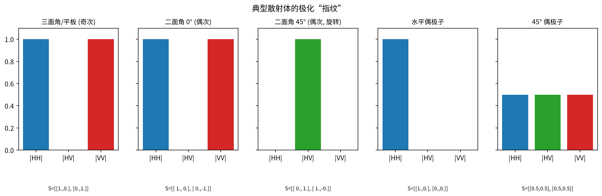
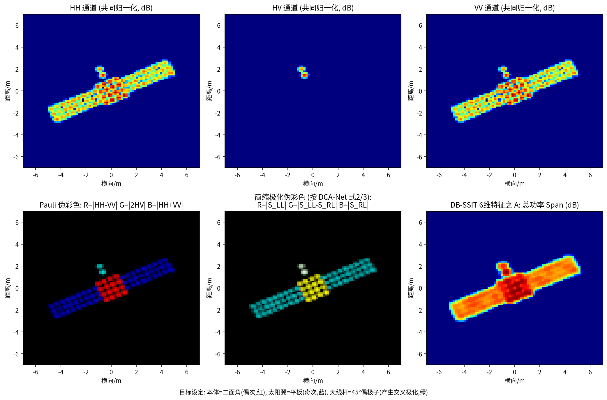

# 第 3 章 雷达极化：散射矩阵、Pauli 分解与简缩极化

!!! tip "本章目标"

    1. 理解“极化”是电磁波电场振动方向，掌握 Sinclair 散射矩阵与 HH/HV/VV 通道的含义；
    2. 掌握 Pauli 分解与相干矩阵 $\mathbf T$，能用一个带数字的 2×2 散射矩阵**手算** Pauli 矢量、$\mathbf T$ 与 DB-SSIT 的 6 维极化特征；
    3. 理解简缩极化（Compact Pol）的动机和 DCA-Net 使用的 $S_{LL}$、$S_{RL}$ 及伪彩色合成，并能手算一次。

!!! note "基础回链"

    **本章用到的基础：** 复数、共轭与 $zz^* = |z|^2$（→ 第 0.1 节）、I/Q 复数图像（→ 第 0.2 节）、ISAR 像的每个像素是一个复数（→ 第 2.3 节）。线性代数只用到：矩阵乘法、共轭转置 $(\cdot)^H$、特征值的概念。

## 3.1 极化是什么

!!! info "直觉"

    **类比：抖动一根绳子。** 你上下抖绳子，波沿绳子传过去，绳子在竖直方向振动；左右抖，绳子在水平方向振动；手画圆圈，绳子上的每一点也画圆圈。电磁波的“极化”就是电场在“绳子”（传播方向）的横截面里怎样振动。偏光太阳镜只让某一方向的振动通过，就是利用了光的极化。

电磁波的电场矢量在垂直于传播方向的平面内振动。振动方向固定在水平方向称为 **H（水平）极化**，竖直方向称为 **V（竖直）极化**；电场矢量端点画圆则为**圆极化**（左旋 L / 右旋 R）。

目标会“改变”入射波的极化状态，而且**不同的几何结构改变方式不同**——这给了我们一个新的识别维度：除了“散射点在哪儿”（图像），还能知道“散射点是什么样的结构”（极化特征）。

## 3.2 Sinclair 散射矩阵

用两种发射极化、两种接收极化测量，得到 2×2 复数矩阵：

$$\mathbf S = \begin{bmatrix} S_{HH} & S_{HV}\\ S_{VH} & S_{VV}\end{bmatrix}, \qquad \begin{bmatrix} E^{s}_{H}\\ E^{s}_{V}\end{bmatrix} \propto \mathbf S \begin{bmatrix} E^{i}_{H}\\ E^{i}_{V}\end{bmatrix}. \tag{3.1}$$

右式说明 $\mathbf S$ 的作用：它是一个“极化变换器”，把入射电场 $\mathbf E^{i}$（分解为 H、V 两个分量）变成散射电场 $\mathbf E^{s}$。每个元素都是复数，既有幅度，也有相位。

$S_{pq}$ 表示“q 发射、p 接收”（下标顺序约定随文献可能不同）。单站雷达满足**互易性** $S_{HV}=S_{VH}$（DB-SSIT 原文 Sec. II 也采用此假设），所以只有 3 个独立复数通道：**HH、HV、VV**。全极化 ISAR 就是对每个通道各成一幅复数 ISAR 像。

**典型散射体的“极化指纹”**（理想情况，忽略常数因子）：

| 散射体 | $\mathbf S$ | 特点 |
|---|---|---|
| 平板、球、三面角（奇次散射） | $\begin{bmatrix}1&0\\0&1\end{bmatrix}$ | HH 与 VV 同相，无交叉极化 |
| 二面角（偶次散射），0° | $\begin{bmatrix}1&0\\0&-1\end{bmatrix}$ | HH 与 VV 反相 |
| 二面角旋转 45° | $\begin{bmatrix}0&1\\1&0\end{bmatrix}$ | 能量全部进入 HV |
| 水平细线（偶极子） | $\begin{bmatrix}1&0\\0&0\end{bmatrix}$ | 只有 HH |

!!! info "直觉"

    **为什么二面角的 VV 会变号？** 波在二面角里要反射两次。每次反射时，平行于反射面的电场分量与垂直于反射面的分量受到的相位变化不同；两次反射后，H 分量与 V 分量之间就多出 180° 的相对相位差，也就是 $-1$。平板只反射一次，没有这个相对变号，所以 HH 与 VV 同相。（这里只给直觉，严格推导需要用到电磁场边界条件。）

!!! info "直觉"

    对卫星而言：本体与太阳翼连接处易形成二面角结构，太阳翼板面近似平板，天线杆近似细线，抛物面天线则较复杂。DCA-Net 把这种“部件 ↔ 散射机理”关系作为部件识别的物理基础（原文 Fig. 3 讨论伪彩色中不同颜色的物理含义，并说明将在后续工作深入研究）。

## 3.3 Pauli 分解

!!! info "直觉"

    **类比：用“三原色”描述一种颜色。** 任意颜色都可以说成“多少红 + 多少绿 + 多少蓝”。Pauli 分解也是如此：把任意散射矩阵说成“多少平板 + 多少二面角 + 多少 45° 二面角”。上一节表格里的三种矩阵就是三种“原色”。

**机理。** 互易时 $\mathbf S$ 是对称矩阵，只有 3 个独立复数。可以验证，它总能唯一地写成三个“标准散射体”矩阵的加权和：

$$\mathbf S = \begin{bmatrix} S_{HH} & S_{HV}\\ S_{HV} & S_{VV}\end{bmatrix}
= \frac{a}{\sqrt2}\begin{bmatrix}1&0\\0&1\end{bmatrix} + \frac{b}{\sqrt2}\begin{bmatrix}1&0\\0&-1\end{bmatrix} + \frac{c}{\sqrt2}\begin{bmatrix}0&1\\1&0\end{bmatrix}. \tag{3.2}$$

逐元素比较两边：左上 $S_{HH} = (a+b)/\sqrt2$，右下 $S_{VV} = (a-b)/\sqrt2$，非对角 $S_{HV} = c/\sqrt2$。解这个线性方程组：两式相加得 $a = (S_{HH}+S_{VV})/\sqrt2$，相减得 $b = (S_{HH}-S_{VV})/\sqrt2$，以及 $c = \sqrt2 S_{HV} = 2S_{HV}/\sqrt2$。把三个系数排成列向量，就是 **Pauli 散射矢量**：

!!! success "关键公式"

    $$\mathbf k_{3P} = \begin{bmatrix} a\\ b\\ c\end{bmatrix} = \frac{1}{\sqrt2}\begin{bmatrix} S_{HH}+S_{VV}\\ S_{HH}-S_{VV}\\ 2S_{HV}\end{bmatrix}. \tag{3.3}$$

系数 $1/\sqrt2$ 的作用是保持总功率不变：可以验证 $|a|^2+|b|^2+|c|^2 = |S_{HH}|^2 + 2|S_{HV}|^2 + |S_{VV}|^2$，即总功率 Span。

- 第 1 分量 $S_{HH}+S_{VV}$：**奇次（单次）散射**，平板、三面角；
- 第 2 分量 $S_{HH}-S_{VV}$：**偶次（二面角）散射**；
- 第 3 分量 $2S_{HV}$：**旋转二面角 / 体散射**（交叉极化）。

**Pauli 伪彩色图**：R = $|S_{HH}-S_{VV}|$，G = $|2S_{HV}|$，B = $|S_{HH}+S_{VV}|$，一张图就能看出不同区域的散射机理。

!!! example "例题"

    **例题 3.1（手算 Pauli 矢量）。** 某像素测得

    $$\mathbf S = \begin{bmatrix} 0.8 & 0.1j\\ 0.1j & -0.6\end{bmatrix}.$$

    HH 与 VV 符号相反，看起来像二面角。代入式 (3.3)（$1/\sqrt2 = 0.7071$）：

    $$\mathbf k_{3P} = 0.7071\begin{bmatrix} 0.8+(-0.6)\\ 0.8-(-0.6)\\ 2\times0.1j\end{bmatrix} = 0.7071\begin{bmatrix}0.2\\1.4\\0.2j\end{bmatrix} = \begin{bmatrix}0.1414\\0.9899\\0.1414j\end{bmatrix}.$$

    三种机理的功率：$|k_1|^2 = 0.02$（奇次），$|k_2|^2 = 0.98$（偶次），$|k_3|^2 = 0.02$（交叉）；总和 $1.02$，与 $|S_{HH}|^2+2|S_{HV}|^2+|S_{VV}|^2 = 0.64+0.02+0.36 = 1.02$ 一致。✓ 偶次散射占 $0.98/1.02 = 96\%$，这个像素在 Pauli 图里会显示为红色。

<video controls preload="metadata" width="100%" poster="../figures/video_frames/M10_Pauli.jpg"><source src="../videos/M10_Pauli.mp4" type="video/mp4"></video>

▶ **动画 10 Pauli 分解与伪彩色（33 s）**：先把 $\mathbf S$ 写成三种标准散射体矩阵的加权和（式 (3.2)），解出 Pauli 矢量（式 (3.3)）。随后依次代入例题 3.1、平板、45° 二面角和水平细线，柱状图给出 $\lvert a\rvert^2,\lvert b\rvert^2,\lvert c\rvert^2$ 的占比，右侧方块是对应的 Pauli 伪彩色（R = $\lvert b\rvert$，G = $\lvert c\rvert$，B = $\lvert a\rvert$）。文件：`videos/M10_Pauli.mp4`，代码：`code/manim/a3_scenes.py`

## 3.4 相干矩阵 T 与 DB-SSIT 的 6 维特征

!!! info "直觉"

    **为什么要做“外积再平均”？** 单个像素的 $\mathbf k$ 好比一次考试成绩，偶然性很大（斑点噪声、相位随机）。看一个班的成绩，人们会算“平均分、方差、两门课的相关性”。相干矩阵 $\mathbf T$ 就是 $\mathbf k$ 的三个分量的“协方差矩阵”：对角元是各分量的平均功率，非对角元是两两之间的相关性。

单个像素的 $\mathbf k$ 受斑点噪声影响大，通常在局部窗口内做统计平均，得到 3×3 **相干矩阵**

$$\mathbf T = \langle \mathbf k_{3P}\,\mathbf k_{3P}^H\rangle = \begin{bmatrix} T_{11}&T_{12}&T_{13}\\ T_{21}&T_{22}&T_{23}\\ T_{31}&T_{32}&T_{33}\end{bmatrix},\qquad T_{ij} = \langle k_i\,k_j^*\rangle . \tag{3.4}$$

符号说明：$(\cdot)^H$ 为共轭转置（先转置再取共轭），所以列向量 $\mathbf k$ 乘行向量 $\mathbf k^H$ 得到 3×3 矩阵（外积）；$\langle\cdot\rangle$ 表示在局部窗口内对多个像素求平均。性质：对角元 $T_{ii} = \langle|k_i|^2\rangle$ 是实数，是三种散射机理的平均功率；非对角元满足 $T_{ji} = T_{ij}^*$（Hermitian 矩阵），描述它们之间的相关性；迹 $T_{11}+T_{22}+T_{33}$ 就是总功率 Span。

!!! example "例题"

    **例题 3.2（手算 $\mathbf T$）。** 接例题 3.1，$\mathbf k = [0.1414,\ 0.9899,\ 0.1414j]^T$，$\mathbf k^H = [0.1414,\ 0.9899,\ -0.1414j]$（第三个元素取了共轭）。先只用这一个像素（不平均），逐元素计算 $T_{ij} = k_i k_j^*$：

    - $T_{11} = 0.1414^2 = 0.02$，$T_{22} = 0.9899^2 = 0.98$，$T_{33} = |0.1414j|^2 = 0.02$；
    - $T_{12} = 0.1414\times0.9899 = 0.14$；
    - $T_{13} = 0.1414\times(-0.1414j) = -0.02j$；
    - $T_{23} = 0.9899\times(-0.1414j) = -0.14j$。

    下三角由 $T_{ji} = T_{ij}^*$ 得到：

    $$\mathbf T_1 = \begin{bmatrix} 0.02 & 0.14 & -0.02j\\ 0.14 & 0.98 & -0.14j\\ 0.02j & 0.14j & 0.02\end{bmatrix},\qquad \mathrm{Span} = 1.02,\qquad B = \frac{T_{22}}{\mathrm{Span}} = 0.961 .$$

    **平均一下。** 窗口里还有第二个像素，它是一块平板：$S_{HH}=S_{VV}=0.5$、$S_{HV}=0$，$\mathbf k = [0.7071, 0, 0]^T$，$\mathbf T_2 = \mathrm{diag}(0.5, 0, 0)$。两者平均：

    $$\mathbf T = \frac{\mathbf T_1+\mathbf T_2}{2} = \begin{bmatrix} 0.26 & 0.07 & -0.01j\\ 0.07 & 0.49 & -0.07j\\ 0.01j & 0.07j & 0.01\end{bmatrix}.$$

    此时 $\mathrm{Span} = 0.76$，偶次占比降为 $B = 0.49/0.76 = 0.645$，说明这个窗口是“二面角 + 平板”的混合。

!!! warning "易错点"

    **易错点：秩 1 与“平均”的意义。** 单个像素的 $\mathbf T_1 = \mathbf k\mathbf k^H$ 永远是**秩 1** 矩阵，特征值为 $[1.02, 0, 0]$，它不比 $\mathbf k$ 多任何信息。平均之后，例题中 $\mathbf T$ 的特征值变为约 $[0.519, 0.241, 0]$，第二个特征值不再为 0，表示“有两种不同的机理混在一起”。所以 $\mathbf T$ 的价值来自**统计平均**；只有一个像素时，各相关系数会退化得没有意义。

<video controls preload="metadata" width="100%" poster="../figures/video_frames/M11_Coherency.jpg"><source src="../videos/M11_Coherency.mp4" type="video/mp4"></video>

▶ **动画 11 相干矩阵是窗口内的平均（27 s）**：左为仿真的 Pauli 伪彩色像素（左半为二面角本体，右半为平板太阳翼），黄框是平均窗口；右为 $\lvert T_{ij}\rvert/\mathrm{Span}$ 热图和 $\mathbf T$ 的特征值。单个像素时 $\mathbf T$ 是秩 1，只有一个非零特征值；3×3 窗口滑过本体与太阳翼的交界时，两种机理混在一起，第二个特征值明显变大；进入太阳翼区后又回到 $T_{11}$ 主导。文件：`videos/M11_Coherency.mp4`，代码：`code/manim/a3_scenes.py`

对角元是三种散射机理的功率，非对角元描述它们之间的相关性。DB-SSIT由 $\mathbf T$ 构造了 6 维特征作为网络输入（原文式 (4)–(9)）：

| 特征 | 定义（原文） | 含义 |
|---|---|---|
| A | $10\log_{10}(T_{11}+T_{22}+T_{33})$ | 总功率 Span（dB） |
| B | $T_{22}/\mathrm{Span}$ | 偶次散射功率占比 |
| C | $T_{33}/\mathrm{Span}$ | 交叉极化（体散射）功率占比 |
| D | $\lvert T_{12}\rvert /\sqrt{T_{11}T_{33}}$ | 奇–偶次相关系数 **【存疑：常见定义为 $\sqrt{T_{11}T_{22}}$，原文印刷为 $T_{11}T_{33}$】** |
| E | $\lvert T_{13}\rvert /\sqrt{T_{11}T_{33}}$ | 奇次–交叉相关系数 |
| F | $\lvert T_{23}\rvert /\sqrt{T_{33}T_{22}}$ | 偶次–交叉相关系数 |

!!! example "例题"

    **例题 3.3（用例题 3.2 的 $\mathbf T$ 算 6 维特征）。** $\mathrm{Span} = 0.76$，所以：

    - A $= 10\log_{10}0.76 = -1.19$ dB；B $= 0.49/0.76 = 0.645$；C $= 0.01/0.76 = 0.013$；
    - D（原文印刷式）$= 0.07/\sqrt{0.26\times0.01} = 1.373$；D（常见式）$= 0.07/\sqrt{0.26\times0.49} = 0.196$；
    - E $= 0.01/\sqrt{0.26\times0.01} = 0.196$；F $= 0.07/\sqrt{0.01\times0.49} = 1.0$。

    相关系数按定义应在 $[0,1]$ 内（由 Cauchy–Schwarz 不等式 $|T_{ij}|^2 \le T_{ii}T_{jj}$ 保证），而原文印刷式算出的 D $=1.373 > 1$。这个数值例子说明，印刷式很可能是笔误，也是我们标注【存疑】的理由。F 恰好为 1，是因为窗口里只有一个像素含交叉极化分量，样本太少；真实计算会用更大的窗口。

## 3.5 简缩极化（Compact Polarimetry, CP）

!!! info "直觉"

    **类比：用两张照片代替三张。** 全极化相当于拍 HH、HV、VV 三张“照片”，需要两套发射机轮流工作。简缩极化只开一个发射机，同时用两个接收通道拍两张，信息少一些，但系统简单很多，而且最重要的“奇次 vs 偶次”信息基本保住了。

全极化系统需要交替发射 H、V 两种极化，系统复杂、数据量翻倍、脉冲重复频率要求加倍。**简缩极化**只发射一种极化（通常是圆极化或 45° 线极化），同时用两个正交通道接收，用“1 发 2 收”换取接近全极化的信息量。

DCA-Net 采用 **DCP 模式**（发射左旋圆极化，同时接收左旋和右旋圆极化），观测矢量为 $\mathbf k_{DCP} = [S_{LL}, S_{RL}]^T$（原文式 (1)）。它与线极化基的关系（原文式 (2)）：

$$S_{LL} = \frac{S_{HH}-S_{VV}}{2} + j\,\frac{S_{HV}+S_{VH}}{2},\qquad S_{RL} = \frac{S_{HH}+S_{VV}}{2} + j\,\frac{S_{HV}-S_{VH}}{2}. \tag{3.5}$$

在互易条件下 $S_{HV}=S_{VH}$，$S_{RL} = (S_{HH}+S_{VV})/2$ 恰好是 Pauli 的**奇次散射**分量，而 $S_{LL}$ 包含**偶次散射与交叉极化**。DCA-Net 的伪彩色合成规则为 R = $|S_{LL}|$，G = $|S_{LL}-S_{RL}|$，B = $|S_{RL}|$（原文 Fig. 3），网络输入则是 $[\mathrm{Re}\,S_{LL}, \mathrm{Im}\,S_{LL}, \mathrm{Re}\,S_{RL}, \mathrm{Im}\,S_{RL}]$ 共 4 通道（原文式 (3)）。

!!! example "例题"

    **例题 3.4（手算简缩极化）。** 仍用例题 3.1 的 $\mathbf S$（$S_{HH}=0.8$，$S_{VV}=-0.6$，$S_{HV}=S_{VH}=0.1j$），代入式 (3.5)：

    $$\begin{aligned}
    S_{LL} &= \frac{0.8-(-0.6)}{2} + j\,\frac{0.1j+0.1j}{2} = 0.7 + j\cdot 0.1j = 0.7 - 0.1 = 0.6,\\
    S_{RL} &= \frac{0.8+(-0.6)}{2} + j\,\frac{0.1j-0.1j}{2} = 0.1 + 0 = 0.1 .
    \end{aligned}$$

    $|S_{LL}| = 0.6$ 远大于 $|S_{RL}| = 0.1$，于是伪彩色里 R $=0.6$、G $=|0.6-0.1| = 0.5$、B $=0.1$，显示为偏红/橙色，说明该像素以偶次散射为主，与全极化 Pauli 分析的结论（例题 3.1）一致。注意 $j\cdot j = -1$ 这一步：交叉极化分量通过虚数单位“混”进了 $S_{LL}$ 的实部。

!!! note "说明"

    **注意：** 圆极化基的定义与符号在不同文献中不完全一致，本文严格采用 DCA-Net 给出的式 (2)。

## 3.6 全极化 vs 简缩极化：一张对比表

| | 全极化（DB-SSIT） | 简缩极化 DCP（DCA-Net） |
|---|---|---|
| 发射 | H、V 交替 | 左旋圆极化 |
| 接收 | H、V | 左旋、右旋 |
| 通道 | HH、HV、VV（互易） | $S_{LL}$、$S_{RL}$ |
| 优点 | 信息最完整，可算完整 $\mathbf T$ | 系统简单、数据量小 |
| 代价 | 系统复杂 | 无法完整恢复 $\mathbf S$ |
| 本文论文中的数据 | 作者自建 220 GHz 太赫兹极化 ISAR 数据集，6 类 × 28 幅（原文称回波为“采集”所得，未说明是否为缩比模型实测【存疑】） | FEKO 仿真，16 GHz，1638 帧 |

!!! abstract "小结"

    - 散射矩阵 $\mathbf S$ 描述目标如何改变极化；互易下有 HH/HV/VV 三个独立通道。
    - Pauli 分解把 $\mathbf S$ 拆成奇次 / 偶次 / 交叉三种物理机理；相干矩阵 $\mathbf T$ 的统计特征（DB-SSIT 的 A–F）是网络的好输入。
    - 简缩极化用 2 个通道近似全极化；DCA-Net 的 $S_{RL}$ 对应奇次散射，$S_{LL}$ 对应偶次 + 交叉。
    - 例题串：$S_{HH}=0.8$、$S_{HV}=0.1j$、$S_{VV}=-0.6$ → $\mathbf k = [0.141, 0.990, 0.141j]^T$ → 偶次占 96% → 简缩极化 $S_{LL}=0.6$、$S_{RL}=0.1$，两种方法结论一致。
    - **幅度相同的结构可能只在相位上不同**——这再次说明“保留复数/相位信息”的价值。
