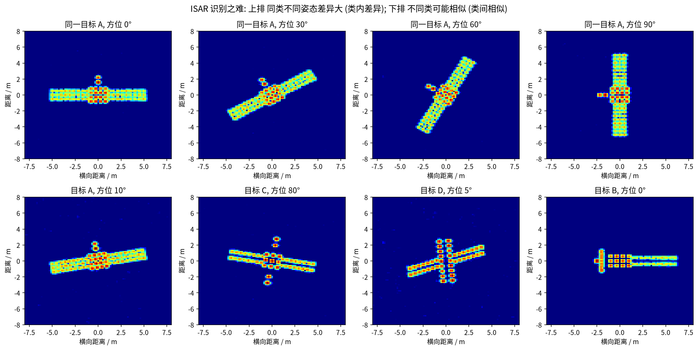

# 第 4 章 为什么 ISAR 目标识别很难

!!! tip "本章目标"

    1. 从成像物理出发，列出 ISAR 识别的主要难点，并能把每个难点追溯到第 1–3 章的某个公式；
    2. 把每个难点对应到 7 篇论文的设计动机上，为 Part B 做铺垫。

!!! note "基础回链"

    **本章用到的基础：** 转台模型与多普勒 ∝ 横向坐标（→ 第 2.2 节）、分辨率公式（→ 第 2.4 节）、散焦与运动补偿（→ 第 2.5、2.6 节）、极化通道（→ 第 3 章）。

!!! info "直觉"

    **类比：只凭“手影”认动物。** 识别 ISAR 像，有点像只看墙上的手影猜是什么动物：手一转，影子就完全变样（姿态敏感）；灯光远近一变，影子就胖瘦不同（尺度形变）；手一抖，影子就糊（散焦）；而且每种动物你只见过一两次（样本稀少）。

## 4.1 识别任务的三种粒度

- **目标级分类**：一张图属于哪一类卫星（DB-SSIT、CV-GNN、MSN、CvPGT、REMI、MLFR）；
- **少样本分类**：每个新类别只有 1 张或 5 张带标签样本（CV-GNN、CvPGT、REMI、MLFR；MSN 是“训练样本少”的小样本分类）；
- **部件级识别（检测）**：在图中用旋转框标出每个部件（太阳翼、天线、本体……）的位置与类别（DCA-Net）。

## 4.2 难点清单

| # | 难点 | 物理原因 | 对应论文的应对 |
|---|---|---|---|
| 1 | **姿态敏感** | ISAR 像是三维目标在“成像平面”上的二维投影，姿态一变投影就变；还有闪烁（角度微变导致散射强度剧变）和自遮挡 | MSN 的旋转注意力模块 RAM；REMI 的 MH-STN；MLFR 的站间对齐 |
| 2 | **尺度/形变不确定** | 横向尺度取决于未知转速；带宽、积累角不同使图像拉伸压缩；平动补偿残差造成平移 | CvPGT 对比学习随机化成像参数；REMI MH-STN（平移、缩放、旋转）；MLFR AMFA 对齐 |
| 3 | **散焦** | 机动、姿态调整带来高阶相位（第 2.5 节） | CV-GNN 直接用复值网络识别散焦像；CvPGT 在对比学习中随机化转动加速度 |
| 4 | **样本稀少** | 非合作目标难以大量观测，标注困难 | MSN 集成学习；CV-GNN、CvPGT、REMI、MLFR 元学习/少样本 |
| 5 | **图像“稀疏”且非光学** | 只有少量强散射点，背景大片空白；旁瓣、斑点噪声 | MSN 增强 Lee 滤波与幂变换；图网络把散射点/图块当节点（CV-GNN、CvPGT、REMI、DCA-Net） |
| 6 | **相位信息被丢弃** | 普通 CNN 只吃幅度图 | CV-GNN、CvPGT 的复值网络 |
| 7 | **单通道信息有限** | 单极化、单站视角都只能看到部分信息 | DB-SSIT、DCA-Net 极化；MLFR 多站融合 |
| 8 | **细粒度与部件尺度差异** | 部件小、散射弱且不均匀（DCA-Net 统计：板状附件有 7183 个标注，而光学镜头只有 273 个） | DCA-Net 两阶段旋转框检测 + 图注意力 |
| 9 | **仿真与实测的差距** | 绝大多数训练数据来自电磁仿真 | MSN 用 Tiangong-1 实测像、CvPGT 用实验室测量、REMI 用实测飞机数据做验证 |

!!! example "例题"

    **例题 4.1（难点 1、2 有多“难”：用公式估一下）。**

    - **尺度形变**：由式 (2.4)，图像横轴是多普勒 $f_d = -2\omega x/\lambda$。若目标转速从 0.05 rad/s 变为 0.1 rad/s，同一个 $x=2$ m 的点，多普勒从 $-6.67$ Hz 变为 $-13.3$ Hz。如果不知道 $\omega$，图像在横向就被拉长了一倍。
    - **分辨率变化**：积累角从 4° 变为 6°，由式 (2.8) $\rho_a$ 从 0.215 m 变为 0.143 m（$\lambda=3$ cm），每个散射点在横向“变瘦”了三分之一。
    - **散焦**：例题 2.4 中仅 0.01 rad/s² 的角加速度，就让 3 m 外的散射点拖影 8 个单元。

    这三种变化都不改变目标“是什么”，却都会大幅改变图像“长什么样”，网络必须学会对它们不敏感。

## 4.3 “测试集到底多难？”——读论文时要特别注意的实验设置

同一个方法，在不同实验设置下的精度可能天差地别。读结果表时请先问：

1. **训练与测试是否同分布？** REMI 设计了 4 个场景：Scenario I 测试集与训练集方位范围、带宽–积累角组合都相同（最容易），Scenario IV 两者都不同（最难）；且训练用 50° 俯仰角、测试用 55° 俯仰角。
2. **类别是否不相交？** 少样本学习要求“基类”与“新类”不相交（CvPGT、REMI、MLFR 均如此）。
3. **数据增强与划分的先后？** 若先增强（旋转、翻转、加噪）再随机划分，测试集可能包含训练图的“变体”，精度会被高估。DB-SSIT 没有说明顺序【存疑】。
4. **“小样本”指什么？** MSN 的 K/N 是训练/测试样本数之比，不是 K-shot；它的“小样本”是每类 33–109 张训练图，比 1-shot / 5-shot 宽松得多。

!!! warning "易错点"

    **易错点（本书项目 1 的亲身数据）。** 用同一份仿真数据训练 ResNet-18：随机划分训练/测试集时精度为 100%；改成“0–90° 方位训练、180–360° 方位测试”（且不做翻转增强）时只有 15.21%（附录表 A-1）。**同一个网络、同一份数据，只换了划分方式，精度从 100% 掉到与乱猜相当（6 类时乱猜为 16.7%）**。所以读论文时一定要先看清划分方式。

!!! abstract "小结"

    - ISAR 像对姿态、成像参数、运动状态都非常敏感，同类差异大、异类差异小；样本又少。
    - 7 篇论文分别从**输入**（极化、复数、多站）、**结构**（注意力、图网络、STN）、**学习范式**（集成、元学习、对比学习）、**任务粒度**（部件检测）四个维度应对这些难点。
    - 读实验结果时，必须先看清训练/测试划分方式，才能公平比较。
