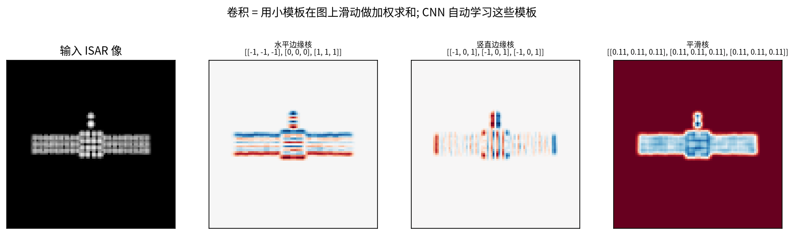

# 第 5 章 深度学习入门（上）：神经元、训练、卷积与 CNN

!!! tip "本章目标"

    1. 把神经网络理解为“可学习的函数”，能手算一个神经元、一次 softmax 和交叉熵；
    2. 理解“训练”到底在做什么：损失 → 梯度 → 反向传播 → 梯度下降，能手算一步参数更新；
    3. 把 CNN 的卷积层和信号与系统里的卷积/相关对应起来，能手算一个 4×4 图像的卷积，会算参数量；
    4. 理解池化、批归一化、残差连接与分组卷积，知道 ResNet 为什么是论文里最常见的基线。

!!! note "基础回链"

    **本章用到的基础：** 向量与矩阵乘法；函数求导与链式法则；相关与卷积（→ 第 0.6 节）。如果你从没接触过深度学习，按顺序读完本章和第 6 章就足以看懂 Part B 的每个网络框图。

本章和第 6 章只讲“够用”的部分，力求每个概念都能在 Part B 中找到用处。为了不让概念悬空，每节都先给一个可以用笔算的小例子。

## 5.1 神经元与多层感知机：可学习的非线性函数

!!! info "直觉"

    **类比：评委打分。** 一个神经元像一位评委：先给每项指标一个权重（“清晰度占 0.5，构图占 0.2……”），把加权分数加起来，再加一个“基础分”，最后过一道“门槛”，分数不够就记 0。成千上万个这样的评委分层组织，前一层的打分作为后一层的输入，就是神经网络。

**机理。** 一个神经元接收输入向量 $\mathbf x = [x_1,\dots,x_n]^T$，做两步运算：

$$z = \mathbf w^T\mathbf x + b = \sum_{i=1}^n w_i x_i + b,\qquad h = \sigma(z). \tag{5.1}$$

符号说明：$\mathbf w$ 为权重向量（每个输入的重要性，**要学习的参数**）；$b$ 为偏置（“基础分”，也要学习）；$z$ 为加权和（“预激活”）；$\sigma(\cdot)$ 为激活函数，提供非线性；$h$ 为神经元输出。

常见激活函数：**ReLU** $\sigma(z)=\max(0,z)$，最常用；**sigmoid** $\sigma(z)=1/(1+e^{-z})$，把任意数压到 $(0,1)$，常用来输出“权重/概率”；**tanh** 输出在 $(-1,1)$；**LeakyReLU / GELU / Mish / SiLU** 是 ReLU 的平滑或改进版，论文中都会出现。

!!! example "例题"

    **例题 5.1（一个神经元）。** $\mathbf x = [1, 2]^T$，$\mathbf w = [0.5, 0.2]^T$，$b=0.1$：

    $$z = 0.5\times1 + 0.2\times2 + 0.1 = 1.0,\qquad \mathrm{ReLU}(1.0) = 1.0,\qquad \mathrm{sigmoid}(1.0) = \frac{1}{1+e^{-1}} = 0.731 .$$

**一层 = 许多神经元并排。** 把 $m$ 个神经元的权重排成矩阵 $\mathbf W\in\mathbb R^{m\times n}$（第 $i$ 行是第 $i$ 个神经元的 $\mathbf w^T$），一层的计算就是

$$\mathbf h = \sigma(\mathbf W\mathbf x + \mathbf b). \tag{5.2}$$

把几层串起来就是**多层感知机（MLP）**（全连接网络）：$\mathbf h_1 = \sigma(\mathbf W_1\mathbf x+\mathbf b_1)$，$\mathbf h_2 = \sigma(\mathbf W_2\mathbf h_1+\mathbf b_2)$，……

!!! warning "易错点"

    **易错点：为什么一定要有非线性？** 去掉 $\sigma$ 后，两层线性层 $\mathbf W_2(\mathbf W_1\mathbf x) = (\mathbf W_2\mathbf W_1)\mathbf x$ 仍然只是一个线性变换，叠 100 层也一样。正是 ReLU 这样的“折一下”，让网络能拟合弯弯曲曲的分类边界。

**输出层：softmax 把分数变成概率。** 分类网络最后一层为每类输出一个分数 $z_c$（logits），再用 softmax 变成和为 1 的概率：

$$p_c = \frac{e^{z_c}}{\sum_{j=1}^{C} e^{z_j}},\qquad c = 1,\dots,C. \tag{5.3}$$

指数保证每个值为正，分母保证总和为 1；分数越高概率越大，差距还被“放大”了。

!!! example "例题"

    **例题 5.2（softmax）。** 3 类分数 $\mathbf z = [2, 1, 0]$：$e^2 = 7.389$，$e^1 = 2.718$，$e^0 = 1$，总和 $11.107$，所以

    $$\mathbf p = [7.389,\ 2.718,\ 1]/11.107 = [0.665,\ 0.245,\ 0.090].$$

于是一个分类网络就是函数 $\hat{\mathbf y} = f_{\mathbf w}(\mathbf x)$：输入图像 $\mathbf x$，输出每类的概率；网络里所有 $\mathbf W$、$\mathbf b$ 合起来记作参数 $\mathbf w$。下一个问题是：怎么找到好的 $\mathbf w$？

## 5.2 训练：损失、梯度与反向传播

!!! info "直觉"

    **类比：蒙着眼下山。** 损失函数 $L(\mathbf w)$ 是一片山地，高度表示“网络错得多离谱”。你蒙着眼站在某处，只能用脚感受哪边是下坡（梯度），然后朝下坡迈一小步（学习率）。反复迈步，就会走到谷底附近。**反向传播**只是一种高效计算“每个参数各自的下坡方向”的方法。

### 5.2.1 损失函数

- **均方误差**（回归）：$L = (\hat y - y)^2$；
- **交叉熵**（分类）：$L = -\log p_{y}$，$y$ 为真实类别，$p_y$ 为网络给真实类别的概率。$p_y\to1$ 时 $L\to0$；$p_y\to0$ 时 $L\to\infty$——“猜错还很自信”会被重罚。

!!! example "例题"

    **例题 5.3（交叉熵及其梯度）。** 接例题 5.2，若真实类别是第 1 类（one-hot $\mathbf y=[1,0,0]$）：$L = -\ln 0.665 = 0.408$。softmax + 交叉熵的梯度非常简洁：

    $$\frac{\partial L}{\partial \mathbf z} = \mathbf p - \mathbf y = [0.665-1,\ 0.245,\ 0.090] = [-0.335,\ 0.245,\ 0.090].$$

    含义：正确类的分数应**升高**（梯度为负，沿负梯度走就是增大），错误类的分数应**降低**。

**推导 $\mathbf p - \mathbf y$。** 由 $L = -\log p_y = -z_y + \log\sum_j e^{z_j}$，对 $z_c$ 求导：

$$\frac{\partial L}{\partial z_c} = -\mathbb 1[c=y] + \frac{e^{z_c}}{\sum_j e^{z_j}} = p_c - y_c ,$$

其中 $\mathbb 1[c=y]$ 在 $c=y$ 时为 1、否则为 0，正好是 one-hot 的 $y_c$。

### 5.2.2 梯度下降

!!! success "关键公式"

    $$\boxed{\mathbf w \leftarrow \mathbf w - \eta\,\frac{\partial L}{\partial \mathbf w}} \tag{5.4}$$

    $\eta$：学习率（步长），论文中的“学习率 1e-4”就是它；$\partial L/\partial\mathbf w$：损失对参数的梯度，指向“上坡最陡”的方向，所以要减去它。

### 5.2.3 反向传播 = 链式法则

网络是函数的嵌套，求梯度靠**链式法则**：若 $L$ 通过 $\hat y$ 依赖 $w$，则 $\dfrac{\partial L}{\partial w} = \dfrac{\partial L}{\partial\hat y}\cdot\dfrac{\partial \hat y}{\partial w}$。反向传播就是从输出层开始，把“上游梯度 × 本层局部导数”一层层往回乘。

!!! example "例题"

    **例题 5.4（手算一步训练）。** 最简单的“网络” $\hat y = wx$；样本 $x = 2$、$y=1$；初值 $w=0.8$；学习率 $\eta=0.1$；损失 $L=(\hat y-y)^2$。

    1. **前向**：$\hat y = 0.8\times2 = 1.6$，$L = (1.6-1)^2 = 0.36$。
    2. **反向**：$\dfrac{\partial L}{\partial\hat y} = 2(\hat y-y) = 1.2$，$\dfrac{\partial\hat y}{\partial w} = x = 2$，所以 $\dfrac{\partial L}{\partial w} = 1.2\times2 = 2.4$。
    3. **更新**：$w \leftarrow 0.8 - 0.1\times2.4 = 0.56$。
    4. **验证**：$\hat y = 0.56\times2 = 1.12$，$L = 0.12^2 = 0.0144$——损失从 0.36 降到 0.0144。

    继续迭代，$w$ 会逼近最优值 $0.5$（图 5-2）。真实网络有上百万个参数，但每个参数的更新方式与此完全相同。

### 5.2.4 训练中的常用术语

- **mini-batch / epoch**：每次用一小批样本（如 32 张）估计梯度并更新一次；所有训练样本用过一遍叫一个 epoch。
- **优化器**：SGD 就是式 (5.4)；Adam、AdamW 为每个参数自适应调节步长，是论文中最常用的选择。
- **超参数**：论文里的“学习率 1e-4”“权重衰减 1e-3”“每 10 个 epoch 衰减 0.1”都是人设定的训练超参数，不是学出来的。
- **过拟合**：参数多、数据少时网络会“背答案”：训练集精度很高、测试集很差。ISAR 数据少，所以几乎每篇论文都在和过拟合作斗争（数据增强、预训练、少样本范式、轻量化网络）。

!!! warning "易错点"

    **易错点：学习率。** 太大会在谷底两侧来回跳，甚至发散；太小则下降极慢。例题 5.4 中若取 $\eta = 0.3$，第一步就变成 $w = 0.8-0.72 = 0.08$，直接跳过了最优点 0.5。

## 5.3 卷积：在图像上滑动的“小模板”

!!! info "直觉"

    **类比：拿印章逐格比对。** 拿一个 3×3 的小“印章”（卷积核）在图像上从左到右、从上到下逐格盖过去，每到一个位置就算一次“印章和这块图像有多像”（对应相乘再相加）。所有位置的得分排成一张新图，叫**特征图**。不同的印章检测不同的花样：竖直边缘、水平边缘、亮斑……

**卷积层**就是信号与系统里的二维卷积（严格说是互相关，→ 第 0.6 节）：一个 $k\times k$ 的小模板在图像上滑动做加权求和。区别在于模板系数是**学出来的**，而且每层有很多个模板（通道）。对单通道输入 $X$ 和卷积核 $K$：

$$Y[i,j] = \sum_{u=0}^{k-1}\sum_{v=0}^{k-1} X[i+u,\ j+v]\;K[u,v] + b. \tag{5.5}$$

符号说明：$(i,j)$ 为输出位置；$(u,v)$ 为核内位置；$b$ 为偏置。

!!! example "例题"

    **例题 5.5（手算 4×4 图像的卷积）。** 输入与一个竖直边缘检测核（左列 $+1$，右列 $-1$）：

    $$X = \begin{bmatrix} 1&2&0&1\\ 0&1&3&1\\ 2&1&0&0\\ 1&0&1&2\end{bmatrix},\qquad
    K = \begin{bmatrix} 1&0&-1\\ 1&0&-1\\ 1&0&-1\end{bmatrix},\qquad b = 0 .$$

    3×3 窗口在 4×4 图上只能放 $2\times2$ 个位置。由于核的中间列为 0，每个结果都等于“窗口左列之和 − 窗口右列之和”：

    $$\begin{aligned}
    Y[0,0] &= (1+0+2) - (0+3+0) = 0, & Y[0,1] &= (2+1+1)-(1+1+0) = 2,\\
    Y[1,0] &= (0+2+1)-(3+0+1) = -1, & Y[1,1] &= (1+1+0)-(1+0+2) = -1.
    \end{aligned}$$

    所以 $Y = \begin{bmatrix} 0 & 2\\ -1 & -1\end{bmatrix}$。$Y[0,1]=2$ 最大，说明该窗口里“左亮右暗”的竖直边缘最明显。

**输出尺寸。** 输入边长 $H$，核大小 $k$，四周补零 $p$ 圈，步长 $s$：

$$H_{\text{out}} = \left\lfloor\frac{H - k + 2p}{s}\right\rfloor + 1 . \tag{5.6}$$

例题 5.5 中 $H=4,\ k=3,\ p=0,\ s=1$，得 $H_{\text{out}} = 2$；若 $p=1$，输出仍为 4×4（“same”卷积）；若 $s=2$，尺寸约减半。

**多通道与参数量。** 输入有 $C_{\text{in}}$ 个通道（如复数图像的实部/虚部是 2 个通道），每个卷积核也有 $C_{\text{in}}$ 层，各层分别卷积后求和；有 $C_{\text{out}}$ 个核就输出 $C_{\text{out}}$ 个通道：

$$\#\text{参数} = k\times k\times C_{\text{in}}\times C_{\text{out}} + \underbrace{C_{\text{out}}}_{\text{偏置}}. \tag{5.7}$$

!!! example "例题"

    **例题 5.6（参数量）。** 3×3 卷积，64 通道进、64 通道出：$3\times3\times64\times64 + 64 = 36\,928$。若改用 $G=4$ 组的**分组卷积**（每组 16 进 16 出，各组独立），权重为 $4\times(3\times3\times16\times16) = 9216$，恰好是原来 36 864 的 $1/4$。

!!! warning "易错点"

    **易错点。**（1）深度学习框架里的“卷积”不翻转卷积核，数学上是相关；由于核是学出来的，翻不翻转没有区别。（2）卷积的两个关键性质是**局部连接**（每个输出只看一小块）和**权值共享**（同一个核用于所有位置），所以参数比全连接少得多：64×64 图像全连接到 64×64 输出需要 $4096^2\approx1678$ 万个权重，一个 3×3 卷积核只要 9 个。

## 5.4 卷积神经网络（CNN）与 ResNet

把“卷积 → 归一化 → 激活 → 池化”重复多次，最后接全连接层与 softmax，就是 CNN。浅层检测边缘、亮点，深层把它们组合成“太阳翼”“本体”这样更抽象的模式。

CNN 的基本组件：

- **池化**（max/avg pooling）：下采样、扩大感受野。例如 2×2 最大池化把 $\left[\begin{smallmatrix}1&3\\2&0\end{smallmatrix}\right]$ 变成 $3$，图像边长减半；
- **批归一化 BN**：把每个通道的激活归一化到零均值、单位方差，稳定训练（见例题 5.7）；
- **残差连接**（ResNet）：$\mathbf y = \mathbf x + F(\mathbf x)$，让很深的网络也能训练。ResNet18/50 是论文中最常见的基线（DB-SSIT 的 ResNet50、MSN 的 ResNet50+RAM、CvPGT 的 CV-ResNet18）；
- **分组卷积 / 深度卷积（DW Conv）**：把通道分组、各组独立卷积，参数更少（例题 5.6）。DB-SSIT 用分组卷积让“每组对应一种极化模式”，MLFR 让“每组对应一个雷达站”——这是一个很巧妙的“结构即先验”设计；
- **空洞（膨胀）卷积、可变形卷积**：扩大或自适应调整采样位置（MSN RAM、REMI GEN）。

!!! example "例题"

    **例题 5.7（批归一化）。** 某通道在一个 batch 里的 4 个激活值为 $[1, 2, 3, 6]$：

    - 均值 $\mu = (1+2+3+6)/4 = 3$；
    - 方差 $\sigma^2 = [(1-3)^2+(2-3)^2+(3-3)^2+(6-3)^2]/4 = 14/4 = 3.5$，标准差 $\sigma = 1.871$；
    - 归一化 $\hat x = (x-\mu)/\sigma = [-1.069,\ -0.535,\ 0,\ 1.604]$；
    - 再乘可学习的缩放 $\gamma$、加偏移 $\beta$：$y = \gamma\hat x+\beta$（网络可自己决定要不要“恢复”原尺度）。

!!! info "直觉"

    **残差连接：只学“改动量”。** 修改一篇文章，与其从头重写（学 $\mathbf y$ 本身），不如在原文上做批注（学改动量 $F(\mathbf x) = \mathbf y-\mathbf x$）。若某一层没什么可改的，只要 $F=0$，输出就等于输入，不会“越改越差”。从梯度看：

    $$\frac{\partial\mathbf y}{\partial\mathbf x} = \mathbf I + \frac{\partial F}{\partial\mathbf x}, \tag{5.8}$$

    即使 $\partial F/\partial\mathbf x$ 很小，梯度也能沿单位矩阵 $\mathbf I$ 这条“高速公路”传回浅层——这就是上百层的 ResNet 也能训练的原因。

!!! abstract "小结"

    - 神经元 = 加权和 + 偏置 + 非线性（例题 5.1：$z=1.0$）；多层堆叠成 MLP；softmax 把分数变成概率（例题 5.2）。
    - 训练 = 最小化损失：交叉熵的梯度为 $\mathbf p-\mathbf y$；反向传播 = 链式法则；梯度下降 $\mathbf w\leftarrow\mathbf w-\eta\nabla L$（例题 5.4：一步把损失从 0.36 降到 0.0144）。
    - 卷积 = 滑动模板的相关运算，局部连接 + 权值共享；会用式 (5.6)(5.7) 算尺寸和参数量。
    - CNN = 卷积 + BN + 激活 + 池化；ResNet 用 $\mathbf y = \mathbf x+F(\mathbf x)$ 让深网络可训练；分组卷积能把“一组 = 一种极化 / 一个雷达站”的先验写进结构。
