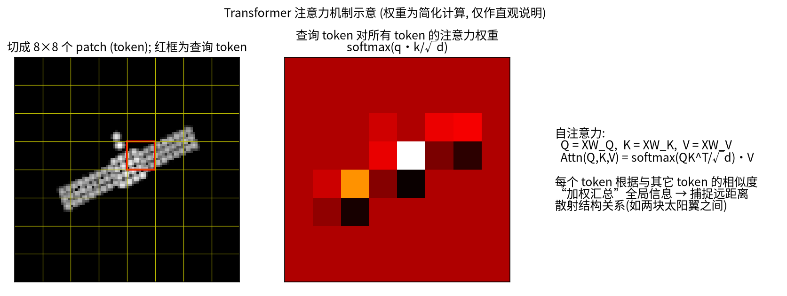
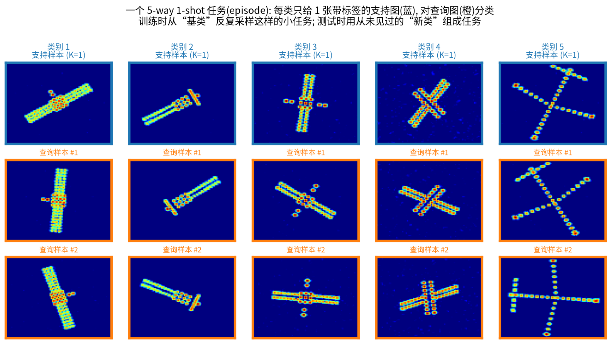
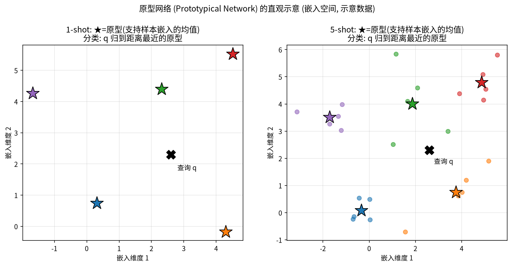
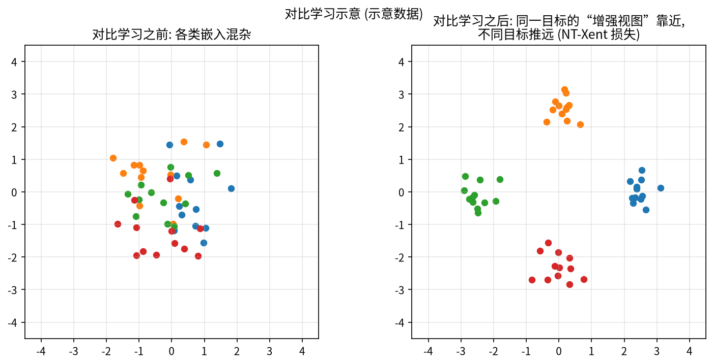
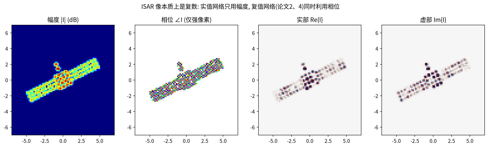
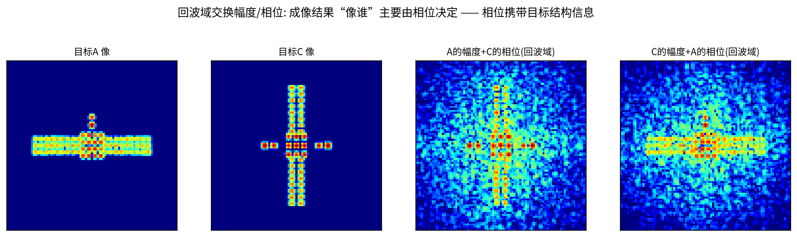
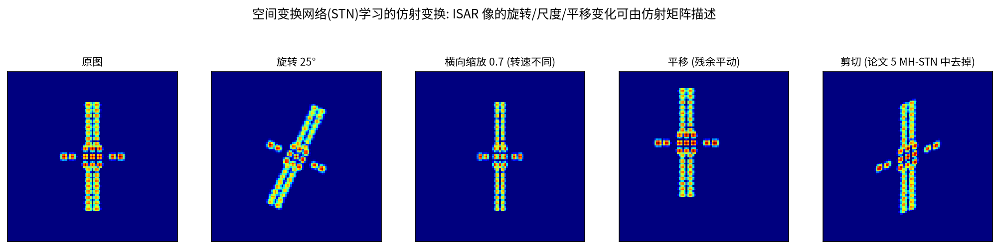

# 第 6 章 深度学习入门（下）：注意力、图网络、少样本与其他模块

!!! tip "本章目标"

    1. 一步步理解注意力机制与 Transformer，能手算 3 个 token 的自注意力；
    2. 理解图神经网络的“消息传递”，能手算 3 节点图上的一层图卷积，了解 GAT；
    3. 掌握少样本学习的 N-way K-shot 范式，能手算 3-way 1-shot 原型网络的分类概率，了解关系网络与 MAML；
    4. 了解对比学习（能算一次 NT-Xent 损失）、复值网络（复数乘法 = 旋转缩放）、空间变换网络（STN）以及常用评价指标。

!!! note "基础回链"

    **本章用到的基础：** 神经元、softmax、交叉熵、梯度下降（→ 第 5.1、5.2 节）；卷积与 CNN（→ 第 5.3、5.4 节）；复数乘法（→ 第 0.1 节）；ISAR 散射中心（→ 第 2.7 节）。

## 6.1 注意力机制与 Transformer

### 6.1.1 通道 / 空间注意力：给特征“打权重”

!!! info "直觉"

    **类比：用荧光笔划重点。** 读一页书时，你会把重要的句子划亮、其余略过。注意力模块就是网络的“荧光笔”：先算出一张 0–1 之间的权重图，再与特征相乘——重要的地方放大，不重要的抑制。

**通道/空间注意力**：给特征图乘一个 0–1 之间的权重图。例如 DB-SSIT SFEB 的空间注意力：沿通道取平均与最大值 → 卷积 → sigmoid（输出在 0–1 之间，→ 第 5.1 节）→ 与特征逐元素相乘（原文式 (20)–(22)）。

### 6.1.2 自注意力：每个 token 向所有 token “提问”

!!! info "直觉"

    **类比：图书馆查资料。** 你带着一个问题（**Query，查询**）走进图书馆，每本书的书脊上有一个标签（**Key，键**），书里是内容（**Value，值**）。你把问题和每个标签比一比，越匹配的书读得越认真（权重越大），最后把读到的内容按权重汇总成答案。自注意力里，每个图像块（token）同时扮演“提问者”和“被查的书”。

**机理。** 把图像切成 $N$ 个小块（patch / token），每块展平并线性映射成 $d$ 维向量，排成矩阵 $X\in\mathbb R^{N\times d}$（每行一个 token）。三个可学习矩阵把它映射成查询、键、值：

$$Q = XW_Q,\qquad K = XW_K,\qquad V = XW_V . \tag{6.1}$$

然后分三步：

1. **打分**：$S = QK^T/\sqrt d$，$S_{ij}$ 是第 $i$ 个查询与第 $j$ 个键的点积相似度；除以 $\sqrt d$ 是为了防止 $d$ 大时点积过大、softmax 过于尖锐；
2. **归一化**：对 $S$ 的**每一行**做 softmax，得到注意力权重 $A$，每行和为 1；
3. **加权汇总**：输出 $= AV$，第 $i$ 行是所有 value 按权重 $A_{i1},\dots,A_{iN}$ 的加权平均。

合起来：

!!! success "关键公式"

    $$\boxed{\mathrm{Attention}(Q,K,V) = \mathrm{softmax}\!\left(\frac{QK^T}{\sqrt d}\right)V} \tag{6.2}$$

    $Q,K,V\in\mathbb R^{N\times d}$：查询、键、值；$d$：特征维数；softmax 按行进行。

!!! example "例题"

    **例题 6.1（3 个 token 的自注意力）。** 3 个 token：$\mathbf x_1=[1,0]$，$\mathbf x_2=[0,1]$，$\mathbf x_3=[1,1]$，$d=2$；为便于手算取 $W_Q=W_K=W_V=I$，于是 $Q=K=V=X$。

    **第 1 步：打分。** $QK^T$ 的第 $(i,j)$ 元是 $\mathbf x_i\cdot\mathbf x_j$，例如 $\mathbf x_1\cdot\mathbf x_3 = 1$，$\mathbf x_3\cdot\mathbf x_3 = 2$。再除以 $\sqrt2 = 1.414$：

    $$S = \frac{1}{\sqrt2}\begin{bmatrix}1&0&1\\0&1&1\\1&1&2\end{bmatrix} = \begin{bmatrix}0.7071&0&0.7071\\0&0.7071&0.7071\\0.7071&0.7071&1.4142\end{bmatrix}.$$

    **第 2 步：按行 softmax。** 第 1 行：$e^{0.7071}=2.028$，$e^{0}=1$，总和 $5.056$，得 $[0.4011, 0.1978, 0.4011]$。同理：

    $$A = \begin{bmatrix}0.4011&0.1978&0.4011\\0.1978&0.4011&0.4011\\0.2483&0.2483&0.5035\end{bmatrix}.$$

    **第 3 步：加权汇总。** 第 1 行输出 $= 0.4011[1,0] + 0.1978[0,1] + 0.4011[1,1] = [0.8022,\ 0.5989]$。同理：

    $$AV = \begin{bmatrix}0.8022&0.5989\\0.5989&0.8022\\0.7517&0.7517\end{bmatrix}.$$

    解读：token 1 原本是 $[1,0]$，现在“吸收”了与它相似的 token 3 的信息，第二维从 0 变成 0.5989。每个 token 的输出都融合了**全图**的信息。

<video controls preload="metadata" width="100%" poster="../figures/video_frames/M12_SelfAttention.jpg"><source src="../videos/M12_SelfAttention.mp4" type="video/mp4"></video>

▶ **动画 12 自注意力三步（36 s）**：按例题 6.1 的数字逐格演示：先算点积打分并除以 $\sqrt2$，再按行 softmax（每行和为 1），最后在左侧平面上把 $\mathbf x_1,\mathbf x_2,\mathbf x_3$ 按权重首尾相接，得到三个输出 $[0.80,0.60]$、$[0.60,0.80]$、$[0.75,0.75]$。文件：`videos/M12_SelfAttention.mp4`，代码：`code/manim/dl_scenes.py`

**多头注意力与 Transformer。** 用 $h$ 组不同的 $(W_Q, W_K, W_V)$ 并行做 $h$ 次注意力（“多头”，每个头关注不同类型的关系），把结果拼接后再线性映射。**Transformer** = 多头自注意力 + 前馈网络（FFN，即每个 token 各自过一个两层 MLP）+ 残差连接 + 层归一化（LayerNorm）；**ViT** 把它用于图像。由于自注意力本身不区分 token 的顺序，还要给每个 token 加上**位置编码**，告诉网络“这一块在图像的哪里”。

**计算量。** 打分矩阵是 $N\times N$ 的，所以代价与 token 数的平方成正比：8×8 = 64 个 patch 就要算 $64^2 = 4096$ 个分数。DB-SSIT 因此用“对 K 做平均池化、减少键的个数”的高效多头自注意力（E-MHSA）降计算量。

!!! warning "易错点"

    **易错点。**（1）softmax 是**按行**做的：每个查询的权重之和为 1，而不是整个矩阵和为 1。（2）CNN 每层只看 3×3 的邻域，要很多层才能“看到”远处；自注意力一步就能建模“远距离关系”（例如两块相距很远的太阳翼），代价是计算量随 $N^2$ 增长。

## 6.2 图神经网络（GNN）与图注意力（GAT）

!!! info "直觉"

    **类比：开班会交换意见。** 每个同学（节点）先有自己的看法（特征），然后听一听和自己关系好的同学（邻居）怎么说，把大家的意见综合一下，更新自己的看法。开几轮会，信息就能在全班传开。图神经网络的每一层就是“开一轮会”，叫**消息传递**。

**图** = 节点 + 边。ISAR 中有两种自然的构图方式：

- **散射点/图块作为节点**（CvPGT 的 patch 图、DCA-Net 的检测框）；
- **样本作为节点**（少样本学习中，支持集和查询集的每个样本是一个节点：CV-GNN、MSN、CvPGT、REMI）。

**邻接矩阵 $A$**：$A_{ij}$ 表示节点 $j$ 对节点 $i$ 的影响有多大（0 表示不相连）。**图卷积**的核心是“邻居消息传递”：

$$\mathbf x_i^{(l+1)} = \rho\Big(\sum_j A_{ij}\,\mathbf x_j^{(l)}\,\Theta\Big). \tag{6.3}$$

符号说明：$\mathbf x_i^{(l)}$ 为第 $l$ 层节点 $i$ 的特征（行向量）；$\Theta$ 为可学习的权重矩阵（所有节点共享，类似卷积核的权值共享）；$\rho$ 为激活函数。写成矩阵形式即 $X^{(l+1)} = \rho\big(A X^{(l)}\Theta\big)$：先“聚合邻居”（乘 $A$），再“变换特征”（乘 $\Theta$）。

!!! example "例题"

    **例题 6.2（3 节点图上的一层图卷积）。** 链状图 1—2—3，初始特征 $\mathbf h_1=[1,0]$，$\mathbf h_2=[0,1]$，$\mathbf h_3=[1,1]$。每个节点也把自己算作邻居（自环），聚合方式取**平均**。

    **第 1 步：聚合。** 节点 1 的邻居（含自己）是 $\{1,2\}$，节点 2 是 $\{1,2,3\}$，节点 3 是 $\{2,3\}$：

    $$\begin{aligned}
    \bar{\mathbf h}_1 &= \tfrac12\big([1,0]+[0,1]\big) = [0.5,\ 0.5],\\
    \bar{\mathbf h}_2 &= \tfrac13\big([1,0]+[0,1]+[1,1]\big) = [0.6667,\ 0.6667],\\
    \bar{\mathbf h}_3 &= \tfrac12\big([0,1]+[1,1]\big) = [0.5,\ 1].
    \end{aligned}$$

    用矩阵写，就是乘上行归一化的邻接矩阵：

    $$\hat A = \begin{bmatrix}1/2&1/2&0\\1/3&1/3&1/3\\0&1/2&1/2\end{bmatrix},\qquad \bar H = \hat A H .$$

    **第 2 步：变换 + 激活。** 取 $\Theta = \begin{bmatrix}1&-1\\0.5&1\end{bmatrix}$，计算 $\bar{\mathbf h}_i\Theta$：例如 $[0.5,0.5]\Theta = [0.5+0.25,\ -0.5+0.5] = [0.75,\ 0]$。三个节点依次得 $[0.75, 0]$、$[1, 0]$、$[1, 0.5]$，经 ReLU 后不变。

    一层之后，节点 1 已经“知道”了节点 2 的信息；再过一层，它还会间接收到节点 3 的信息。

**少样本 GNN：边也是学出来的。** 在 CV-GNN、MSN、CvPGT 采用的 Garcia & Bruna 式少样本 GNN 中，边权不是事先给定，而是由节点特征差的绝对值经 MLP 学出：$A_{ij} = \mathrm{MLP}(|\mathbf x_i - \mathbf x_j|)$，再按行 softmax。每个节点的特征 = 图像嵌入 ⊕ 标签 one-hot；查询节点的标签部分初始化为均匀分布（“还不知道是哪类”）。经过几层消息传递，查询节点从“长得像的支持样本”那里获得标签信息。

**GAT（图注意力网络）**：边权由注意力机制计算，并可多头。对节点 $i$ 的每个邻居 $j$，先算一个打分 $e_{ij} = \mathrm{LeakyReLU}\big(\mathbf a^T[\mathbf W\mathbf h_i \,\|\, \mathbf W\mathbf h_j]\big)$（$\|$ 表示拼接，$\mathbf a$ 为可学习向量），再在邻居上做 softmax 得到权重 $\alpha_{ij}$，最后 $\mathbf h_i' = \sigma\big(\sum_j\alpha_{ij}\mathbf W\mathbf h_j\big)$。它与 6.1 节的自注意力思路相同，只是“只在邻居之间”做注意力。REMI 发现全连接 GAT 有两个问题——过度平滑、所有支持样本贡献相同——于是提出只保留 top-k 邻居的掩码高斯 GAT（MG-GAT）。DCA-Net 用 GAT 在检测框之间传递信息。

!!! warning "易错点"

    **易错点：过度平滑。** 消息传递本质上是“取平均”。层数太多时，所有节点的特征会越来越像（例题 6.2 中一层后三个节点已从 $[1,0],[0,1],[1,1]$ 变得彼此接近），最终无法区分。这就是 REMI 用“只保留最相似的几个邻居”来缓解的问题。

## 6.3 少样本学习（Few-Shot Learning）与元学习

!!! info "直觉"

    **类比：看一张照片认人。** 朋友给你看一张他表弟的照片，第二天你在人群里就能认出他来。你并没有针对“表弟”训练过，而是平时见过成千上万张脸，学会了“怎样比较两张脸是否是同一个人”。少样本学习要让网络学会的，正是这种**通用的比较能力**，而不是死记某几个类别。

**问题**：每个新类别只有极少（1 或 5 张）带标签样本，怎么分类？

**N-way K-shot 任务（episode）**：随机抽 N 个类别，每类给 K 张带标签的**支持集（support set）**，再给若干张待分类的**查询集（query set）**。例如 5-way 1-shot：5 个类各 1 张支持图，查询图要判断属于这 5 类中的哪一类，随机猜测的正确率为 20%。

**关键设定**：类别分为**基类（base）**与**新类（novel）**，二者**不相交**。训练（元训练）时只在基类上反复抽取任务；测试时在从未见过的新类上抽取任务，报告上千个任务的平均精度与 95% 置信区间（REMI、MLFR 均为 1000 个任务）。“训练时也按测试时的形式做题”，这种思路叫**元学习**（learning to learn）。

### 6.3.1 原型网络（ProtoNet）

**机理。** 用一个嵌入网络 $f_\phi$（通常是 4 层卷积 Conv4 或 ResNet）把每张图映射成向量。每类支持嵌入的均值就是这一类的**原型**：

$$\mathbf c_n = \frac{1}{K}\sum_{k=1}^{K} f_\phi(\mathbf x_{n,k}),\qquad n = 1,\dots,N. \tag{6.4}$$

查询 $\mathbf q$ 属于第 $n$ 类的概率，是对“负的距离平方”做 softmax：

!!! success "关键公式"

    $$\boxed{p(y=n\mid\mathbf q) = \frac{\exp\!\big(-\|f_\phi(\mathbf q)-\mathbf c_n\|^2\big)}{\sum_{m=1}^{N}\exp\!\big(-\|f_\phi(\mathbf q)-\mathbf c_m\|^2\big)}} \tag{6.5}$$

    $\mathbf c_n$：第 $n$ 类原型；$\|\cdot\|^2$：欧氏距离的平方。离哪个原型越近，属于哪类的概率越大。训练时用交叉熵（→ 第 5.2 节）更新 $\phi$。

!!! example "例题"

    **例题 6.3（3-way 1-shot 原型网络）。** 1-shot 时原型就是那唯一一张支持图的嵌入：$\mathbf c_1=[1,0]$，$\mathbf c_2=[0,1]$，$\mathbf c_3=[-1,-1]$；查询嵌入 $\mathbf q = [0.6, 0.3]$。

    **第 1 步：距离平方。**

    $$\begin{aligned}
    d_1^2 &= (0.6-1)^2 + (0.3-0)^2 = 0.16+0.09 = 0.25,\\
    d_2^2 &= (0.6-0)^2 + (0.3-1)^2 = 0.36+0.49 = 0.85,\\
    d_3^2 &= (0.6+1)^2 + (0.3+1)^2 = 2.56+1.69 = 4.25.
    \end{aligned}$$

    **第 2 步：softmax。** $e^{-0.25}=0.7788$，$e^{-0.85}=0.4274$，$e^{-4.25}=0.0143$，总和 $1.2205$，所以 $\mathbf p = [0.638,\ 0.350,\ 0.0117]$，判为第 1 类。

    **第 3 步：损失。** 若真实类别确为第 1 类，交叉熵 $L = -\ln 0.638 = 0.449$；训练会让 $\mathbf q$ 更靠近 $\mathbf c_1$。

    **5-shot 时**：若第 1 类有 5 张支持图，嵌入分别为 $[1,0],[0.8,0.2],[1.2,-0.2],[0.9,0.1],[1.1,-0.1]$，原型就是它们的平均 $[1,0]$。样本越多，原型越不受个别“坏样本”（如自遮挡、强旁瓣）的影响。

<video controls preload="metadata" width="100%" poster="../figures/video_frames/V3_fewshot_episode_2.png"><source src="../videos/V3_fewshot_episode.mp4" type="video/mp4"></video>

▶ **动画 3 少样本任务与原型网络推理（36 s）**：抽类 → 支持图嵌入 → 原型 → 查询嵌入 → 距离与概率 → 判别，连续演示两个任务。文件：`videos/V3_fewshot_episode.mp4`

### 6.3.2 关系网络与 MAML

**关系网络（RelationNet）**：不再用固定的欧氏距离，而是用一个可学习的小网络 $g$ 打“关系分数”：$r_{n} = g\big([f_\phi(\mathbf q)\,\|\,\mathbf c_n]\big)\in[0,1]$（拼接后经卷积/全连接，最后 sigmoid）。直觉：“怎么比较”本身也交给网络去学。

**MAML（模型无关元学习）**：学一个好的**初始化** $\boldsymbol\theta$，使得在任何新任务上只需走几步梯度下降就能适应。每个任务分两层循环：

$$\begin{aligned}
\text{内循环（在任务 } i \text{ 的支持集上走一小步）：}\quad \boldsymbol\theta_i' &= \boldsymbol\theta - \alpha\,\nabla_{\boldsymbol\theta}L_{\text{支持}}^{(i)}(\boldsymbol\theta),\\[4pt]
\text{外循环（看走完这步后在查询集上的效果）：}\quad \boldsymbol\theta &\leftarrow \boldsymbol\theta - \beta\,\nabla_{\boldsymbol\theta}\sum_i L_{\text{查询}}^{(i)}(\boldsymbol\theta_i').
\end{aligned} \tag{6.6}$$

$\alpha$、$\beta$ 分别为内、外循环学习率。类比：不是教学生某道题的答案，而是培养“看一眼例题就能举一反三”的底子。

**代表性方法**（7 篇论文中的对比方法几乎都在这里）：

| 方法 | 思想 | 论文中出现 |
|---|---|---|
| 原型网络 ProtoNet | 每类支持嵌入的均值为“原型”，查询按到原型的距离分类 | CV-GNN、MSN、REMI、MLFR |
| 匹配网络 Matching Net | 查询与每个支持样本做注意力加权 | MSN |
| 孪生网络 Siamese | 学“两张图是否同类” | MSN |
| 关系网络 RelationNet | 用一个可学习的网络 $g(\cdot)$ 输出两样本的“关系分数” | MSN、CvPGT、REMI、MLFR（其推理模块即基于此） |
| GNN 少样本 | 样本当节点，消息传递标签（6.2 节） | CV-GNN、MSN、CvPGT |
| TPN | 转导式传播，利用查询集之间的关系 | REMI、MLFR |
| MGA-Net | 基于 GAT 的方法 | REMI、MLFR |
| MAML | 学一个好的初始化，使少量梯度步即可适应新任务 | MSN、CvPGT |

!!! warning "易错点"

    **易错点。**（1）“few-shot”指**测试时每个新类只有 K 张标签样本**，不是“整个训练集很小”；MSN 的“小样本”是后者（见第 4.3 节）。（2）基类与新类必须不相交，否则测得的精度只是“认识老朋友”的能力。（3）本书项目 2 实测：同一个 Conv4 原型网络，训练前 5-way 1-shot 精度为 42.08%，在基类上元训练后为 91.69%（新类，附录表 A-1），说明“比较能力”是可以学出来并迁移到新类的。

## 6.4 对比学习

!!! info "直觉"

    **类比：认双胞胎之外的“同一个人”。** 给你同一个人在不同光照、不同角度下的两张照片，你要学会说“这是同一个人”；同时，对其他人的照片说“不是”。不需要知道这个人叫什么（不需要标签），只要知道“哪两张来自同一个人”。学会之后，对光照、角度的变化就“不敏感”了。

**思想**：不需要标签，让同一样本的两个“增强视图”在嵌入空间中靠近，不同样本互相推远。相似度常用余弦相似度 $\mathrm{sim}(\mathbf u,\mathbf v) = \mathbf u^T\mathbf v/(\|\mathbf u\|\|\mathbf v\|)\in[-1,1]$。SimCLR 的 NT-Xent 损失（一个 batch 有 $N$ 个样本 → $2N$ 个视图，每个正样本对有 $2N-2$ 个负样本）：

$$\ell_{i,j} = -\log\frac{\exp(\mathrm{sim}(\mathbf z_i,\mathbf z_j)/T)}{\sum_{k\ne i}\exp(\mathrm{sim}(\mathbf z_i,\mathbf z_k)/T)}. \tag{6.7}$$

符号说明：$\mathbf z_i,\mathbf z_j$ 为同一样本两个视图的嵌入（正样本对）；分母对除 $i$ 自身以外的所有视图求和（含正样本和负样本）；$T$ 为温度，$T$ 越小越“挑剔”。它其实就是一个“在所有候选里把正样本挑出来”的 softmax 交叉熵（→ 第 5.2 节）。

!!! example "例题"

    **例题 6.4（NT-Xent）。** 温度 $T=0.5$；视图 $i$ 与正样本的相似度为 0.9，与两个负样本分别为 0.1 和 $-0.2$：

    $$e^{0.9/0.5} = e^{1.8} = 6.0496,\qquad e^{0.2} = 1.2214,\qquad e^{-0.4} = 0.6703,$$

    $$\ell = -\ln\frac{6.0496}{6.0496+1.2214+0.6703} = -\ln 0.7618 = 0.272 .$$

    若正样本相似度降到 0.5，$e^{1.0}=2.718$，损失升为 $-\ln(2.718/4.610) = 0.528$——损失会推动正样本对靠得更近。

CvPGT 把“增强”换成**物理上有意义的成像参数随机化**（积累角、转动加速度、旋转角），使编码器对分辨率、散焦、姿态不敏感（对应第 2.4、2.5 节的物理形变）；并把相似度换成复数版本（实部与虚部余弦相似度的乘积，原文式 (2)）。MLFR 的类间对比损失 $L_{CR}$ 则是**有监督**对比学习（InfoNCE）：同类样本都算正样本。

## 6.5 复值神经网络

!!! info "直觉"

    **为什么要“复数权重”？** 第 0.1 节说过：复数乘法 = 长度相乘、角度相加。复数权重因此天然能表达“把相位转一个角度、把幅度放大缩小”这种对 ISAR 很自然的操作。把实部、虚部拆成两个独立实数通道的实值网络，要靠学习才能“发现”这种耦合关系。

ISAR 像是复数 $I = I_r + jI_i$（→ 第 0.2 节）。实值网络要么只用幅度 $|I|$，要么把实部、虚部当两个独立通道。**复值网络**让权重也是复数 $W = A + jB$，卷积按复数乘法展开：

$$W * I = (A + jB)*(I_r + jI_i) = (A*I_r - B*I_i) + j\,(A*I_i + B*I_r). \tag{6.8}$$

推导只用了 $j^2 = -1$：$jB * jI_i = j^2(B*I_i) = -B*I_i$，归入实部。

!!! example "例题"

    **例题 6.5（复数乘法与复激活）。** 权重 $w = 1+2j$，输入 $x = 3-j$：

    $$wx = 3 - j + 6j - 2j^2 = 3 + 5j + 2 = 5+5j .$$

    极坐标验证：$|w| = 2.236$，$|x| = 3.162$，$|wx| = 7.071 = 2.236\times3.162$ ✓；$\angle w = 63.4^\circ$，$\angle x = -18.4^\circ$，$\angle wx = 45^\circ = 63.4^\circ + (-18.4^\circ)$ ✓。

    复激活 CReLU 对实部、虚部分别做 ReLU：$\mathrm{CReLU}(-2+3j) = \max(0,-2) + j\max(0,3) = 0 + 3j$。

由式 (6.8)，一次复卷积相当于 4 次实卷积，所以 CV-GNN 指出 CV-GNN 的复杂度约为实值的 4 倍（单张 1.190 s vs RV-GNN 0.198 s）。配套组件：

- **复激活**：如 CReLU（实部、虚部分别 ReLU），CV-GNN 的 CV-Softmax 为 $\sigma(\mathrm{Re}) + j\,\sigma(\mathrm{Im})$；
- **复批归一化 CV-BN**：不是对实部、虚部分别归一化，而是把每个复数看成二维向量 $[\mathrm{Re},\mathrm{Im}]^T$，用 2×2 协方差矩阵

$$V = \begin{bmatrix}C_{rr}&C_{ri}\\C_{ir}&C_{ii}\end{bmatrix},\qquad \tilde{\mathbf x} = V^{-1/2}\big(\mathbf x - \mathbb E[\mathbf x]\big) \tag{6.9}$$

做“白化”（CV-GNN 式 (8)–(13)、CvPGT 式 (7)–(8)）。$C_{rr}$、$C_{ii}$ 为实部、虚部的方差，$C_{ri}=C_{ir}$ 为二者的协方差。白化后实部和虚部不相关、方差都为 1——这是例题 5.7 一维 BN 的二维推广。

**为什么相位重要？** 图 6-11 给出一个经典实验：在回波域把目标 A 的幅度和目标 C 的相位组合，成像结果“长得像 C”。相位携带了大量结构信息；散焦的信息也主要藏在相位里（CV-GNN 的核心论点：高阶项信息蕴含在实部与虚部的关系中）。

## 6.6 空间变换网络（STN）

!!! info "直觉"

    **类比：扫描文件前先把纸摆正。** 拍一张歪斜的文件照片，扫描软件会先自动检测四个角、把它旋转拉正，再做文字识别。STN 就是网络内部的“自动摆正”模块：它自己判断图像该怎么转、怎么缩放、怎么平移，而且这个判断能力是和分类任务一起训练出来的。

STN 是一个“可微的图像校正器”，分三步：

1. **定位网络**：一个小 CNN 从输入图像预测仿射参数 $\boldsymbol\theta$（2×3 矩阵，6 个数）；
2. **网格生成**：对输出图上的每个像素坐标 $(x_t, y_t)$，算出它应该到输入图的哪里“取像素”：

$$\begin{bmatrix}x_s\\ y_s\end{bmatrix} = \boldsymbol\theta\begin{bmatrix}x_t\\ y_t\\ 1\end{bmatrix} = \begin{bmatrix}\theta_{11}&\theta_{12}&\theta_{13}\\ \theta_{21}&\theta_{22}&\theta_{23}\end{bmatrix}\begin{bmatrix}x_t\\ y_t\\ 1\end{bmatrix}; \tag{6.10}$$

3. **双线性采样**：$(x_s, y_s)$ 一般不是整数，用周围 4 个像素加权插值。插值对坐标可导，所以整个过程能端到端训练。

坐标通常归一化到 $[-1,1]$。左边 2×2 部分负责旋转/缩放/剪切，第三列 $(\theta_{13},\theta_{23})$ 负责平移。

!!! example "例题"

    **例题 6.6（STN 的坐标变换与插值）。** 旋转 30° 并沿 $x$ 平移 0.1：

    $$\boldsymbol\theta = \begin{bmatrix}\cos30^\circ & -\sin30^\circ & 0.1\\ \sin30^\circ & \cos30^\circ & 0\end{bmatrix} = \begin{bmatrix}0.866 & -0.5 & 0.1\\ 0.5 & 0.866 & 0\end{bmatrix}.$$

    输出点 $(x_t,y_t)=(0.5, 0)$：$x_s = 0.866\times0.5 - 0.5\times0 + 0.1 = 0.533$，$y_s = 0.5\times0.5 + 0.866\times0 + 0 = 0.25$。即输出图在 $(0.5,0)$ 处的像素取自输入图的 $(0.533, 0.25)$（图 6-13）。

    **双线性插值。** 设要在像素坐标 $(1.3,\ 2.6)$ 处取值，周围 4 个像素为 $I(1,2)=10$，$I(2,2)=20$，$I(1,3)=30$，$I(2,3)=40$（$I(x,y)$）。小数部分 $\Delta x = 0.3$，$\Delta y = 0.6$，每个像素的权重是“对角那块矩形的面积”：

    $$\begin{aligned}
    I(1.3,2.6) &= (1-0.3)(1-0.6)\cdot10 + 0.3(1-0.6)\cdot20 + (1-0.3)\,0.6\cdot30 + 0.3\times0.6\cdot40\\
    &= 2.8 + 2.4 + 12.6 + 7.2 = 25 .
    \end{aligned}$$

**与 ISAR 的联系。** ISAR 中的形变（旋转、尺度、平移）恰好能用仿射变换描述：旋转来自视线/姿态变化，横向缩放来自未知转速与积累角（第 2.4 节），平移来自平动补偿残差（第 2.6 节）。但普通 STN 的 6 个参数还包含**剪切**，例如 $\left[\begin{smallmatrix}1&0.4\\0&1\end{smallmatrix}\right]$（即 $x_s = x_t + 0.4y_t$）会把矩形推成平行四边形，而 ISAR 物理上不产生剪切；参数无约束时还可能把目标“移出边界”。REMI 的 MH-STN 因此把参数约束为 5 个（2 平移 + 2 缩放 + 1 旋转，tanh 限幅），并用多个头输出多个校正结果、与原图拼接（详见第 11 章）。MLFR 的 AMFA 沿用了相同的参数化思路。

## 6.7 评价指标速查

| 指标 | 定义 | 出现 |
|---|---|---|
| OA（总体精度） | 分对的样本数 / 总数 | DB-SSIT、MSN |
| AA（平均精度） | 各类精度的平均 | DB-SSIT |
| Kappa 系数 | 扣除“随机猜对”后的一致性，1 为完美 | DB-SSIT、CV-GNN、MSN |
| 均值 ± 95% 置信区间 | 少样本中上千个任务精度的统计 | REMI、MLFR |
| Precision / Recall / F1 | 检测中的查准率、查全率及其调和平均 | DCA-Net |
| mAP50 | IoU ≥ 0.5 算检测正确时，各类 AP 的平均 | DCA-Net |
| FLOPs / Params | 计算量 / 参数量 | DB-SSIT、REMI、MLFR、DCA-Net |

!!! example "例题"

    **例题 6.7（OA、AA 与 Kappa）。** 两类问题，测试集 A 类 90 张、B 类 10 张。某网络把 A 类全判对，B 类只判对 5 张。

    - OA $= (90+5)/100 = 95\%$；AA $= (100\% + 50\%)/2 = 75\%$——AA 揭示了少数类表现差。
    - Kappa：观测一致率 $p_o = 0.95$。网络预测为 A 的有 95 张、为 B 的有 5 张，随机一致率 $p_e = 0.90\times0.95 + 0.10\times0.05 = 0.86$。于是 $\kappa = (p_o - p_e)/(1-p_e) = 0.09/0.14 = 0.643$。

    **95% 置信区间**：少样本测试 $M$ 个任务、精度标准差为 $s$ 时，区间半宽为 $1.96\,s/\sqrt M$。例如 $M=1000$、$s=15\%$，半宽为 $0.93\%$，报告为“$xx.xx \pm 0.93\%$”。

**F1 与 IoU。** Precision $= TP/(TP+FP)$（报出来的有多少是对的），Recall $= TP/(TP+FN)$（真目标有多少被找到），F1 $= 2PR/(P+R)$。IoU 是预测框与真值框的“交集面积 / 并集面积”。

**可视化工具**：Grad-CAM（网络“看”哪里的热力图，DB-SSIT、MSN、CvPGT 使用）、t-SNE（把高维特征降到 2 维看聚类，DB-SSIT、MLFR 使用）、混淆矩阵（DB-SSIT、MSN、REMI、DCA-Net）。

!!! abstract "小结"

    - 自注意力 = 查询与键打分 → 按行 softmax → 对值加权（例题 6.1）；Transformer 擅长全局关系，代价随 token 数平方增长。
    - GNN = 消息传递：先聚合邻居、再变换（例题 6.2）；少样本 GNN 的边由 $|\mathbf x_i-\mathbf x_j|$ 学出；GAT 用注意力算边权。
    - 少样本学习的核心是 **episode 训练 + 基类/新类不相交**；ProtoNet 用“到原型的距离平方 + softmax”分类（例题 6.3：$p=[0.638, 0.350, 0.012]$）；RelationNet、GNN、MAML 是标准基线。
    - 复值网络保留相位（复数乘法 = 旋转缩放）；对比学习获得不变性（NT-Xent 例题 0.272）；STN 校正几何形变（例题 6.6）。这三样分别对应 ISAR 的“复数本质”“成像参数多变”“几何形变”。
    - CNN 擅长局部特征，Transformer 擅长全局关系，GNN 擅长“关系推理”；7 篇论文几乎都是这三者的组合。
