> **Part B 的阅读方法。** 每篇论文按统一结构展开：基本信息 → 一句话概括 → 背景与动机 → 要解决的问题 → 方法分步讲解（自绘简化框图 + 原文关键图）→ 数据集 → 实验与结果（数值均已对照原文表格核对）→ 优点与局限 → 本科生可复现的部分 → 自测题。阅读顺序按第 15 章的推荐路线：DB-SSIT → DCA-Net → MSN → REMI → MLFR → CV-GNN → CvPGT；各章以方法简称标识，按目录顺序阅读即可。

# 第 7 章 DB-SSIT —— 太赫兹全极化 ISAR 的双分支识别

!!! tip "本章目标"

    1. 理解 DB-SSIT 如何把极化物理特征（6 维 Pauli/T 特征）与空间结构特征结合起来；
    2. 掌握 PSFEB、SFEB、LGFB 三个模块各自的作用；
    3. 能正确解读 Table 2 与消融实验 Table 3，并认识数据集规模带来的局限。

!!! note "基础回链"

    **读这一章前，建议先看：** 极化、散射矩阵与 Pauli 分解（→ 第 3.2、3.3 节，例题 3.1）；相干矩阵 $\mathbf T$ 与 6 维特征 A–F（→ 第 3.4 节，例题 3.2、3.3）；卷积、分组卷积与参数量（→ 第 5.3、5.4 节，例题 5.5、5.6）；通道/空间注意力与自注意力（→ 第 6.1 节，例题 6.1）；OA / AA / Kappa（→ 第 6.7 节，例题 6.7）。

## 7.1 基本信息

- **题目**：Terahertz Polarimetric ISAR Target Recognition Based on a Dual-Branch Spatial-Scatter Interaction Transformer
- **作者**：Wanting Chen, Yinwei Li（通讯）, Jixiang Fu, Hongqiang Wang, Mengdao Xing, Yiming Zhu（通讯）, Guangyou Fang；上海理工大学太赫兹技术创新研究院等
- **出处**：Electromagnetic Science, 2025, doi: 10.23919/emsci.2025.0060（原文为录用版，卷期号为 “vol. x, no. x”）
- **注意**：题目中是 “**Spatial-Scatter**”（空间–散射），不是 “spatial-spectral”（空间–光谱）。

**一句话概括**：把全极化 ISAR 数据先转换成 6 维物理特征，再用“极化散射分支 + 空间分支”双路提取特征，最后用轻量 Transformer 融合局部与全局，在自建的 6 类太赫兹极化 ISAR 数据集上 OA 达到 99.38%，参数仅 1.91 M。

## 7.2 背景与动机

1. **太赫兹 ISAR 的优势**：太赫兹频段（0.1–10 THz）可以用很大的带宽获得厘米到亚毫米级的距离分辨率，能看清微波 ISAR 难以分辨的细节（原文 Sec. I）。本文系统带宽为 10 GHz，按 $c/2B$ 计算距离分辨率为 1.5 cm。
2. **极化在 ISAR 中用得少**：极化分解（Pauli、Krogager）在 SAR 地物分类中很常见，但 ISAR 场景更复杂（目标有微动，极化状态与运动状态耦合），现有 ISAR 研究多用单极化通道。
3. **现有方法的三个不足**（原文原话的概括）：多极化信息利用不充分；缺乏对物理散射特征的挖掘；局部细节与全局语义的协同建模不足。

作者的核心理念：**不再把极化当作普通的输入通道，而是专门建一条“挖掘电磁散射语义”的支路**，显式地解耦并联合建模“空间语义特征”与“物理散射特征”。

## 7.3 方法分步讲解

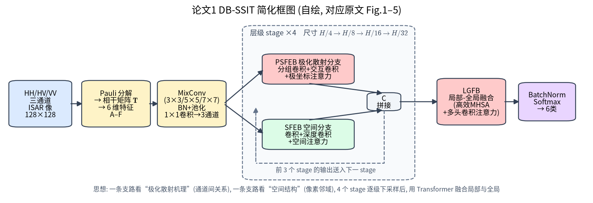

### 步骤 0：从极化数据到 6 维特征

!!! note "基础回链"

    一句话：把每个像素的 2×2 散射矩阵换算成 6 个“物理含义明确的实数”。手算过程见例题 3.1–3.3（→ 第 3.3、3.4 节）。

对每个像素做 Pauli 分解得到 $\mathbf k_{3P}$（第 3 章式 (3.3)），构造相干矩阵 $\mathbf T$，再计算 A–F 六个特征（第 3.4 节表格；原文式 (4)–(9)）。作者认为这样**既保留了极化散射的幅度差异，又避免直接处理复数数据的复杂性**（原文 Sec. III）。

### 步骤 1：预处理模块（原文 Fig. 2）

!!! note "基础回链"

    一句话：用大小不同的卷积核同时看“细节”和“轮廓”，再用 1×1 卷积压缩通道。卷积、池化、BN 见第 5.3、5.4 节；1×1 卷积就是 $k=1$ 的式 (5.5)。

- 6 维特征平均分成 3 组（每组 2 通道），分别用 3×3、5×5、7×7 卷积核做 **MixConv**，聚合为 32 通道——不同尺寸卷积核捕捉不同尺度的极化–空间特征；
- BN + 2×2 最大池化（步长 2）降维；
- 两个 1×1 卷积：32 → 6（保留关键极化信息）→ 3（匹配后续模块输入）。

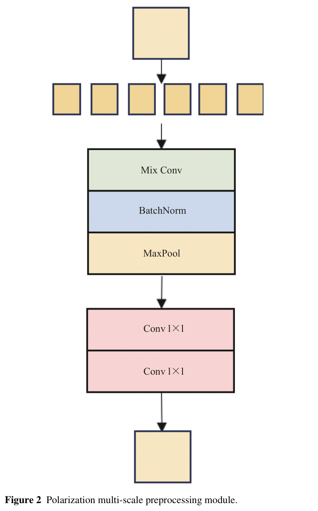{ width="55%" loading=lazy }

> **读图：** 从上往下看：6 维极化特征先做多尺度卷积、BatchNorm 和池化，再经两个 1×1 卷积压缩通道，正好对应上面步骤 1 的文字。

### 步骤 2：4 个层级 Stage（原文 Fig. 1）

!!! note "基础回链"

    一句话：两条分支并行——一条按极化模式分组提取“散射机理”特征，一条提取“空间形状”特征，然后拼接。分组卷积见例题 5.6，空间注意力的 sigmoid 权重见第 6.1.1 节。

网络由 4 个 stage 堆叠，特征图尺寸依次为 $H/4, H/8, H/16, H/32$。每个 stage 内：

- **PSFEB（极化散射特征提取块，原文 Fig. 3）**：patch embedding 后，
  1. **分组卷积**（3×3，组数 $G = C/C_p$，每组对应一种极化模式）——先在“同一种极化”内部提特征；
  2. **交互卷积**——再让不同极化通道之间交换信息（捕捉交叉极化关系）；
  3. **极坐标注意力 PCA**：沿水平、竖直方向分别计算**均值**（XMean、YMean）与**方差**（XVar、YVar）（原文式 (16)–(19)）。均值刻画极化散射的全局能量分布，方差刻画与几何结构和散射机理相关的局部起伏；拼接后经分组卷积与 ECA 通道注意力，生成两个方向的权重，对特征重新加权。
- **SFEB（空间特征提取块，原文 Fig. 4）**：3×3 卷积 → 3×3 深度卷积 → 3×3 卷积；然后是空间注意力：沿通道做平均和最大池化（原文式 (20)–(22)），用 3/5/7 多尺度深度可分离卷积、1×1 卷积、BN、LeakyReLU(0.01)、sigmoid 得到空间权重并相乘。
- 两分支输出**拼接（C）**后进入下一个 stage。

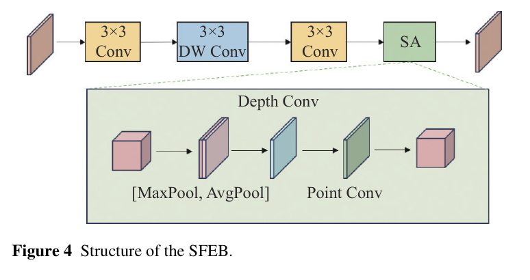{ width="80%" loading=lazy }

> **读图：** 上排是主干：3×3 卷积 → 3×3 深度卷积 → 3×3 卷积 → 空间注意力 SA；下方虚线框展开了 SA（MaxPool 与 AvgPool 拼接后卷积）。SFEB 与 PSFEB 并列，构成“双分支”中的空间分支。

### 步骤 3：局部–全局融合块 LGFB（原文 Fig. 5）

!!! note "基础回链"

    一句话：用自注意力把相距很远的部件联系起来，同时通过对 K 池化减少计算量。自注意力三步（打分 → softmax → 加权）见例题 6.1；计算量随 token 数平方增长见第 6.1.2 节。

- **E-MHSA（高效多头自注意力）**：$Q,K,V$ 由 1×1 卷积得到，再对 $K$ 做空间平均池化得到 $K_{avg}$，注意力为 $\mathrm{softmax}(QK_{avg}^T/\sqrt d)V$（原文式 (23)–(26)）。池化后 key 的数量变少，计算量大幅降低；
- **MHCA（多头卷积注意力）**：弥补 E-MHSA 对通道细节捕捉不足；
- **LFFN（局部前馈网络）**：3×3 深度卷积（步长 1、填充 1）+ ReLU + 1×1 逐点卷积。

最后 BatchNorm + Softmax 输出 6 类概率。

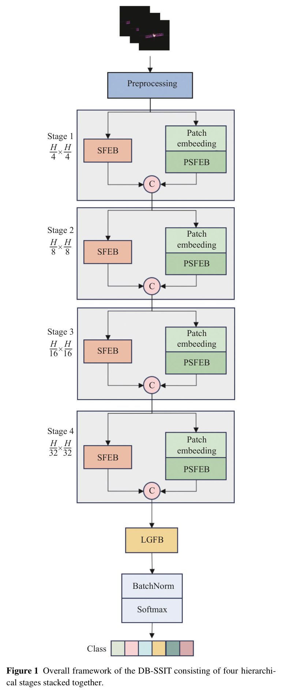

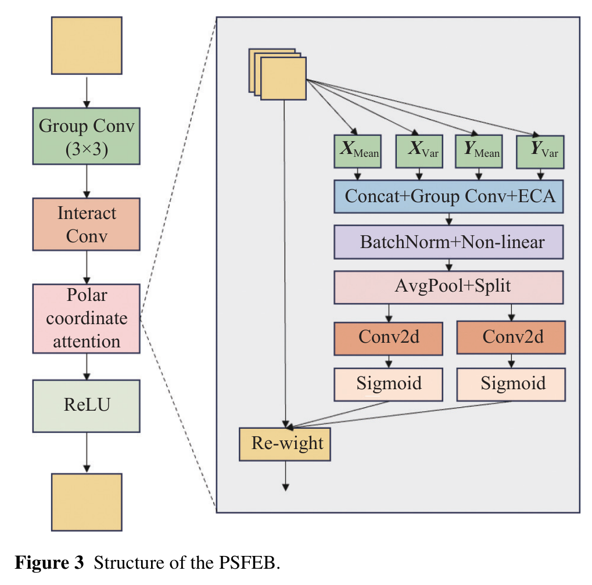

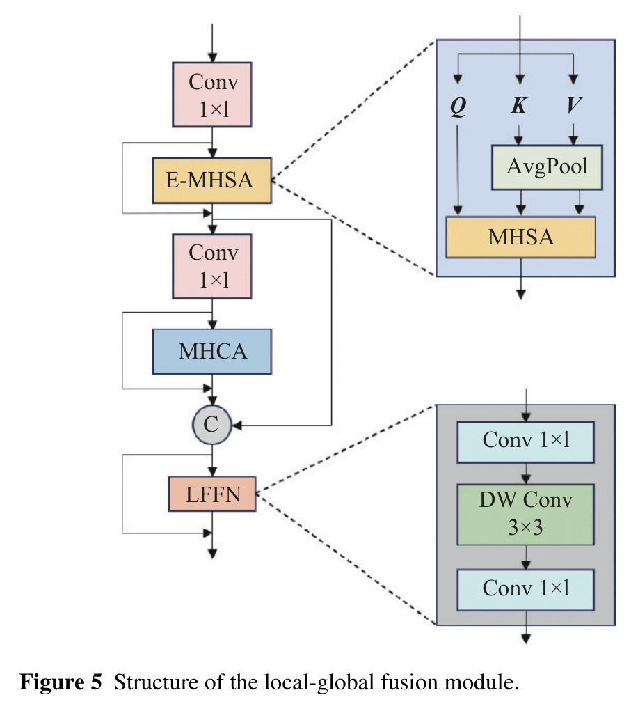{ width="70%" loading=lazy }

> **读图：** 左列是主干，右侧两个灰框分别放大了带池化的多头自注意力（E-MHSA）和 LFFN（1×1 卷积 → 3×3 深度卷积 → 1×1 卷积）。看图时重点找“全局注意力”和“局部卷积”是怎样交替出现的。

## 7.4 数据集

| 项目 | 内容（原文 Sec. IV-1 与 Table 1） |
|---|---|
| 类别 | 6 类空间目标（正文未给出具体类别名称） |
| 原始样本 | 每类 28 幅，每幅含 HH、HV、VV 三个极化通道 |
| 雷达参数 | 中心频率 220 GHz，带宽 10 GHz，俯仰角 75°，方位角 80°–83° |
| 图像尺寸 | 裁剪并缩放到 128×128（原文 Fig. 7） |
| 扩增 | 随机旋转（–180° 到 180°）、水平/竖直翻转、高斯噪声（μ=0，σ=0.05）、椒盐噪声（密度 0.1），共扩增到 3024 幅 |
| 划分 | 训练 : 验证 : 测试 = 7 : 2 : 1 |

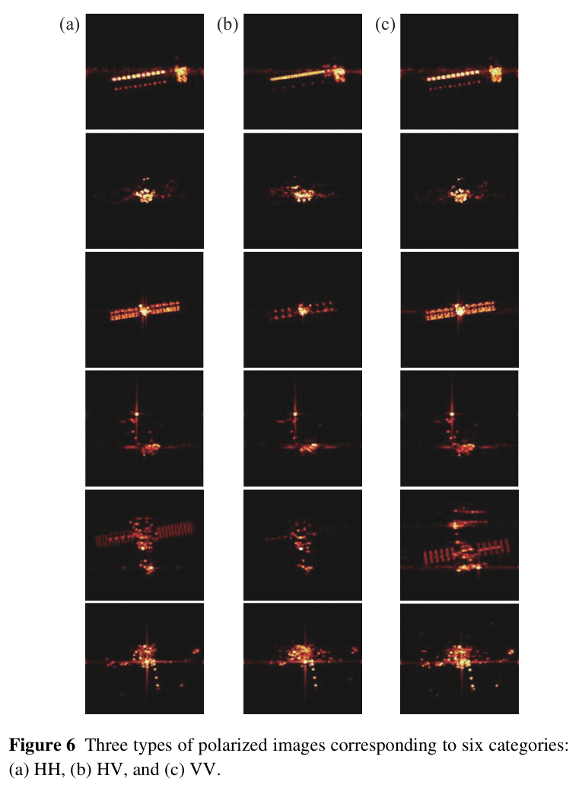

!!! info "直觉"

    原文还提到“采用平均加权策略由三路回波生成极化 ISAR 图像”，但没有给出更多细节【存疑：具体加权方式不明】。

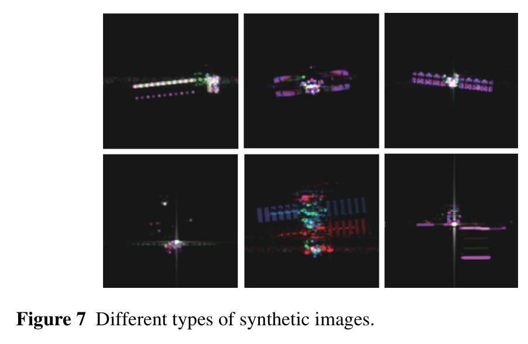{ width="80%" loading=lazy }

> **读图：** 这是送入网络前的合成图像示例，可与上面 Fig. 6 的单极化图对照。具体合成方式以原文正文为准。

## 7.5 实验设置与结果

**训练设置**：RTX 3090；AdamW，初始学习率 1e-4，权重衰减 1e-3；StepLR 每 10 个 epoch 乘 0.1；batch size 32；100 个 epoch；交叉熵损失；随机种子 42；保存验证集精度最高的模型。所有对比方法采用相同超参数。

**表 7-1 对比实验（原文 Table 2，各类精度 %）**

| 模型 | C1 | C2 | C3 | C4 | C5 | C6 | OA (%) | AA (%) | Kappa | FLOPs | Params |
|---|---|---|---|---|---|---|---|---|---|---|---|
| ResNet50 | 94.34 | 33.96 | 70.37 | 94.34 | 81.13 | 18.52 | 65.31 | 65.44 | 0.5838 | 1.35G | 23.52M |
| ST-MC-DCNN | 100 | 88.68 | 94.44 | 100 | 100 | 90.74 | 95.62 | 95.64 | 0.9475 | 2.70G | 14.78M |
| Lw-PSCNN | 98.11 | 98.11 | 92.59 | 98.11 | 100 | 88.89 | 95.94 | 95.97 | 0.9513 | 0.61G | 12.72M |
| Swin Transformer | 83.02 | 81.13 | 92.59 | 83.02 | 100 | 94.44 | 89.06 | 89.03 | 0.8687 | 2.12G | 27.52M |
| ViT | 100 | 92.45 | 98.15 | 98.11 | 100 | 88.89 | 96.25 | 96.27 | 0.9550 | 5.56G | 85.70M |
| **DB-SSIT** | 98.11 | 100 | 100 | 98.11 | 100 | 100 | **99.38** | **99.37** | **0.9925** | 3.99G | **1.91M** |

解读：

- 相比第二名 ViT，OA、AA、Kappa 分别提升 3.13%、3.10%、0.0375（可由表中数据直接验算：99.38 − 96.25 = 3.13）；
- 参数量仅 1.91 M，是 ViT 的约 1/45；但 FLOPs（3.99 G）并不低，作者也承认“多次交互融合导致 FLOPs 较高”；
- ResNet50 在 Class 6 只有 18.52%，作者解释为 Class 6 边缘信息丰富，局部卷积难以建模。

**表 7-2 消融实验（原文 Table 3）**

| PSFEB | SFEB | LGFB | OA (%) | Kappa |
|---|---|---|---|---|
| ✓ | | | 71.25 | 0.6550 |
| | ✓ | | 95.00 | 0.9400 |
| ✓ | ✓ | （在分类器处拼接） | 98.44 | 0.9813 |
| ✓ | ✓ | ✓ | 99.38 | 0.9925 |

解读：单独的极化分支只有 71.25%，单独的空间分支 95.00%，二者结合 98.44%——**极化分支单独不强，但与空间分支互补**；LGFB 再带来 0.94% 的提升。

**可视化**：原文 Fig. 8 用 Grad-CAM 对比 Class 1、5、6 的热力图；Fig. 9 为 t-SNE；Fig. 10 为混淆矩阵。

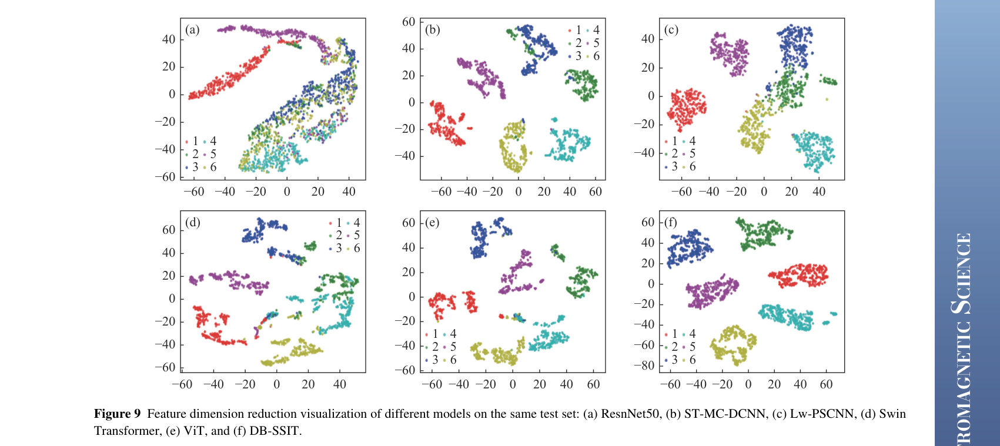{ width="100%" loading=lazy }

> **读图：** 每个点是一个测试样本，颜色代表类别。簇越紧凑、不同颜色分得越开，说明特征越容易区分。t-SNE 只能定性比较，布局本身没有物理意义。

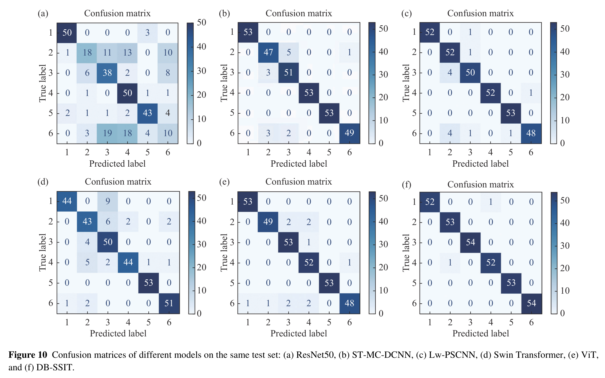{ width="100%" loading=lazy }

> **读图：** 行是真实类别、列是预测类别：对角线越深越好，非对角格子说明哪两类容易混淆。可以比较最后一幅 DB-SSIT 与其他模型的非对角元素。

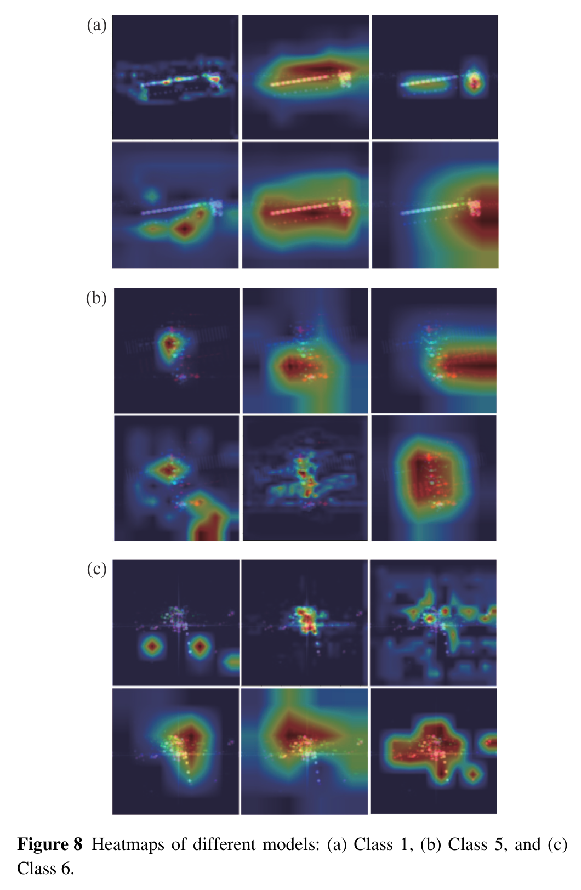

## 7.6 优点与局限

**优点**

- 物理先验与网络结构结合得自然：分组卷积 ↔ 极化模式，交互卷积 ↔ 交叉极化，均值/方差 ↔ 散射能量与结构起伏；
- 模型很轻（1.91 M 参数），适合小数据集；
- 消融清楚地展示了两个分支的互补性。

**局限（部分为本文作者的分析）**

1. **数据规模很小**：原始只有 6 × 28 = 168 幅，俯仰角单一（75°），方位只有 80°–83°（3°）；
2. **数据泄漏风险**：原文先把数据扩增到 3024 幅、再按 7:2:1 划分，但未说明是“先划分后扩增”还是“先扩增后划分”。若是后者，测试集中可能有训练图的旋转/翻转/加噪版本，精度会偏高【存疑】；
3. 没有跨姿态、跨俯仰角、实测噪声等泛化实验；类别名称未给出；
4. 文中一些细节不一致：FFN 部分正文说 GELU，原文式 (12) 写的是 ReLU 形式【存疑】；特征 D 的分母印刷为 $\sqrt{T_{11}T_{33}}$【存疑】。

## 7.7 本科生可以复现什么

- **6 维特征计算**：本文 `code/isar_core.py::coherency_6d` 与 `code/dbssit_lite.py::pol_features_torch` 已按原文公式实现（D 同时给出原文印刷版与常见版）；
- **简化版网络**：`code/dbssit_lite.py` 实现了“MixConv 预处理 + 4 个 stage 的双分支 + 简化 LGFB”的骨架（**教学简化版，非官方代码**，参数约 1.23 M），可直接用课题组的太赫兹数据训练；
- **建议的严谨实验**：先按原始 168 幅划分训练/测试，再只对训练集扩增，对比与原文的精度差异——这本身就是一个很好的本科研究小课题。

## 7.8 自测题

1. 为什么 DB-SSIT 不直接把 HH/HV/VV 的幅度作为 3 通道输入，而是先转成 6 维特征？这样做丢掉了什么信息？
2. PSFEB 中“分组卷积”和“交互卷积”分别对应什么物理含义？
3. 根据表 7-2，为什么单独的 PSFEB 只有 71.25%，而与 SFEB 结合后达到 98.44%？
4. 本文系统带宽 10 GHz，距离分辨率是多少？若方位积累角为 3°、载频 220 GHz，横向分辨率约为多少？（提示：$\lambda \approx 1.36$ mm）
5. 如何设计实验来检验本文结果是否存在“扩增后划分”导致的数据泄漏？

!!! abstract "小结"

    DB-SSIT 是“物理先验 + 轻量混合架构”的典型例子：6 维极化特征作为输入，极化分支与空间分支并行提取，Transformer 融合局部与全局。它在小规模太赫兹全极化数据集上取得了 99.38% 的 OA，但由于数据规模、姿态范围和划分方式的限制，结论的泛化性还需要更大、更严格的实验来验证。
