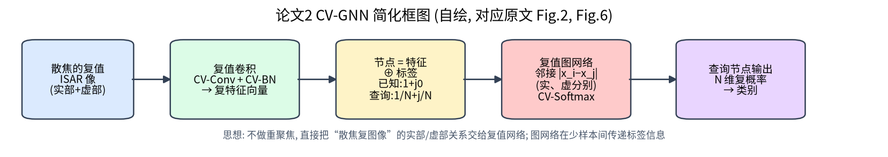
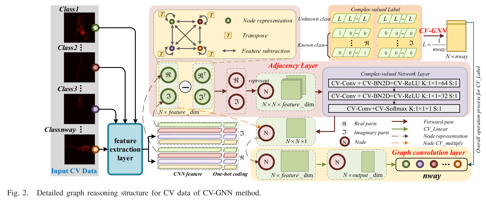
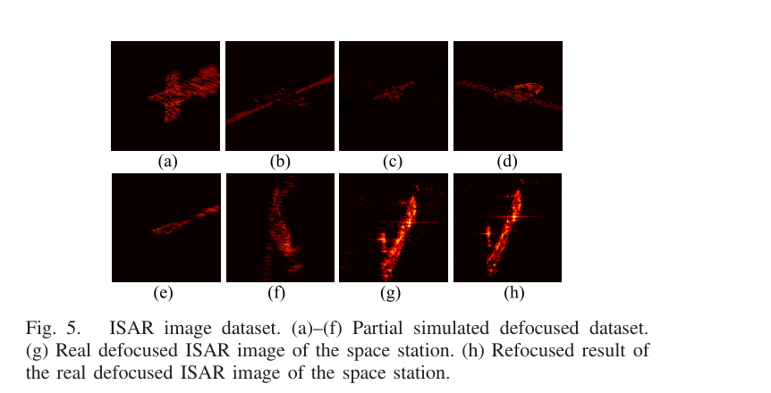

# 第 8 章 CV-GNN —— 不重聚焦，直接识别散焦的复值 ISAR 像

!!! tip "本章目标"

    1. 理解“机动 → 高阶相位 → 散焦”的物理链条，以及作者“不重聚焦、直接用复数识别”的思路；
    2. 掌握复值 GNN 的节点构造、邻接矩阵、CV-Softmax 与复值损失；
    3. 正确解读 Table II，并认识该文实验协议描述上的不足。

!!! note "基础回链"

    **读这一章前，建议先看：** 复数与 I/Q（→ 第 0.1、0.2 节）；非匀速转动导致散焦（→ 第 2.5 节，例题 2.4）；运动补偿与重聚焦（→ 第 2.6 节）；复值卷积与复批归一化（→ 第 6.5 节，例题 6.5）；少样本 GNN 的消息传递（→ 第 6.2 节，例题 6.2）；N-way K-shot（→ 第 6.3 节）。

## 8.1 基本信息

- **题目**：Complex-Valued Graph Neural Network on Space Target Classification for Defocused ISAR Images
- **作者**：Yun Zhang, Haoxuan Yuan, Hongbo Li（通讯）, Chenxi Wei, Chengxin Yao；哈尔滨工业大学
- **出处**：IEEE Geoscience and Remote Sensing Letters, vol. 19, 2022, Art. no. 4512905, doi: 10.1109/LGRS.2022.3185709
- **代码**：原文称将公开于 github.com/yhx-hit/cv_gnn（本文未核实其可用性）

**一句话概括**：机动空间目标的 ISAR 像会散焦，重聚焦又慢又不彻底；作者认为散焦信息藏在复数像的实部与虚部关系里，于是设计了全复值的特征提取 + 图神经网络，在少样本条件下直接对散焦复图像分类。

## 8.2 背景与动机

- 空间目标机动或调整姿态时，回波中出现**高阶相位项**，导致 ISAR 像散焦（原文 Fig. 1 给出天基 ISAR 成像几何以及机动目标与慢速目标的成像结果对比）；
- 回波模型（原文式 (1)–(2)）：

  $$s(t,t_m) = \sum_k A_k\,\mathrm{sinc}\Big(B\big(t - 2R_k(t_m)/c\big)\Big)\exp\big(j\varphi_k(t_m)\big),\qquad \varphi_k(t_m) = \varphi_0 + 2\pi\sum_q C_{k,q}\,t_m^q .$$

  第一项是距离压缩后的 sinc 峰（→ 式 (1.12)），第二项是相位。$q=1$ 的项就是普通多普勒（→ 第 2.2 节）；$q\ge2$ 的高阶项让多普勒随时间变化，造成散焦（→ 例题 2.4）；
- 传统做法是先估计高阶系数、重聚焦（原文式 (3)），再分类。问题：重聚焦存在残余相位误差，且计算量大；
- 现有分类模型多为实值网络，只用幅度，**忽略了实部与虚部之间关系所蕴含的高阶项信息**；
- 同时，空间目标样本少，需要少样本方法。

## 8.3 方法分步讲解

### 步骤 1：复值特征提取

!!! note "基础回链"

    一句话：网络直接“吃”复数 ISAR 像，不丢掉相位。复卷积 = 4 次实卷积（式 (6.8)），复 BN = 2×2 协方差白化（式 (6.9)）。

输入为 $N\times1\times128\times128$ 的复数 ISAR 数据，经过若干 **CV-Conv + CV-BN2D** 层（复卷积、复批归一化，第 6.5 节），再经 **CV-Linear** 压缩成 1 维复特征向量（原文 Fig. 6 给出了详细的层配置）。

### 步骤 2：构造图节点

!!! note "基础回链"

    一句话：每个样本是一个节点，“特征 + 标签”拼在一起；查询样本的标签先填“均匀分布”，表示还不知道。对应第 6.2 节“少样本 GNN”。

每个样本是一个节点：**复特征向量 ⊕ 标签编码**。

- 已知标签的支持样本：标签编码为 one-hot，取值 $1 + j0$；
- 未知的查询样本：标签编码为均匀分布 $1/n_{way} + j\,(1/n_{way})$。

### 步骤 3：邻接层与图卷积（原文 Fig. 3、Fig. 4）

!!! note "基础回链"

    一句话：特征越像的两个样本，连边越强；然后像例题 6.2 那样“聚合邻居 → 变换”，让查询节点从相似的支持节点那里拿到标签信息。

- **邻接矩阵**：节点特征“减去自身的转置”取绝对值得到关系，即 $|x_i - x_j|$，实部、虚部分别计算，再经 **CV-Softmax**：$\sigma(\mathrm{Re}) + j\,\sigma(\mathrm{Im})$（原文式 (5)）；
- **图卷积**：$\mathbf x^{(k+1)} = \rho\big(\sum_{B\in\mathcal A} B\,\mathbf x^{(k)}\,\theta\big)$（原文式 (4)），其中乘法按复数规则展开（原文式 (6)）。

### 步骤 4：输出与损失

!!! note "基础回链"

    一句话：查询节点输出每类的“复概率”，对实部、虚部分别算交叉熵类损失。交叉熵见第 5.2 节例题 5.3。

输出为 $N\times n_{way}$ 的矩阵，第一行对应查询样本的各类复概率。损失函数（原文式 (7)）对实部和虚部分别计算交叉熵类损失再组合，形式为
$$L = -\tfrac12\Big(\overline{\ln\sigma(\mathrm{Re})\odot l}\Big)^2 - \tfrac12\Big(\overline{\ln\sigma(\mathrm{Im})\odot l}\Big)^2,$$
其中 $l$ 为 one-hot 标签，$\odot$ 只取正确类别的值。原文式 (8)–(13) 推导了复值 BN（2×2 协方差白化）和 CV-Linear 的反向传播。

## 8.4 数据集

| 项目 | 内容（原文 Sec. III-A、Table I） |
|---|---|
| 仿真目标 | 8 类：NSS-7, KH-4, Tstar-1, FM5, KH-12, Insat-1, MS-19, CZ-1，姿态连续变化的散焦复值 ISAR 数据 |
| 实测数据 | 高分三号（Gaofen-3）卫星获取的空间站散焦 ISAR 像（原文 Fig. 5(g)，重聚焦结果见 Fig. 5(h)） |
| 样本数 | 每类仿真 100 幅，其中 30 幅用于训练，其余测试 |
| 仿真参数 | 带宽 240 MHz，载频 5.4 GHz，转角 –1.92°～1.92°，转速 0.1 rad/s，转动加速度 5000 rad/s²（原文印刷值），图像 128×128 |

!!! info "直觉"

    根据式 (1.13)，240 MHz 带宽对应距离分辨率 0.625 m。

## 8.5 实验设置与结果

**设置**：Intel i7 3.39 GHz + Quadro P4000；Xavier 初始化；学习率 1e-4；所有方法训练 3000 次迭代；每个方法重复 10 次；指标为平均精度与 Kappa 系数。

**消融 1（原文 Fig. 7，损失曲线）**：在聚焦数据上，CV-GNN 与 RV-GNN 的损失曲线相近；在散焦数据上，RV-GNN 的损失在约 0.2 附近波动，CV-GNN 能收敛——说明复值信息对散焦数据更关键。

**消融 2（原文 Fig. 8）**：当训练类别数达到 5、每类样本达到 14 时，CV-GNN 精度超过 90%，而 CV-CNN 只有约 70%——说明 GNN 的少样本推理能力。

**表 8-1 对比实验（原文 Table II，随机选取 5 类、每类 20 个样本训练；各列为每类精度 %）**

| 方法 | NSS-7 | KH-4 | Tstar-1 | FM5 | KH-12 | Insat-1 | MS-19 | CZ-1 | 实测 | 时间 (s) |
|---|---|---|---|---|---|---|---|---|---|---|
| CV-CNN | 80.00 | 77.14 | 75.71 | 77.14 | 80.00 | 78.57 | 75.71 | 74.29 | 87.32 | 0.951 |
| ProtoNets | 78.57 | 82.86 | 75.71 | 91.43 | 84.29 | 80.00 | 88.57 | 78.57 | 89.11 | 0.122 |
| RV-GNN | 78.57 | 87.14 | 81.43 | 87.14 | 80.00 | 87.14 | 85.71 | 87.14 | 98.32 | 0.198 |
| MetaNet | 87.14 | 85.71 | 88.57 | 90.00 | 85.71 | 85.71 | 87.14 | 88.57 | 97.36 | 0.405 |
| Refocusing | 95.71 | 94.29 | 87.14 | 94.29 | 91.43 | 98.57 | 91.43 | 95.71 | 100.00 | 13.290 |
| TCML | 98.57 | 94.29 | 91.43 | 92.86 | 90.00 | 100.00 | 90.00 | 95.71 | 100.00 | 0.532 |
| **CV-GNN** | **100.00** | 94.29 | **100.00** | **97.14** | **100.00** | 92.86 | **94.29** | 94.29 | **100.00** | 1.190 |

解读：

- 作者称 CV-GNN 的平均精度比 RV-GNN 高 11.2%。按表中 9 列简单平均：CV-GNN 96.99%，RV-GNN 85.84%，差 11.14 个百分点，与原文的 11.2% 基本一致（只算 8 个仿真类则差 12.3 个百分点）；
- “Refocusing”（先按式 (3) 重聚焦再用 CNN 分类）精度也很高，但单张 13.290 s，比 CV-GNN 慢 10 倍以上；
- CV-GNN 比 RV-GNN 慢（1.190 s vs 0.198 s），原因是复卷积的计算复杂度约为实卷积的 4 倍。

!!! note "说明"

    【存疑】Table II 说明为“随机选取 5 类、每类 20 个样本训练”，但表中给出了全部 8 类仿真目标 + 实测共 9 列的精度；而数据集部分又写“每类 30 幅训练”。原文未详细说明每一列是在何种 N-way 任务下测得的、实测数据如何参与任务，评测协议不够清晰。

## 8.6 优点与局限

**优点**：

- 思路新颖、物理动机明确：**把“散焦”从需要消除的误差，变成可利用的信息**；
- 全复值网络（含复值 BN 与反向传播推导），可作为复值网络入门的范例；
- 用到了真实的天基 ISAR 数据（高分三号空间站像）。

**局限**：

- 快报（Letter）篇幅限制，实验协议、网络细节描述较简略；
- 仿真目标转角仅 ±1.92°，类别 8 个，规模较小；
- 推理较慢；且需要复数数据，很多公开数据只提供幅度图。

## 8.7 本科生可以复现什么

- 用 `code/isar_core.py` 的 `echo_turntable(..., alpha_ratio>0)` 生成**散焦**复数像数据集；
- 用 PyTorch 原生复数张量（`torch.cfloat`）实现复卷积：`conv_r(x.real) - conv_i(x.imag)` 与 `conv_r(x.imag) + conv_i(x.real)`；
- 对比三种输入：幅度、[实部, 虚部] 双通道、复值网络——在散焦数据上观察差异，即可验证论文的核心观点。

## 8.8 自测题

1. 为什么非匀速转动会让 ISAR 像在横向（而不是距离向）散焦？
2. CV-GNN 中查询节点的标签为何初始化为 $1/n_{way} + j\,(1/n_{way})$？
3. 一次复卷积需要几次实卷积？由此解释 CV-GNN 的推理时间。
4. “Refocusing”方法精度很高，为什么作者仍认为 CV-GNN 更有价值？
5. 如果让你设计实验验证“散焦信息藏在实部与虚部的关系中”，你会怎么做？

!!! abstract "小结"

    CV-GNN 的核心贡献是一种思路：对于散焦的机动目标，不一定要先把图像“修好”，可以让复值网络直接从复数数据中学习。这一思路在同一团队的 CvPGT（CvPGT）中得到延续和加强。
