# 第 9 章 MSN —— 用 Stacking 集成三个“性格不同”的分类器

!!! tip "本章目标"

    1. 理解集成学习中 Stacking（堆叠）的思想及其在小样本 ISAR 识别中的作用；
    2. 掌握三个基学习器（ResNet50+RAM、GCN、关系网络）与自适应加权 XGBoost 元学习器；
    3. 正确理解“K/N”的含义，读懂 Table III。

!!! note "基础回链"

    **读这一章前，建议先看：** 斑点噪声与 ISAR 像的稀疏性（→ 第 4.2 节）；ResNet 与残差连接（→ 第 5.4 节）；空洞卷积与注意力（→ 第 5.4、6.1 节）；少样本 GNN（→ 第 6.2 节）；关系网络（→ 第 6.3.2 节）；交叉熵与梯度下降（→ 第 5.2 节）。

## 9.1 基本信息

- **题目**：Meta-Learner-Based Stacking Network on Space Target Recognition for ISAR Images
- **作者**：Yun Zhang, Haoxuan Yuan, Hongbo Li（通讯）, Jiaying Chen（电子科技大学）, Muqun Niu；哈尔滨工业大学
- **出处**：IEEE JSTARS, vol. 14, 2021, pp. 12132–12148, doi: 10.1109/JSTARS.2021.3128938

**一句话概括**：深度模型参数多、空间目标标注样本少，单个模型容易过拟合；作者训练了三个结构迥异的基学习器，再用改进的 XGBoost 作为元学习器把它们的输出“集成”起来，在 5 类仿真卫星上把总体精度提到 99.78%（K/N = 1.2）。

## 9.2 背景与动机

- **矛盾**：深度模型参数空间大 ↔ 空间目标标注样本不足（原文摘要）；
- **ISAR 特有困难**（原文 Fig. 3）：细粒度、对入射角敏感、角闪烁、成像平面变化；
- **想法**：不同类型的模型（CNN、图网络、度量学习网络）犯的错误不同，把它们组合起来可以互补。这就是集成学习中的 **Stacking**：第一层若干基学习器输出预测，第二层元学习器以这些预测为特征再做一次学习。

!!! warning "易错点"

    注意：这里的 “Meta-Learner” 是 Stacking 中“第二层学习器”的意思，**与少样本学习中的“元学习”（meta-learning，学会学习）不是一回事**。

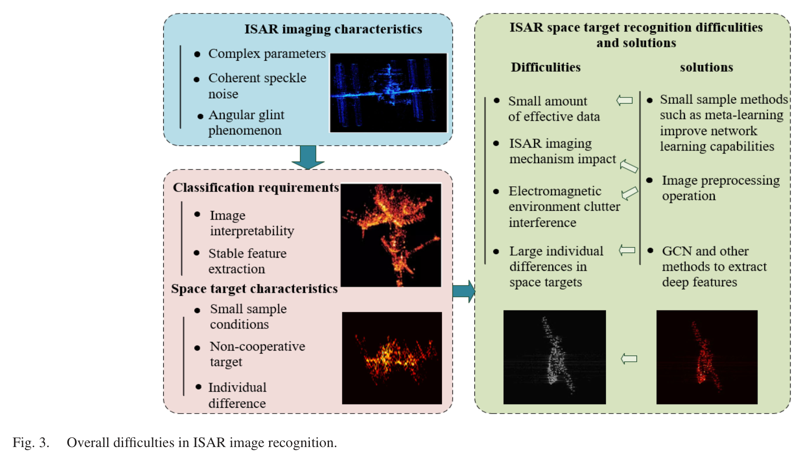{ width="90%" loading=lazy }

> **读图：** 左侧列出 ISAR 成像特点与分类要求，右侧把“难点”和“对应对策”配成对。可以把它当作 MSN 设计动机的总览。

## 9.3 方法分步讲解

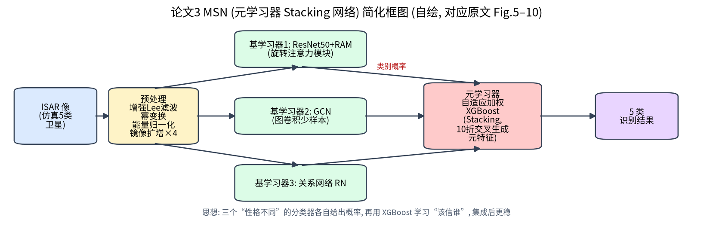

### 步骤 1：预处理（原文 Fig. 4）

!!! note "基础回链"

    一句话：先去斑点噪声、再把弱散射点“提亮”、最后统一能量尺度并镜像扩增。幂变换 $J=H^\alpha$ 在 $\alpha<1$ 时压缩动态范围，例如 $0.01^{0.5}=0.1$、$1^{0.5}=1$，弱点与强点的比值从 1:100 变为 1:10。

1. **增强 Lee 滤波**：ISAR 像有乘性斑点噪声 $I = x\cdot u$；Lee 滤波 $\hat x = \bar I + k(I - \bar I)$，增强版按局部变差系数把图像分为三类区域（均匀区、非均匀区、强点目标区；阈值 $C_{min}=C_n$，$C_{max}=\sqrt{1+2/L}$）分别处理（原文式 (1)–(4)）；
2. **幂变换** $J = H^{\alpha}$（原文式 (5)）：压缩动态范围，让弱散射点更明显；
3. **能量归一化**（原文式 (6)）【存疑：抽取的公式形式不清，通常为 $K = J/\sqrt{\sum|J|^2}$】；
4. **数据扩增**：左右、上下镜像，扩增为原来的 4 倍。

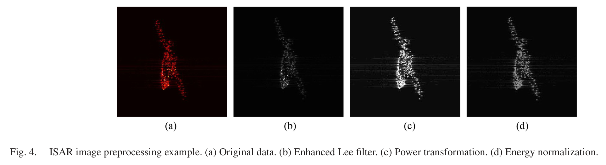{ width="100%" loading=lazy }

> **读图：** 从 (a) 到 (d) 依次看：滤波压低斑点噪声，幂变换让弱散射点更明显，能量归一化统一亮度尺度。

### 步骤 2：基学习器 1 —— ResNet50 + 旋转注意力模块 RAM（原文 Fig. 5–7）

!!! note "基础回链"

    一句话：把特征图转几个角度分别算注意力再平均，让网络对目标朝向不那么敏感。ResNet 见第 5.4 节，注意力见第 6.1 节。

ISAR 像中目标的方向随姿态变化，作者设计 RAM 来获得一定的旋转鲁棒性：

1. 把特征图按 K 个角度旋转（最近邻插值）；
2. Conv1（3×3 + ReLU）→ Conv2-1、Conv2-2（1×1 + Softmax）得到注意力图；Conv3（3×3 空洞卷积，膨胀率 2）+ BN；
3. 注意力加权求和（原文式 (10)），再对各旋转角度的结果取平均（原文式 (11)）。

RAM 插在每个 bottleneck 最后一个 ReLU 之后；ResNet50 使用 ImageNet 预训练、冻结卷积层，只训练全连接层与 RAM，输入 224×224。

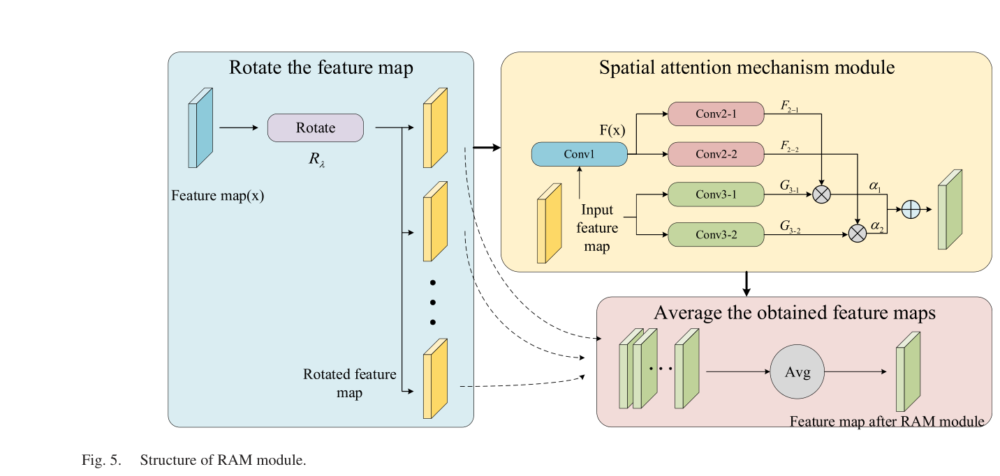{ width="85%" loading=lazy }

> **读图：** 左侧把特征图旋转出多个角度，中间分别做空间注意力，右侧取平均融合。目的是让注意力对目标姿态（旋转）更稳健。

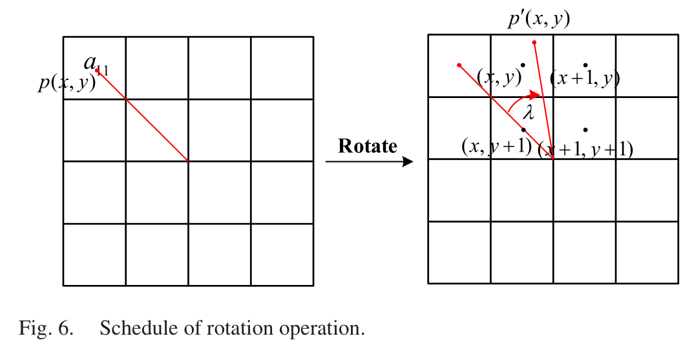{ width="60%" loading=lazy }

> **读图：** 演示像素坐标旋转后怎样映射回网格：旋转后的位置通常落在格点之间，需要用邻近像素插值。

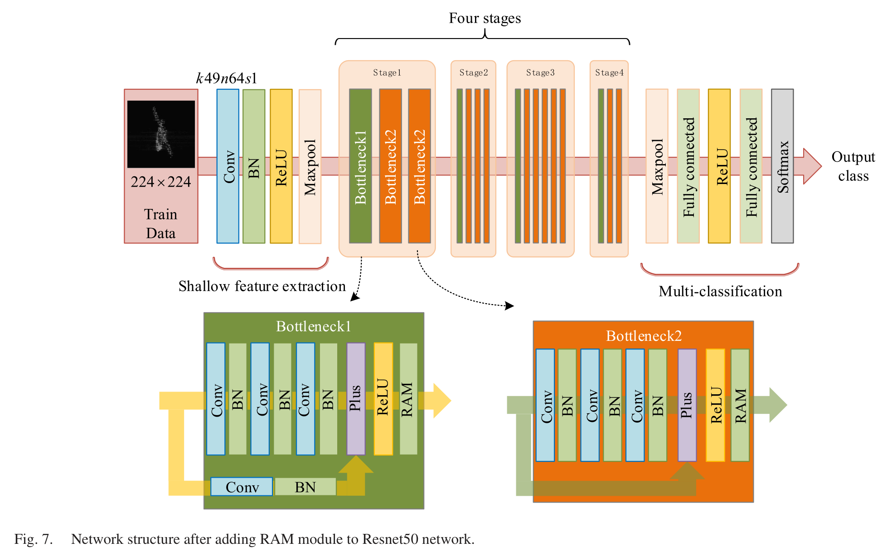{ width="90%" loading=lazy }

> **读图：** 上排是 ResNet50 的四个 stage，下方放大了插入 RAM 的瓶颈块，可以看出 RAM 放在哪一层。

### 步骤 3：基学习器 2 —— GCN（原文 Fig. 8）

!!! note "基础回链"

    一句话：样本当节点、相似度当边的少样本 GNN，计算过程同例题 6.2（→ 第 6.2 节）。

与第 6.2 节的少样本 GNN 相同：CNN 特征 ⊕ one-hot 标签作为节点，邻接 $A_{ij} = \mathrm{MLP}(|x_i - x_j|)$ 再按行 softmax（原文式 (13)–(14)），图卷积用 Leaky ReLU（原文式 (15)），交叉熵损失。

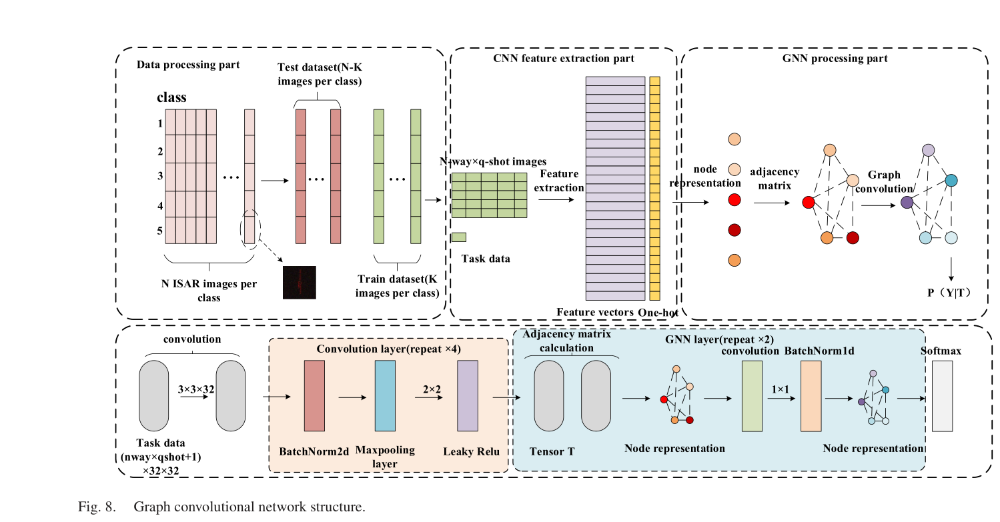{ width="90%" loading=lazy }

> **读图：** 流程是先提取特征，再把样本当节点、用学习到的相似度构图，最后做图卷积分类。与第 6.2 节的少样本 GNN 思路一致。

### 步骤 4：基学习器 3 —— 关系网络 RN（原文 Fig. 9）

!!! note "基础回链"

    一句话：让一个小网络学“两张图像不像”，输出 0–1 的分数（→ 第 6.3.2 节）。

嵌入网络 $f$ 提取特征，拼接后由关系模块 $g$ 输出 0–1 的关系分数 $r_{ij} = g(C(f(x_i), f(x_j)))$，以均方误差逼近 1（同类）/0（异类）（原文式 (17)–(18)）。

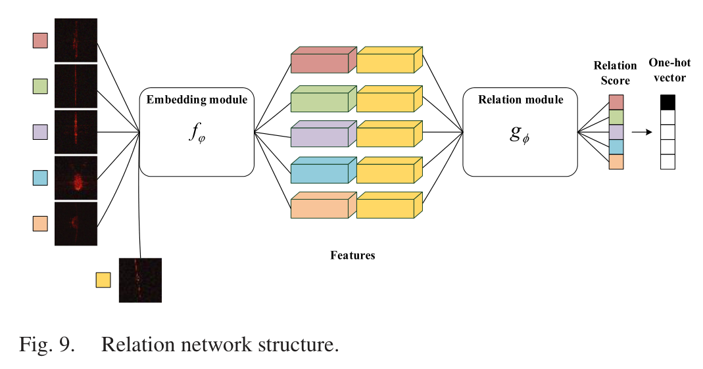{ width="75%" loading=lazy }

> **读图：** 嵌入模块 f 提取特征，把查询样本与每个支持样本的特征拼接后送入关系模块 g，输出关系分数，分数最高的就是预测类别。

### 步骤 5：元学习器 —— 自适应加权 XGBoost（原文 Fig. 10、Algorithm 1）

!!! note "基础回链"

    一句话：三位“专家”各自给出类别概率，第二层的 XGBoost 学习“该信谁、信多少”。这里的“元学习器”是 Stacking 的第二层，与第 6.3 节的少样本“元学习”不是一回事。

- **生成元特征**：用 K 折交叉验证（K = 10），每个基学习器对“没参与自己训练的那一折”输出类别概率，作为第二层的输入特征（避免元学习器看到“训练集上过于自信的预测”）；
- **自适应加权**：每个基学习器给出的概率向量的**方差**乘以一个可学习权重 $q_\alpha$ 作为样本权重（原文式 (19)）；$q_\alpha$ 初始为 1/3，用梯度更新，学习率 η = 0.1（原文式 (27)–(28)）。直觉：概率向量方差大 → 该基学习器“很有把握”；
- 初始预测设为最大概率而非 0.5（原文式 (25)）；分裂增益也加权（原文式 (26)）。

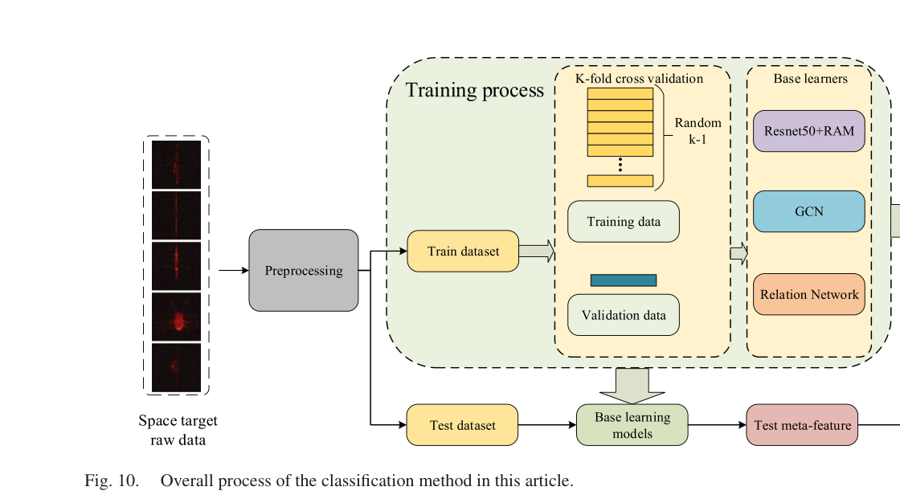

## 9.4 数据集

| 项目 | 内容（原文 Sec. IV-A） |
|---|---|
| 目标 | SolidWorks 建模的 5 颗卫星 sat1–sat5（原文 Fig. 11） |
| 散射点 | FEKO 在 1 GHz 下剖分网格，取网格角点作为散射点，共 500 个 |
| 雷达参数 | LFM，载频 5.52 GHz，带宽 300 MHz，脉宽 25.6 μs，采样率 2.5 MHz，转速 0.1 rad/s，初始角 –130° |
| 样本 | 每类 200 幅（不同转动周期） |
| 实测 | Tiangong-1（天宫一号）TIRA 雷达图像（FGAN/Fraunhofer FHR，2018），用 200 幅实测像替换第 1 类仿真像做验证（原文 Fig. 15、16） |

**K/N 的含义（很重要）**：K/N 是**每类训练样本数与测试样本数之比**，不是 K-shot。原文 Table I（每类）：

| K/N | 训练 / 测试（原始） | 扩增后（×4） |
|---|---|---|
| 0.2 | 33 / 167 | 132 / 668 |
| 0.7 | 82 / 118 | 328 / 472 |
| 1.2 | 109 / 91 | 436 / 364 |

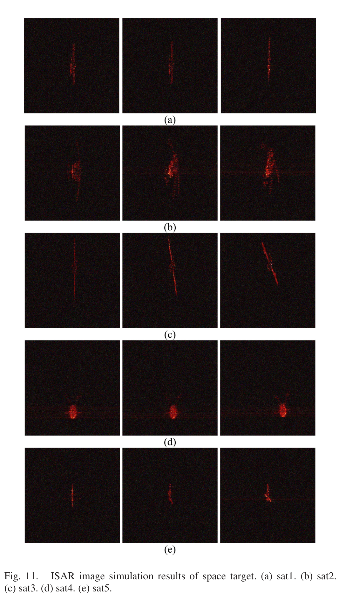

## 9.5 实验设置与结果

**训练设置**（原文 Sec. IV-B）：

| 学习器 | 设置 | 训练 / 验证精度 (%) |
|---|---|---|
| ResNet50+RAM | SGD 动量 0.9，权重衰减 4e-5，学习率 1e-4（FC 层 1e-3），50 epoch，batch 32 | 94.46±0.22 / 92.44±0.44 |
| GCN | batch 16，学习率 0.01，输入 32×32，12000 次迭代 | 98.90±0.22 / 94.46±0.22 |
| RN | 输入 84×84，batch 10，50000 次迭代，学习率 1e-3 | 96.44±0.22 / 94.68±0.44 |
| XGBoost | 学习率 0.4，最大深度 20，2000 次迭代，multi:softprob，num_class 5 | — |

（原文还列有参数 “ESR 0.8”，含义未说明【存疑】。）

**表 9-1 不同 K/N 下的总体精度（原文 Table III，%）**

| 方法 | K/N = 0.2 | K/N = 0.7 | K/N = 1.2 |
|---|---|---|---|
| Fine-tuned AlexNet | 70.24±0.44 | 80.90±0.44 | 89.56±0.44 |
| MAML | 72.22±0.22 | 80.24±0.22 | 90.24±0.22 |
| Siamese | 74.68±0.44 | 83.58±0.22 | 92.44±0.22 |
| Matching Net | 75.56±0.22 | 84.68±0.44 | 94.68±0.44 |
| ProtoNet | 78.90±0.22 | 88.68±0.22 | 98.90±0.22 |
| **MSN** | **82.44±0.22** | **91.34±0.44** | **99.78±0.22** |

解读：

- 在所有比例下 MSN 都最好；训练样本越少，优势越明显（K/N = 0.2 时比 ProtoNet 高 3.54 个百分点）；
- 混淆矩阵（原文 Tables IV–VII）给出的 Kappa：ResNet50+RAM 0.92，GCN 0.96，RN 0.94，MSN 0.99；

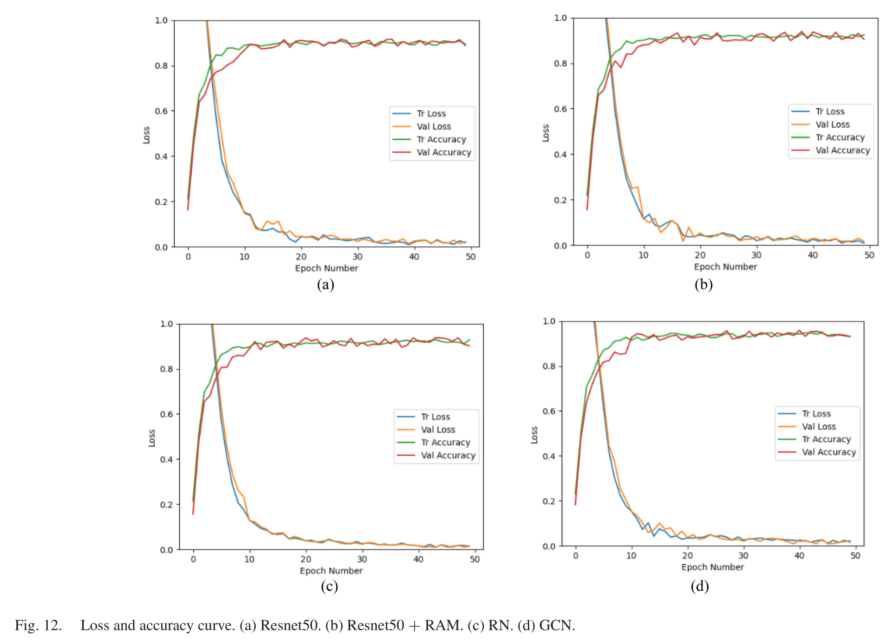{ width="100%" loading=lazy }

> **读图：** 四个基学习器各自的训练/验证曲线。重点看是否收敛、训练与验证之间有没有明显差距（过拟合）。

- 原文 Fig. 13 的 Grad-CAM 显示加入 RAM 后注意力更集中在目标上；Fig. 14 给出特征重要性分布（自适应加权 XGBoost 中 f0–f4 的得分为 28、54、50、35、58）；

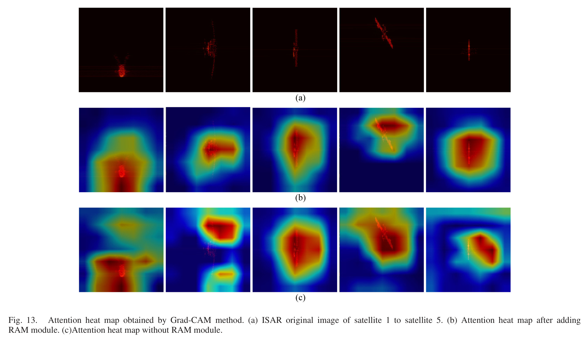{ width="100%" loading=lazy }

> **读图：** 热区越集中在目标散射区域越好。对照正文：加入 RAM 后注意力更集中在目标上。

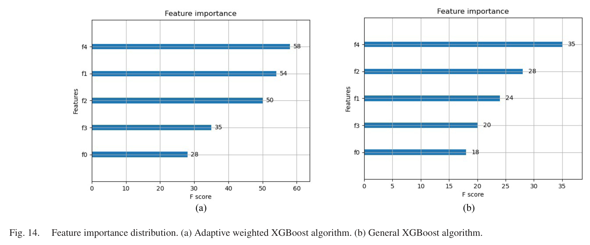{ width="100%" loading=lazy }

> **读图：** 纵轴是三个基学习器输出的各维特征，横轴是 XGBoost 给出的重要性。比较两幅图里重要性分布的差异，理解“自适应加权”改变了什么。

- 实测 Tiangong-1 实验（原文 Fig. 16）中，所有方法的分类置信度均超过 90%，MSN 最高。

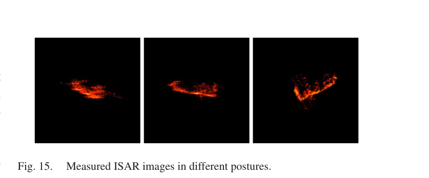{ width="75%" loading=lazy }

> **读图：** 这是实测验证用的天宫一号图像示例，与上面 Fig. 11 的仿真像对比，实测图像更不规则、背景更复杂。

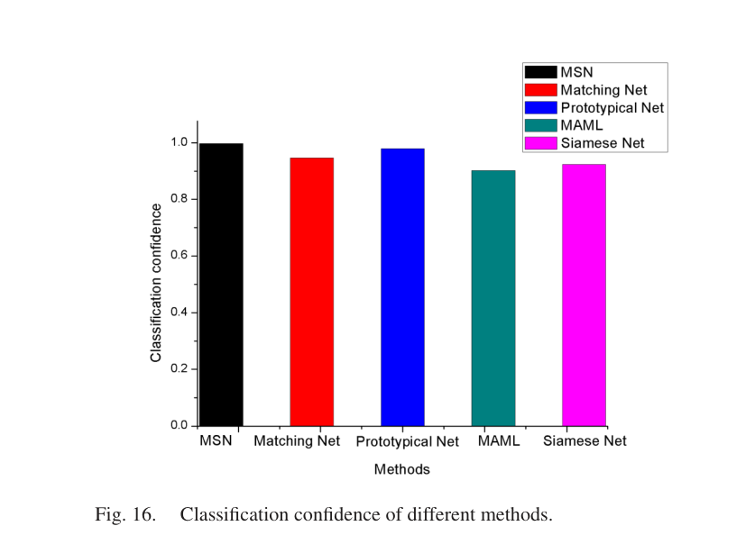{ width="60%" loading=lazy }

> **读图：** 柱高是各方法对实测样本的分类置信度。各方法都在 0.9 以上，差距不大，解读时不要过度放大。

!!! note "说明"

    【存疑】正文称 Table III 显示了 RAM 对 ResNet50 的提升，但 Table III 中并没有 ResNet50 / ResNet50+RAM 的行。另外，原文对 Fig. 14 中“自适应加权”与“普通 XGBoost”特征得分方差（132.8 vs 36.8）的解读与数值方向不完全一致。

## 9.6 优点与局限

**优点**：

- 思路朴素有效，**工程上很实用**：组合不同模型几乎总能提升稳定性；
- 预处理（滤波、幂变换）对 ISAR 稀疏图像很有借鉴意义；
- 使用了 Tiangong-1 实测数据。

**局限**：

- 需要训练 3 个深度模型 + 10 折交叉验证生成元特征，**训练成本高、流程复杂**；
- 类别只有 5 个，均为仿真；“小样本”是每类 33–109 张，并非 1/5-shot；
- 训练集与测试集来自同一批仿真（不同转动周期），类别不是“新类”，与后来的少样本论文（4、5、6）不可直接比较。

## 9.7 本科生可以复现什么

- 用 `project1_rd_dataset.py` 生成数据，分别训练 ResNet18（`project1_train_resnet18.py`）、原型网络（`project2_protonet.py`）与一个简单 SVM；
- 用 `sklearn` 的 `StackingClassifier` 或 `xgboost` 实现第二层集成，比较“单模型 vs 简单平均 vs Stacking”。

## 9.8 自测题

1. Stacking 中为什么要用 K 折交叉验证来生成元特征？如果直接用基学习器在训练集上的预测会怎样？
2. RAM 模块为什么要对特征图做多角度旋转再平均？这与 ISAR 的哪个难点对应？
3. K/N = 0.2 时，每类有多少张原始训练图、扩增后多少张？
4. 本文的“小样本”与 REMI 的“3-way 1-shot”有何本质区别？
5. 自适应加权 XGBoost 用“概率向量的方差”作为权重依据，背后的直觉是什么？可能有什么问题？

!!! abstract "小结"

    MSN 代表了“小样本问题的集成学习路线”：不追求单个模型的极致，而是让结构不同的模型互补。它是哈工大团队系列工作的起点；之后的 CV-GNN（2022）和 CvPGT（2024）转向了“复值 + 图网络”的少样本路线。
