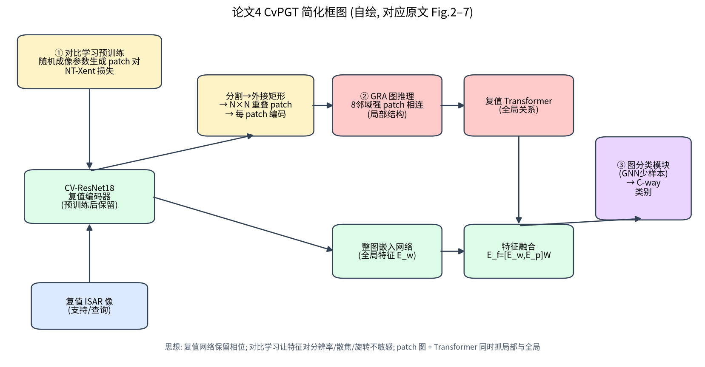
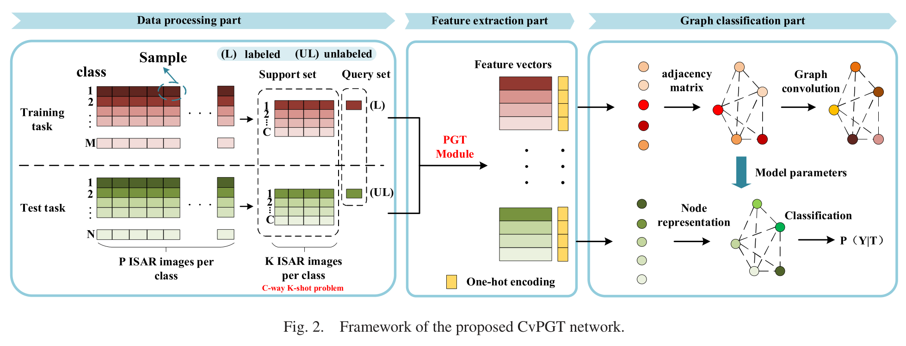
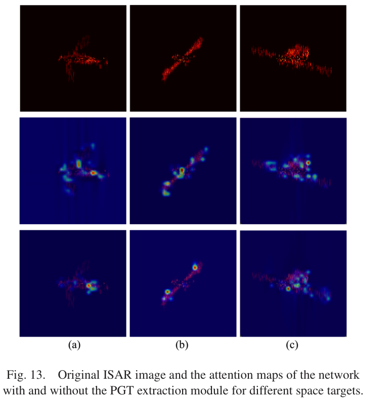

# 第 10 章 CvPGT —— 复值 Patch 图 Transformer 少样本识别

!!! tip "本章目标"

    1. 理解 CvPGT 的三大模块：复值对比学习预训练、Patch 图 Transformer（PGT）、图分类模块；
    2. 理解“用物理成像参数做对比学习增强”的巧思；
    3. 读懂 4 个测试任务、实验室实测验证与消融实验的结论。

!!! note "基础回链"

    **读这一章前，建议先看：** 分辨率与积累角（→ 第 2.4 节）、散焦与转动加速度（→ 第 2.5 节）；复值网络（→ 第 6.5 节）；对比学习与 NT-Xent（→ 第 6.4 节，例题 6.4）；图卷积（→ 第 6.2 节，例题 6.2）；自注意力与 Transformer（→ 第 6.1 节，例题 6.1）；少样本任务（→ 第 6.3 节）。

## 10.1 基本信息

- **题目**：Few-Shot Classification for ISAR Images of Space Targets by Complex-Valued Patch Graph Transformer
- **作者**：Haoxuan Yuan, Hongbo Li, Yun Zhang（通讯）, Muyao Li, Chenxi Wei；哈尔滨工业大学
- **出处**：IEEE Transactions on Aerospace and Electronic Systems, vol. 60, no. 4, Aug. 2024, doi: 10.1109/TAES.2024.3382222

**一句话概括**：在 CV-GNN的基础上，先用“随机成像参数”生成的复值图块做对比学习，让编码器对分辨率、散焦、旋转不敏感；再把图像切成重叠 patch、以 patch 为节点构图，用复值图推理（局部）+ 复值 Transformer（全局）提取特征；最后用 GNN 完成少样本分类。

## 10.2 背景与动机

- **少样本 + 大姿态变化 + 散焦**：机动空间目标受成像条件限制，样本少，姿态变化大，还会散焦；
- 现有少样本方法主要靠**数据增强与度量学习**，面对空间目标的这些问题效果有限；
- 实值网络丢失相位；只用**全局特征**不足以刻画目标的局部结构。

原文 Fig. 1 对比了经典分类与少样本分类：后者把数据组织成任务，每个任务含支持集 S 与查询集 Q（C-way K-shot）。

## 10.3 方法分步讲解

### 模块 1：复值对比学习（原文 Fig. 3）

!!! note "基础回链"

    一句话：同一目标用不同积累角、转动加速度、旋转角成像，得到“同一个人的不同照片”，让编码器学会对这些变化不敏感。NT-Xent 计算见例题 6.4；积累角 ↔ 分辨率见式 (2.8)，加速度 ↔ 散焦见例题 2.4。

- **正负样本构造**：用随机成像参数生成同一目标同一位置的 patch 对作为正样本——随机的**积累角 $\varphi_a$**（改变分辨率）、**转动加速度 $\omega_r$**（改变散焦程度）、**旋转角 $\theta_r$**（改变方向）。一个 batch 有 N 对 → 2N 个 patch，每对有 2N−2 个负样本；
- **编码器**：CV-ResNet18（复值 ResNet18）；
- **损失**：类 NT-Xent 形式（原文式 (1)），温度为 T；**相似度用复数版本**：实部余弦相似度 × 虚部余弦相似度（原文式 (2)）；
- 预训练好的编码器保留下来，供 PGT 模块使用。

!!! info "直觉"

    **为什么巧妙？** SimCLR 的增强是裁剪、颜色抖动等“视觉”变换；这里的增强直接来自**雷达成像物理**——网络学到的不变性正是 ISAR 需要的不变性（分辨率、散焦、姿态）。

### 模块 2：Patch 图 Transformer（PGT，原文 Fig. 4–6）

!!! note "基础回链"

    一句话：把目标切成小块，相邻且有目标的块连边，先用图卷积看局部结构（→ 例题 6.2），再用复值 Transformer 看全局关系（→ 例题 6.1）。

1. **切块**：阈值分割 → 目标外接矩形 → 划分为 $N\times N$ 个重叠 patch，每个 patch 用预训练编码器编码，得到节点特征 $F\in\mathbb C^{N^2\times D}$；
2. **建边**：两个 patch 在 8 邻域内、且二者的幅度和都超过阈值时相连（$A_{ij} = 1$）——只连接“有目标”的相邻块；
3. **GRA（图推理聚合）**：$\hat N_j = (AN_j + N_j)w$（复数乘法），$N_{j+1} = \mathrm{CvReLU}(\mathrm{CvBN1d}(\hat N_j))$（原文式 (4)–(6)）；CvBN1d 用 2×2 协方差白化（式 (7)–(8)）——提取**局部结构**；
4. **复值 Transformer**（原文 Fig. 6，式 (9)–(15)）：复数 $q,k,v$、$\mathrm{softmax}(qk^T/\sqrt{D_k})$、复值 LayerNorm、MLP，共 L 个块——提取**全局关系**；
5. **另一路**：整幅图像经嵌入网络（原文 Fig. 7）得到全局特征 $E_w$；
6. **融合**：$E_f = [E_w, E_p]\,w_f$（原文式 (16)–(17)）。

### 模块 3：图分类模块

!!! note "基础回链"

    一句话：与 CV-GNN、MSN 相同的少样本 GNN（→ 第 6.2 节）。

与 CV-GNN、MSN 的少样本 GNN 相同：$E_f$ ⊕ one-hot 作为节点，邻接 $\mathrm{MLP}(|x_i - x_j|)$ + softmax（原文式 (18)），Leaky ReLU 节点更新（式 (19)），交叉熵损失（式 (20)）。

## 10.4 数据集

| 项目 | 内容（原文 Sec. IV-A、Table I、II） |
|---|---|
| 目标 | 8 类，SolidWorks 建模 + FEKO 计算散射点：MRO, Sentinel-5, Skynet-5, Trace, Yantar-4KS1, CRS-1, SZ-5, CZ-1（原文 Fig. 8） |
| 雷达参数 | LFM，载频 10 GHz，带宽 5 GHz，PRF 5000 Hz，脉宽 200 μs，距离 200 km；RD 成像 |
| 样本 | 横滚角 0–360°，每 12° 一幅 → 每类 30 幅，224×224 |
| 训练类（基类） | MRO, Sentinel-5, Skynet-5, Trace, Yantar-4KS1；转速 RS = 0.1 rad/s，转动加速度 RA = 0.3 rad/s² |
| 测试类（新类） | CRS-1, SZ-5, CZ-1；4 个测试集：Set1 (RS 0.1, RA 0.3)、Set2 (0.1, 0.5)、Set3 (0.18, 0.3)、Set4 (0.18, 0.5) |
| 实验室实测 | SZ-13、CE-2、TG-2 三个模型，每个 30 幅（原文 Fig. 11） |

**任务**：3-way 1-shot 与 3-way 5-shot；Task 1–4 对应测试集 1–4，同一任务内支持集与查询集参数相同；每个任务 1 个查询样本（随机类别）；测试重复 100 次。

**训练设置**：i7 3.39 GHz + RTX 3080；Xavier 初始化；AdamW；预训练嵌入的学习率 5e-5（权重衰减 0），其余 1e-3（权重衰减 1e-6）；每 100 次迭代衰减为 0.8 倍；3000 次迭代；batch 32。

## 10.5 实验结果

**数据量与分辨率的影响（原文 Fig. 9）**：横滚角步长从 4° 增大到 44°、图像分辨率从 224×224 降到 64×64。原文结论：为保证两种场景下精度不低于 70%，“横滚角最小步长至少为 32° 和 12°，图像分辨率至少为 112×112 和 176×176”（按原文顺序分别对应 5-shot 与 1-shot）。【存疑：步长越大样本越少，这里的“最小步长至少为”在逻辑上应理解为“步长最多不能超过”，原文措辞有歧义。】

**表 10-1 仿真测试统计（原文 Table IV，%，100 次重复）**

| 任务 | 1-shot 最小 / 最大 / 均值 / 标准差 | 5-shot 最小 / 最大 / 均值 / 标准差 |
|---|---|---|
| Task 1 | 56.67 / 96.67 / 78.74 / 9.20 | 81.11 / 98.89 / 96.47 / 4.01 |
| Task 2 | 46.67 / 93.33 / 75.26 / 8.40 | 84.44 / 98.89 / 97.79 / 3.43 |
| Task 3 | 42.22 / 93.33 / 79.47 / 9.52 | 81.11 / 97.78 / 95.58 / 4.45 |
| Task 4 | 46.67 / 90.00 / 73.95 / 10.16 | 84.44 / 98.89 / 95.68 / 4.36 |

**表 10-2 与其他方法对比（原文 Table XI 仿真 + Table XII 实验室实测，%）**

| 方法 | 1-shot T1 / T2 / T3 / T4 | 5-shot T1 / T2 / T3 / T4 | 实测 1-shot / 5-shot | 时间 (s) 1-shot / 5-shot |
|---|---|---|---|---|
| RelationNet | 63.10 / 65.18 / 67.47 / 65.86 | 66.21 / 70.36 / 69.14 / 74.96 | 58.63 / 63.78 | 0.185 / 0.291 |
| GNN | 70.12 / 70.95 / 69.75 / 64.26 | 74.34 / 77.77 / 80.90 / 75.84 | 59.87 / 62.35 | 0.081 / 0.197 |
| MAML | 77.78 / 72.52 / 74.47 / 70.53 | 88.89 / 89.48 / 91.32 / 87.68 | 60.65 / 65.76 | 0.214 / 0.324 |
| CvGNN | 76.95 / 74.70 / 73.93 / 72.21 | 92.17 / 94.38 / 91.27 / 90.65 | 64.89 / 70.69 | 0.298 / 1.190 |
| **CvPGT** | **78.74 / 75.26 / 79.47 / 73.95** | **96.47 / 97.79 / 95.58 / 95.68** | **70.07 / 76.27** | 1.070 / 4.036 |

**实验室实测（原文 Table VI、VII）**：采用交叉验证，3 个测试集各含 1 个真实目标 + 2 个仿真目标，**只统计真实目标的精度**。1-shot：最小 51.11 / 最大 84.44 / 均值 70.07 / 标准差 7.04；5-shot：60.00 / 86.67 / 76.27 / 6.27。原文称相对其他方法提升 5.18–11.44%（1-shot）与 5.58–12.49%（5-shot）。【存疑：按 Table XII 验算，5-shot 相对 GNN（62.35%）的提升应为 13.92%，超出原文给出的上限 12.49%；12.49% 恰为相对 RelationNet 的提升。】

**表 10-3 消融实验（原文 Table IX、X，%，Task 1 / 2 / 3 / 4）**

| 配置 | 1-shot | 5-shot |
|---|---|---|
| 无对比学习（state 0） | 54.69 / 49.12 / 58.88 / 59.91 | 82.53 / 83.60 / 84.08 / 80.56 |
| 无 PGT 模块 | 65.73 / 68.20 / 60.11 / 63.05 | 92.12 / 94.06 / 89.40 / 89.70 |
| 完整 CvPGT | 78.74 / 75.26 / 79.47 / 73.95 | 96.47 / 97.79 / 95.58 / 95.68 |

解读：**对比学习贡献最大**（按 4 个任务平均计算，1-shot 提升约 21 个百分点，5-shot 约 14 个百分点）；PGT 模块也带来明显提升（按 4 个任务平均计算，1-shot 约 13 个百分点，5-shot 约 5 个百分点）。原文 Fig. 13 显示加入 PGT 后注意力更集中在目标结构上，Fig. 14 对比了复值与实值版本（RvPGT）的训练损失。

## 10.6 优点与局限

**优点**：

- 对比学习的增强方式**物理可解释**，消融显示它是最关键的组件；
- 局部（patch 图）+ 全局（Transformer、整图嵌入）双重建模；
- 训练类与测试类不相交，且测试集的转动参数与训练集不同（Task 2–4），设置比 MSN 更严格；
- 有实验室实测验证。

**局限**：

- 结构复杂，5-shot 推理单次 4.036 s，在对比方法中最慢；
- 每类只有 30 幅图（12° 步长），测试类只有 3 个，统计规模偏小；1-shot 标准差约 8–10%，波动大；
- 实测精度（70.07% / 76.27%）明显低于仿真，仿真–实测差距仍然显著。

## 10.7 本科生可以复现什么

- **物理增强对比学习**：用 `isar_core.echo_turntable` 对同一目标随机化 `dtheta_deg`（积累角）、`alpha_ratio`（加速度）、`theta0_deg`（旋转），生成正样本对，训练一个 SimCLR 式编码器；然后接 `project2_protonet.py`，比较有/无预训练的少样本精度——这是复现论文核心结论最直接的方式；
- **patch 构图**：把 RD 像切成 8×8 块，按“8 邻域 + 能量阈值”建邻接矩阵，用 `torch_geometric` 或手写图卷积。

## 10.8 自测题

1. CvPGT 的对比学习随机化了哪三个成像参数？分别对应 ISAR 的哪种变化？
2. 原文式 (2) 的复数相似度为什么用“实部余弦 × 虚部余弦”？请思考它的优缺点。
3. PGT 中节点之间的边是如何定义的？为什么要加“幅度和超过阈值”的条件？
4. 根据表 10-3，若只能保留一个模块，你会选对比学习还是 PGT？理由是什么？
5. 实测精度明显低于仿真，可能的原因有哪些？

!!! abstract "小结"

    CvPGT 把 CV-GNN 的复值 GNN 升级为“物理增强对比学习 + 局部/全局 patch 图 Transformer + GNN 分类”的完整框架。最值得学习的是：**数据增强可以来源于成像物理**——这是 ISAR 识别区别于普通图像识别的关键思想之一。
