# 第 11 章 REMI —— 鲁棒嵌入 + 流形推理的少样本 ISAR 识别

!!! tip "本章目标"

    1. 理解 ISAR 图像“未知形变”的来源，以及普通 STN、普通 GAT 在 ISAR 少样本识别中的问题；
    2. 掌握 MH-STN（多头约束 STN）、GEN（组嵌入网络）、MG-GAT（掩码高斯图注意力）三个模块；
    3. 理解 4 个难度递增的实验场景，读懂 Table VI–IX。

!!! note "基础回链"

    **读这一章前，建议先看：** 带宽/积累角导致的拉伸压缩（→ 第 2.4 节）、平动补偿残差导致的平移（→ 第 2.6 节）；STN 与仿射变换（→ 第 6.6 节，例题 6.6）；分组卷积（→ 第 5.4 节，例题 5.6）；GAT 与过度平滑（→ 第 6.2 节）；原型网络与少样本任务（→ 第 6.3 节，例题 6.3）。

## 11.1 基本信息

- **题目**：REMI: Few-Shot ISAR Target Classification via Robust Embedding and Manifold Inference
- **作者**：Xueru Bai（通讯）, Minjia Yang, Bowen Chen, Feng Zhou；西安电子科技大学雷达信号处理国家重点实验室
- **出处**：IEEE Transactions on Neural Networks and Learning Systems, vol. 36, no. 4, Apr. 2025, pp. 6000–6013, doi: 10.1109/TNNLS.2024.3391330（2024 年 4 月 29 日在线发表）

**一句话概括**：先用多个“受物理约束”的 STN 头把形变的 ISAR 像校正，与原图一起送入组嵌入网络得到“带不确定度的嵌入”（均值 + 方差），再在少样本图上用只连接 top-k 邻居的掩码高斯图注意力做推理；在 7 颗卫星的仿真数据和实测飞机数据上都优于 ProtoNet、RelationNet、TPN、MGA-Net。

## 11.2 背景与动机

**ISAR 图像的“未知形变”**（第 2.4、4.2 节）：

- **拉伸/压缩**：带宽、积累角不同；
- **旋转**：视线方向与目标姿态变化；
- **平移**：平动补偿误差。

**现有方法的问题（原文 Fig. 1）**：

- **STN 的问题**：① 会产生 ISAR 中不存在的**剪切**；② 参数无约束，可能把目标移出边界；③ 只输出变换后的图，**丢掉了原图**；
- **GAT 的问题**：① 全连接图导致**过度平滑**（所有节点特征趋同）；② 所有支持样本贡献相同，但实际中样本质量差异很大（自遮挡、旁瓣等）。

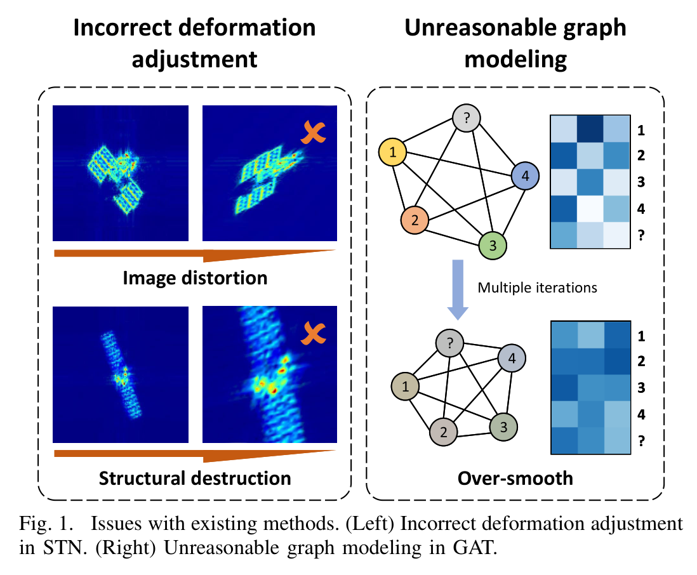

## 11.3 方法分步讲解

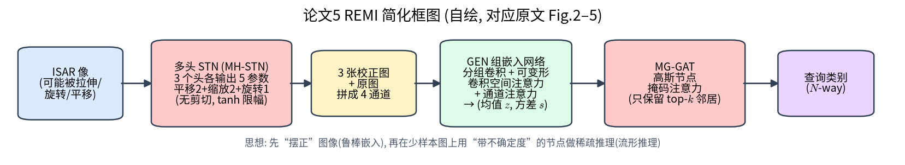

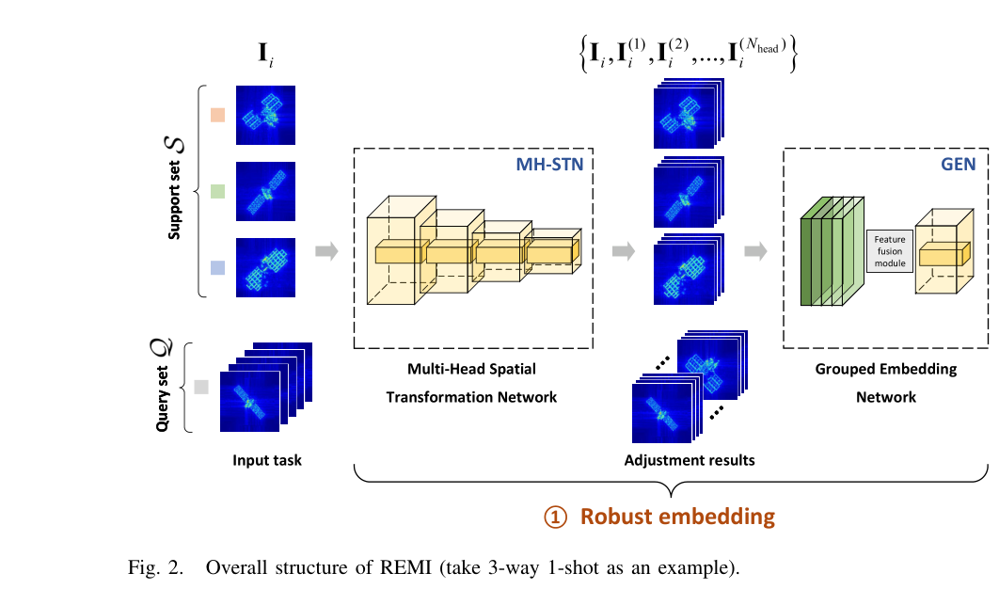

### 阶段 1：鲁棒嵌入

!!! note "基础回链"

    一句话：先用 3 个“受约束的自动摆正器”（只允许平移、缩放、旋转，不允许剪切）生成 3 张校正图，再和原图一起分组编码。仿射矩阵与坐标变换的手算见例题 6.6；为什么不要剪切见第 6.6 节。

**(1) MH-STN（多头空间变换网络，原文 Fig. 3）**

- 3 个头（$N_{head} = 3$），每个头只输出 **5 个参数**，经 tanh 限幅（原文式 (3)）：
  - 2 个平移参数（尺度系数 $\lambda_t$）；
  - 2 个缩放参数（$I$ + 偏移，尺度系数 $\lambda_s$）；
  - 1 个旋转角（$\pi\sigma_5$）；
- 变换矩阵 $T = T_s T_r T_t$（原文式 (4)–(7)）——**没有剪切**，参数有界；
- 3 张校正图 + **原图**拼接成 4 通道；
- 与数据增强不同，MH-STN 在**训练和测试时都起作用**。

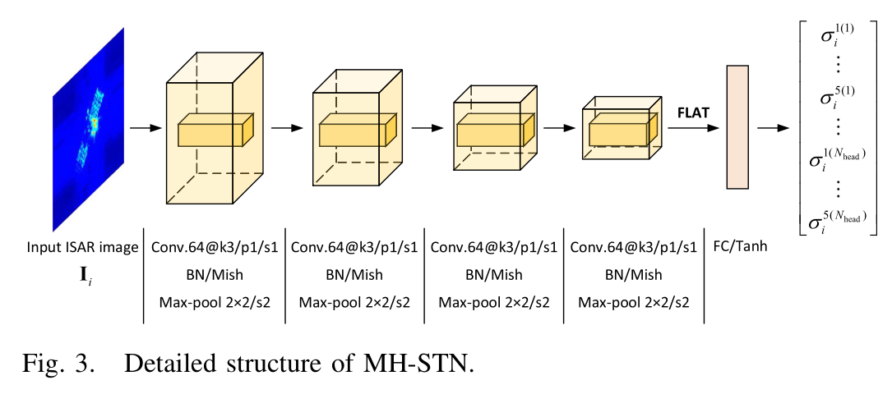{ width="90%" loading=lazy }

> **读图：** 输入 ISAR 像经若干卷积 + 池化层回归出多组变换参数（多头），每个头给出一种无剪切的仿射校正。“多头”是为了在不同假设下校正形变，减少单个 STN 的错误校正。

**(2) GEN（组嵌入网络，原文 Fig. 4）**

- 两层分组卷积（组数 $G = N_{head}+1 = 4$，膨胀率 2）——每个“视图”单独提特征；
- 特征融合：用**调制可变形卷积（MDC，原文式 (11)，K = 3）**做空间注意力，加通道注意力；
- 两层标准卷积 → 全连接 → 拼接 one-hot 标签（查询样本用 $1/N$ 向量）→ 拆分为**嵌入均值 $z_i$** 与**方差 $s_i$**。

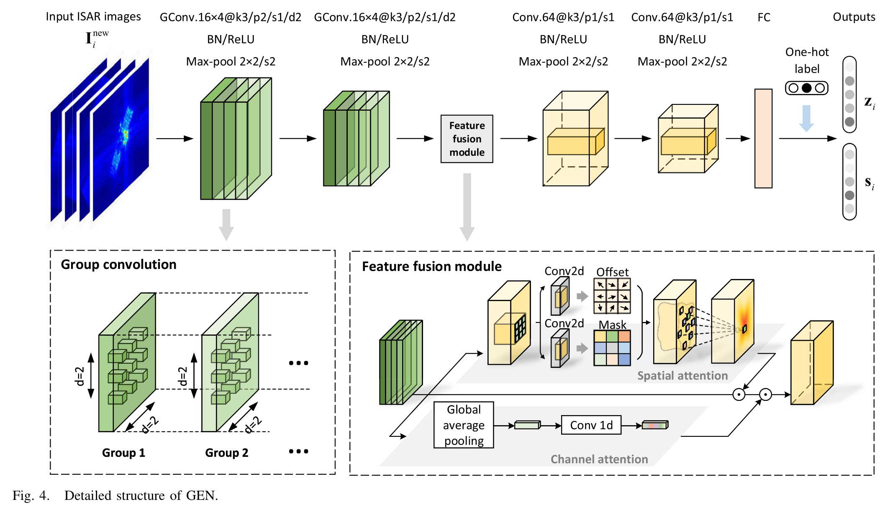{ width="95%" loading=lazy }

> **读图：** 上排是整体流程；下方左框是分组卷积，右框是特征融合模块。分组卷积让不同组分别处理多头校正后的图像，参数和计算量反而下降（见表 11-2 的 FLOPs）。

### 阶段 2：流形推理 —— MG-GAT（原文 Fig. 5）

!!! note "基础回链"

    一句话：每个样本只和最像自己的几个样本交换信息，避免“大家都变得一样”的过度平滑（→ 第 6.2 节易错点）；每个样本还带一个“方差”，表示自己有多可靠。

- **高斯节点**：每个样本是一个高斯分布 $(z, s)$，编码为 $v = z + z\odot\mathrm{softmax}(s)$（原文式 (14)）——方差反映样本的“可信度”；
- **边权**：$a_{ij} = \mathrm{MLP}(|v_i - v_j|)$（原文式 (15)）【存疑：原文印刷为 $v_i - v_j$，按上下文应为绝对值】；
- **掩码注意力**：每个节点只保留最相似的 $k_{near}$ 个邻居（原文式 (16)–(17)），$k_{near} = N + \lfloor Q/N\rfloor - 1$，满足 $N < k_{near} < N + Q$；
- 多头注意力，仅第 1 个头保留自注意力；聚合 → MLP → 再拆分为 $z, s$（原文式 (19)–(20)）；最后一层输出 N 维类别概率。

!!! info "直觉"

    **直觉**：只和“最像自己的少数几个样本”交换信息，可以避免过度平滑；方差大的（质量差的）样本，其嵌入在编码时被抑制。

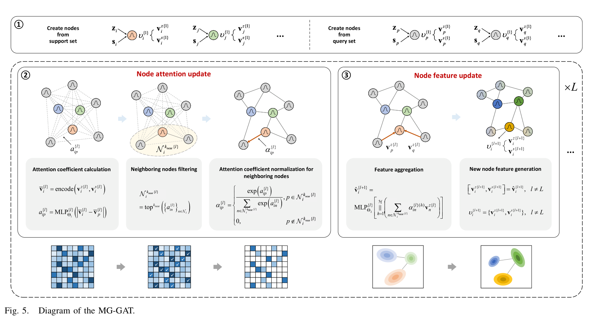{ width="100%" loading=lazy }

> **读图：** 左侧是节点注意力更新，右侧是节点特征更新，下方小图展示邻接矩阵与特征分布在迭代中的变化。要点是在流形上传播，避免普通 GAT 的过平滑。

## 11.4 数据集与实验场景

| 项目 | 内容（原文 Sec. IV-A） |
|---|---|
| 目标 | 7 颗卫星：OCO-2, CloudSat, CALIPSO, Jason-3, IceSat, QuikSCAT, SWAS（原文 Fig. 6） |
| 电磁计算 | 物理光学法计算 HH 极化回波，载频 17 GHz |
| 参数组合 | 带宽 1 / 1.5 / 2 GHz；俯仰角 50°、55°；方位 0–359°（步长 0.05°）；BP 成像，积累角 4° / 5° / 6°；相邻图像间隔 1°；128×128 |
| 规模 | 每颗卫星 2 × 3 × 3 = 18 种组合，每种 360 幅 |
| 基类 / 新类 | 基类：OCO-2, CloudSat, Jason-3, IceSat；新类：CALIPSO, QuikSCAT, SWAS（原文 Table V） |

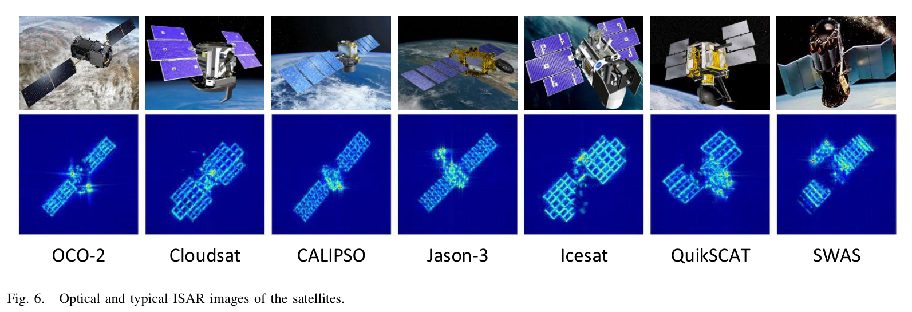{ width="100%" loading=lazy }

> **读图：** 上排是七颗卫星的光学外观，下排是对应 ISAR 像，可以感受不同卫星在 ISAR 像中的差别有多细微。

**4 个场景（原文 Tables I–IV）**：训练用 50° 俯仰角，测试用 55° 俯仰角。

| 场景 | 方位角范围 | 带宽–积累角组合 | 难度 |
|---|---|---|---|
| I | 训练、测试相同（0–269°） | 相同：(1 GHz, 4°), (1.5 GHz, 5°), (2 GHz, 6°) | ★ |
| II | 相同 | 不同：测试为 (1 GHz, 5°), (1.5 GHz, 6°), (2 GHz, 4°) | ★★ |
| III | 不同：测试 0–359° | 相同 | ★★ |
| IV | 不同 | 不同 | ★★★ |

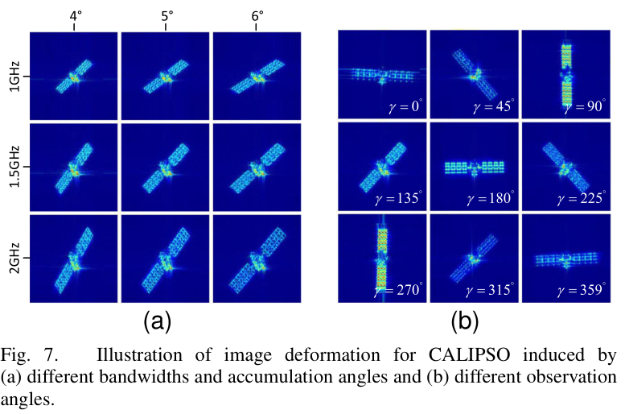

**训练设置**：元训练用 3-way 5-shot、30 个查询；最多 1000 次迭代；Adam，学习率 1e-3，每次迭代指数衰减 0.997；测试 1000 个随机任务，报告均值与 95% 置信区间；RTX 3090，PyTorch 1.12.0。

## 11.5 实验结果

**表 11-1 4 个场景的对比（原文 Table VI，3-way，%）**

| 方法 | I 1-shot | I 5-shot | II 1-shot | II 5-shot | III 1-shot | III 5-shot | IV 1-shot | IV 5-shot | FLOPs |
|---|---|---|---|---|---|---|---|---|---|
| ProtoNet | 63.99±0.62 | 71.22±0.44 | 62.98±0.59 | 69.49±0.44 | 63.20±0.62 | 70.61±0.41 | 62.38±0.60 | 68.80±0.42 | 0.214G |
| RelationNet | 60.68±0.58 | 66.42±0.36 | 59.78±0.52 | 63.78±0.35 | 59.97±0.58 | 65.22±0.39 | 59.05±0.54 | 62.94±0.38 | 0.229G |
| TPN | 64.46±0.55 | 73.77±0.43 | 64.26±0.57 | 73.26±0.43 | 63.20±0.49 | 70.87±0.41 | 62.97±0.49 | 70.84±0.40 | 0.216G |
| MGA-Net | 63.02±0.57 | 71.73±0.41 | 62.89±0.55 | 70.33±0.45 | 62.51±0.58 | 70.68±0.46 | 61.96±0.56 | 69.55±0.50 | 0.218G |
| **REMI** | **69.07±0.48** | **77.42±0.41** | **67.46±0.51** | **75.76±0.40** | **67.92±0.51** | **76.23±0.42** | **66.99±0.54** | **74.92±0.44** | 0.331G |

解读：REMI 在所有场景均最优；在最难的场景 IV 中，比现有方法至少高 4.02%（1-shot，相对 TPN 66.99 − 62.97）与 4.08%（5-shot，74.92 − 70.84）。

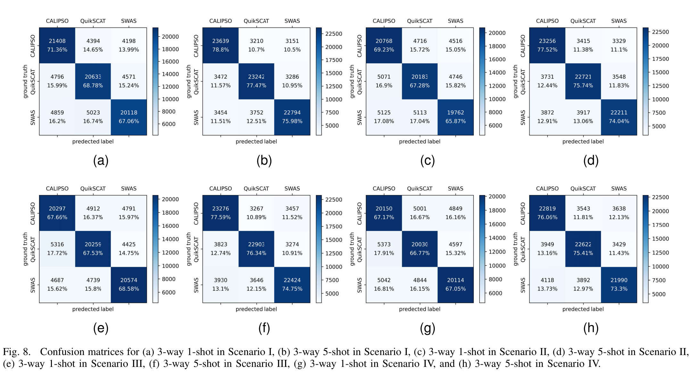{ width="100%" loading=lazy }

> **读图：** (a)–(h) 分别对应不同场景与 1-shot / 5-shot 设置。看对角线深浅和非对角格子，找出哪几类卫星最容易互相混淆。

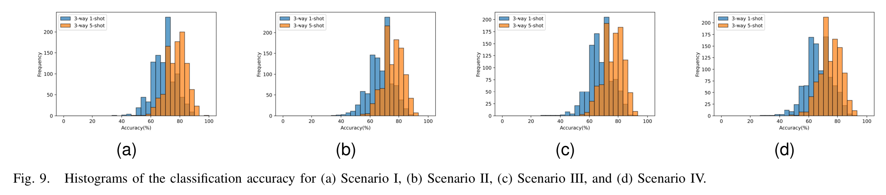{ width="100%" loading=lazy }

> **读图：** 每个直方图是大量测试任务的精度分布，与对比方法的分布叠在一起。REMI 的分布整体右移，说明不是靠个别好运气的任务。

**表 11-2 消融实验（原文 Table VII，基线为 Conv4 + GAT，即 MGA-Net；% ）**

| 配置 | I 1/5-shot | II 1/5-shot | III 1/5-shot | IV 1/5-shot | FLOPs |
|---|---|---|---|---|---|
| 基线 (MGA-Net) | 63.02 / 71.73 | 62.89 / 70.33 | 62.51 / 70.68 | 61.96 / 69.55 | 0.218G |
| + MH-STN | 65.27 / 74.81 | 64.99 / 74.25 | 64.48 / 73.47 | 64.06 / 72.79 | 0.459G |
| + MH-STN + GEN | 65.48 / 75.17 | 65.16 / 74.41 | 64.76 / 73.12 | 64.73 / 73.70 | 0.334G |
| + MG-GAT | 66.32 / 74.65 | 65.86 / 73.99 | 65.20 / 73.13 | 64.98 / 72.35 | 0.215G |
| + MH-STN + MG-GAT | 66.58 / 75.93 | 65.50 / 75.64 | 65.40 / 74.26 | 65.08 / 74.06 | 0.456G |
| 完整 REMI | 69.07 / 77.42 | 67.46 / 75.76 | 67.92 / 76.23 | 66.99 / 74.92 | 0.331G |

解读：三个模块都有贡献；MH-STN 增加 0.241 G FLOPs，GEN 的分组卷积反而减少 0.125 G；MG-GAT 几乎不增加计算量。

**即插即用（原文 Table VIII，场景 IV）**：把 MH-STN 与 GEN 加到其他方法上同样有效，例如 ProtoNet 从 62.38 / 68.80 提升到 66.75 / 72.89，RelationNet 从 59.05 / 62.94 提升到 64.51 / 69.22。（原文该表的列标题有一处重复印刷【存疑】。）

**实测飞机数据（原文 Table IX、Fig. 10）**：基类为 F16、F18、F117、MiG29（电磁仿真，俯仰角 145°，17 GHz，1 GHz 带宽，积累角 4°，每类 200 幅）；新类为 An-26、Citation、Yak-42 的**实测** C 波段 ISAR 数据（每类 90 幅）。

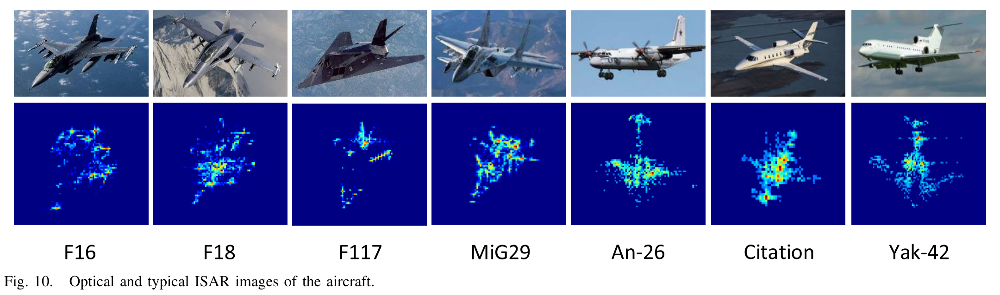{ width="85%" loading=lazy }

> **读图：** 这是“仿真基类 → 实测新类”实验所用的飞机示例。上排为光学图像，下排为 ISAR 像。

| 方法 | 1-shot | 5-shot |
|---|---|---|
| ProtoNet | 72.54±0.54 | 80.53±0.35 |
| RelationNet | 62.34±0.53 | 71.62±0.35 |
| TPN | 74.07±0.79 | 83.05±0.53 |
| MGA-Net | 74.70±0.56 | 84.68±0.34 |
| **REMI** | **77.62±0.54** | **89.56±0.26** |

这是一个“**仿真基类 → 实测新类**”的跨域设置，很有说服力。

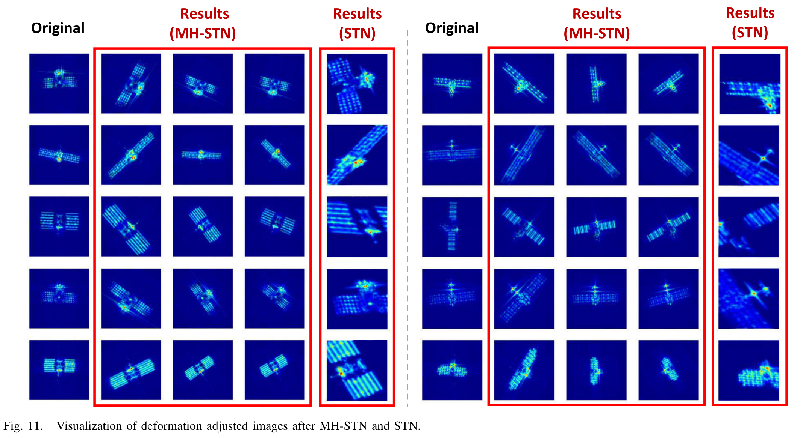

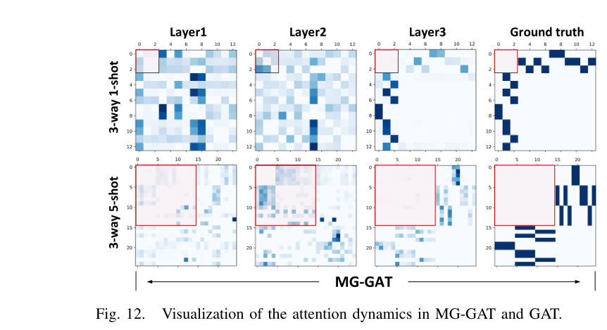{ width="85%" loading=lazy }

> **读图：** 每列是一层的注意力（邻接）矩阵，最右为真实类别关系。看 MG-GAT 的矩阵是否随层数逐渐接近块状的 ground truth，而 GAT 是否变得模糊（过平滑）。

## 11.6 优点与局限

**优点**：

- 把 ISAR 形变的**物理规律写进网络结构**（无剪切、有界参数、保留原图）；
- 实验设计严谨：俯仰角不同、方位范围不同、成像参数不同的 4 个场景；1000 个任务 + 95% 置信区间；
- 跨域（仿真 → 实测）验证；模块可迁移到其他方法。

**局限**：

- 总体精度仍不高（3-way 1-shot 约 67–69%，随机猜测为 33%），少样本 ISAR 识别远未解决；
- 仅 HH 单极化、单站；作者在展望中提到序列观测、多站或多极化融合——这直接引出了 MLFR。

## 11.7 本科生可以复现什么

- 在 `project2_protonet.py` 的 Conv4 前加一个**约束 STN**：小 CNN 预测 5 个参数（tanh 限幅），用 `F.affine_grid` + `F.grid_sample` 变换，与原图拼接后输入嵌入网络；
- 设计“场景 II”式实验：训练数据用 (B=1 GHz, Δθ=4°)，测试用 (B=1 GHz, Δθ=6°)，比较有无 STN 的精度。

## 11.8 自测题

1. ISAR 图像的拉伸、旋转、平移分别来源于什么物理因素？
2. MH-STN 为什么去掉剪切？为什么要把原图也拼接进来？
3. MG-GAT 中 $k_{near} = N + \lfloor Q/N\rfloor - 1$，在 3-way、每类 30 个查询（Q = 90）时 $k_{near}$ 是多少？
4. 场景 IV 与场景 I 的区别是什么？REMI 在两者上的 5-shot 精度差多少？
5. 实测飞机实验中，基类和新类的数据来源有什么不同？为什么这种设置更有说服力？

!!! abstract "小结"

    REMI 的关键词是“**约束**”：用物理约束的 STN 校正形变，用 top-k 掩码约束图注意力的连接方式。它把少样本 ISAR 识别的实验设置推向了更严格、更接近实际的方向，是西电团队后续多站工作（MLFR）的基础。
