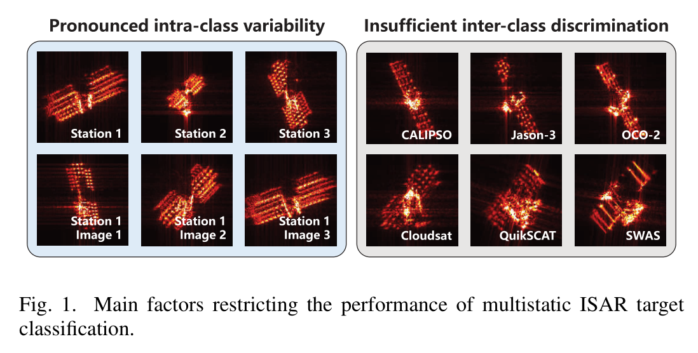
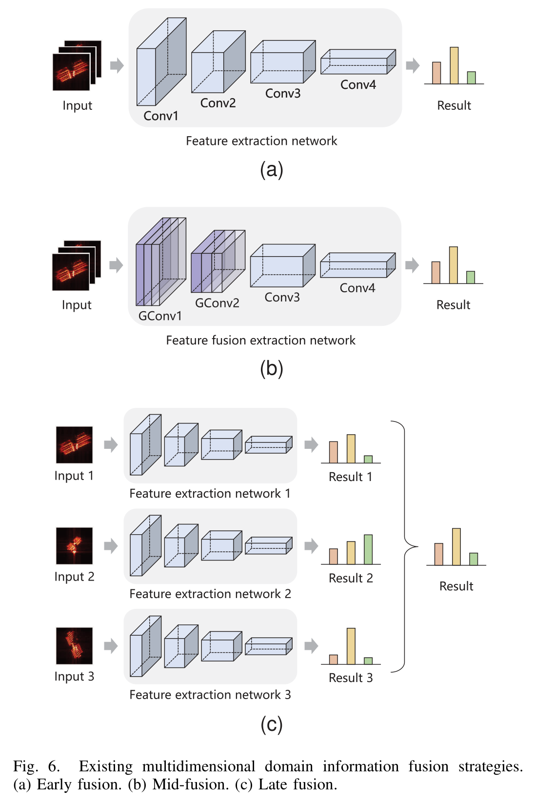
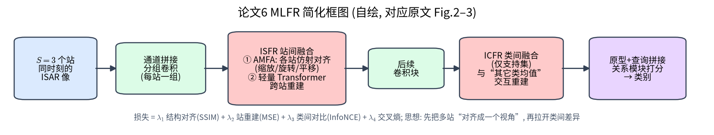
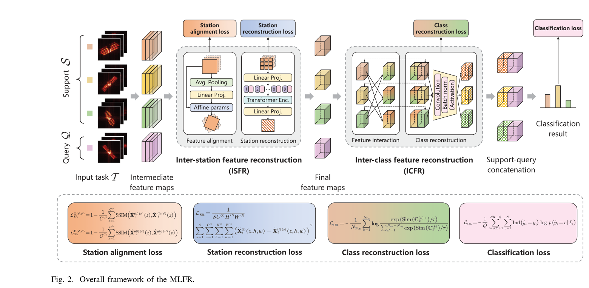
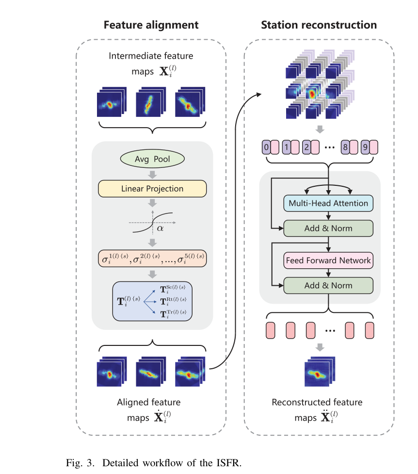
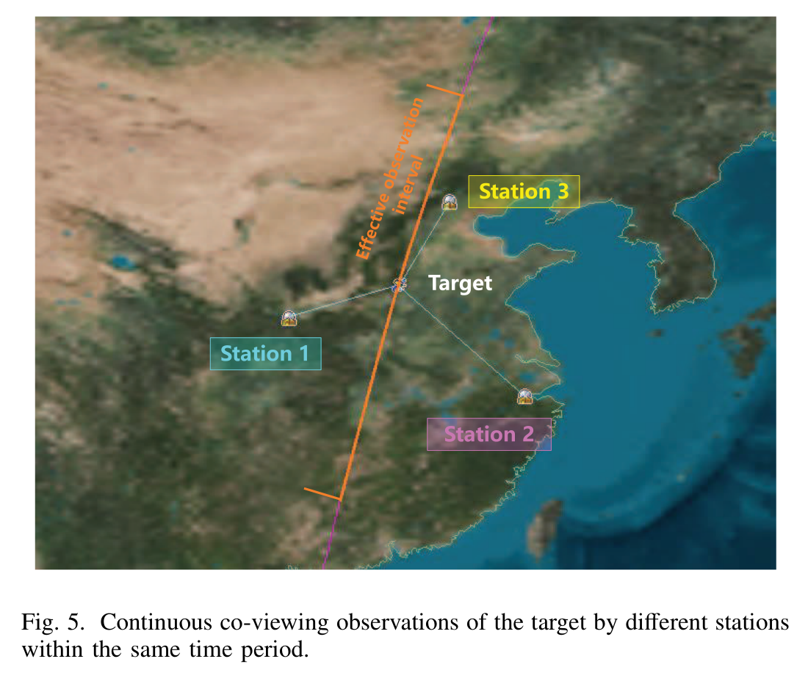
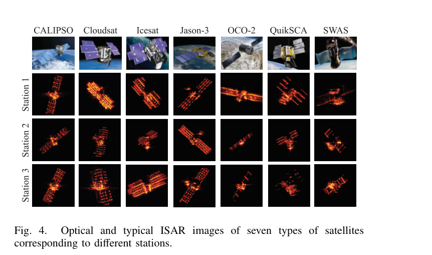
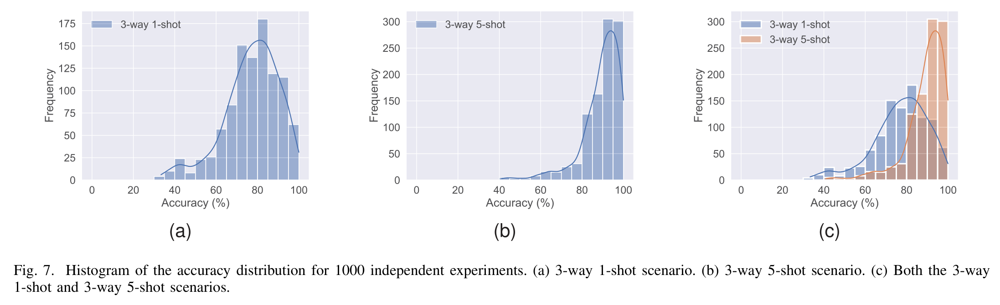
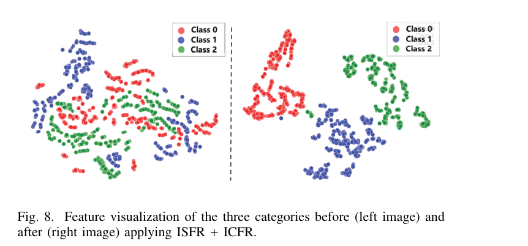
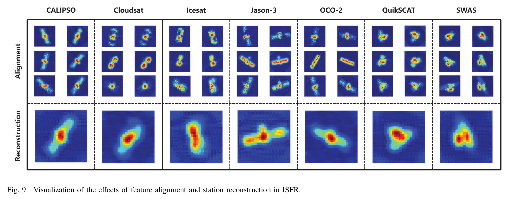

# 第 12 章 MLFR —— 多站 ISAR 的多层级特征重建少样本识别

!!! tip "本章目标"

    1. 理解多站（multistatic）ISAR 协同观测的价值与“简单融合反而变差”的现象；
    2. 掌握 ISFR（站间融合：对齐 + 重建）与 ICFR（类间融合）两大模块，以及四项混合损失；
    3. 读懂单站 / 早期 / 中期 / 晚期融合与 MLFR 的对比，以及消融实验。

!!! note "基础回链"

    **读这一章前，建议先看：** 多视角观测为什么能补充信息（→ 第 4.2 节难点 7）；分组卷积（→ 第 5.4 节）；STN 式对齐（→ 第 6.6 节）；Transformer 与位置编码（→ 第 6.1 节）；原型与关系网络（→ 第 6.3 节）；有监督对比损失（→ 第 6.4 节）；交叉熵（→ 第 5.2 节）。

## 12.1 基本信息

- **题目**：Few-Shot Multistatic ISAR Target Classification Based on Multilevel Feature Reconstruction
- **作者**：Minjia Yang, Bowen Chen, Yue Wang, Xueru Bai（通讯）, Feng Zhou；西安电子科技大学
- **出处**：IEEE Transactions on Geoscience and Remote Sensing, vol. 63, 2025, Art. no. 5106516, doi: 10.1109/TGRS.2025.3592206（2025 年 7 月 24 日发表）

**一句话概括**：3 个雷达站同时观测同一目标，各站图像的尺度、方向、散射强度差异很大；MLFR 先把各站特征**仿射对齐**并用轻量 Transformer **跨站重建**，再让每类支持特征与“其他类均值”交互重建以**拉大类间差异**，最终 3-way 1-shot / 5-shot 精度达到 77.13% / 89.33%，比最好的对比方法高 8.65 / 11.80 个百分点，参数仅 468 K。

## 12.2 背景与动机

- **单站的局限**：视角遮挡、噪声干扰时，单站信息不足；多站可同时从多个视角观测，信息更全面；
- **两大挑战（原文 Fig. 1）**：
  1. **类内差异显著**：同一目标在不同站的图像尺度、方向、散射分布不同；
  2. **类间区分不足**：细粒度分类，不同卫星在同一站的图像差异不明显；
- **惊人的发现**：在对比方法中，直接用多站数据融合时，**43.3% 的实验结果反而比该方法的最好单站结果更差**，在 3-way 1-shot 中这一比例高达 66.7%（原文 Sec. IV）——数据少时，融合不当反而有害。

{ width="80%" loading=lazy }

> **读图：** 左侧：同一目标在不同站的图像差异很大（类内差异大）；右侧：不同目标的图像可能很像（类间区分不足）。这两点分别对应后面的 ISFR 与 ICFR。

## 12.3 方法分步讲解

**问题定义**：第 $i$ 个时刻的样本为 $S$ 个站的同时观测 $I_i = \{I^s\}_{s=1}^S$（本文 $S = 3$）；基类与新类不相交；N-way K-shot episode 训练。

### 步骤 1：分组卷积编码

!!! note "基础回链"

    一句话：3 个雷达站的图像各走各的卷积组，互不干扰地提取浅层特征（分组卷积 → 例题 5.6）。

各站图像沿通道拼接，经 $l$ 层二维**分组卷积**（组数 $G = S$，空洞卷积 + BN + 激活，原文式 (1)–(2)）——每站独立提取浅层特征。

### 步骤 2：ISFR 站间特征重建（原文 Fig. 3）

!!! note "基础回链"

    一句话：先把 3 个站的特征“摆正对齐”（与第 6.6 节 STN 同一思路），再用 Transformer 让各站互相补充（→ 第 6.1 节）。

**(a) AMFA 自适应多站特征对齐**：$F = \mathrm{Mish}(\mathrm{Linear}(\mathrm{GAP}(X)))$ 输出 $5S$ 个参数（原文式 (3)–(4)），每站 5 个：缩放 2 个（$I + \lambda_{Sc}\cdot$ 偏移）、旋转 1 个（$\pi\sigma_3$）、平移 2 个（$\lambda_{Tr}$ 约束），$T = T_{Sc}T_{Rt}T_{Tr}$（原文式 (5)–(8)），对各站特征图做仿射变换（式 (9)）。思路与 REMI 的 MH-STN 一脉相承，但作用在**特征图**上、且按**站**而不是按“头”。

**(b) 跨站重建**：轻量 Transformer（1 个编码器、1 个头、嵌入维 $E = 64$）。把特征图按滑动窗口展开为 $P$ 个局部向量，线性映射并加正弦位置编码（原文式 (11)–(13)），自注意力（式 (14)–(16)）+ LayerNorm + 残差 + FFN（式 (17)–(20)），再线性解码、折叠回特征图（式 (21)–(22)）。

{ width="80%" loading=lazy }

> **读图：** 左半是特征对齐：把各站的中间特征图做空间变换，对齐到统一姿态；右半是站间重建：用多头注意力等结构融合各站信息。注意先对齐、后重建的顺序（消融里 ISFR‡ 正说明了顺序的重要性）。

### 步骤 3：ICFR 类间特征重建（仅作用于支持集）

!!! note "基础回链"

    一句话：让每个支持样本“看一眼别的类的平均样子”，从而突出自己的独特之处。

- 对每个支持样本，计算**所有其他类**共 $(N-1)K$ 个样本特征的平均（原文式 (24)）；
- 与自身特征拼接（式 (25)），经卷积块重建（式 (26)–(27)）——让网络显式地“看到别的类长什么样”，从而突出本类的独特之处。

### 步骤 4：类别推理

!!! note "基础回链"

    一句话：先算原型（式 (6.4)），再用关系网络打分（→ 第 6.3.2 节）。

原型 $P_c$ = K 个支持特征的均值（原文式 (28)）；原型与查询特征拼接（式 (29)），经 2 个卷积块 + 线性层输出关系分数，softmax 后取最大（式 (30)–(33)）——类似 RelationNet。

### 步骤 5：多层级混合损失（原文式 (34)–(45)）

!!! note "基础回链"

    一句话：总损失是 4 项加权和；其中 $L_{CR}$ 是有监督对比损失（→ 第 6.4 节），$L_{CL}$ 是交叉熵（→ 第 5.2 节）。

$$L = \lambda_1 L_{SA} + \lambda_2 L_{SR} + \lambda_3 L_{CR} + \lambda_4 L_{CL}$$

| 损失 | 作用 | 做法 |
|---|---|---|
| $L_{SA}$ 站对齐损失 | 让对齐后的各站特征结构一致 | 高斯模糊 + Sobel 边缘，计算只含结构项的 SSIM（$(\sigma_{xy}+\epsilon)/(\sigma_x\sigma_y+\epsilon)$），全局 + 边缘，两两站之间取 $1-\overline{\mathrm{SSIM}}$ |
| $L_{SR}$ 站重建损失 | 重建特征应与各站对齐特征相似 | MSE |
| $L_{CR}$ 类重建损失 | 拉大类间差异 | 有监督对比损失（InfoNCE，余弦相似度，温度 τ） |
| $L_{CL}$ 分类损失 | 最终分类 | 交叉熵 |

!!! note "说明"

    【存疑】我在正文中未找到 $\lambda_1$–$\lambda_4$ 的具体取值。

## 12.4 数据集

| 项目 | 内容（原文 Sec. IV-A、Table I、II） |
|---|---|
| 目标 | 7 颗卫星：CALIPSO, Cloudsat, Icesat, Jason-3, OCO-2, QuikSCAT, SWAS（与 REMI 相同） |
| 站数 | 3 个站，在同一时段连续同时观测（原文 Fig. 5） |
| 电磁计算 | 物理光学法，HH 极化，载频 17 GHz |
| 成像 | 带宽 1 / 1.5 / 2 GHz，RD 算法，积累角 4° / 5° / 6°，128×128 |
| 样本 | 原文：“每个站获得 90 幅 ISAR 图像”【存疑：未说明是每颗卫星每种参数组合 90 幅，还是总共 90 幅】 |
| 基类 / 新类 | 基类：OCO-2, Cloudsat, Jason-3, Icesat；新类：CALIPSO, QuikSCAT, SWAS |
| 参数组合 | 基类：(1 GHz, 4°), (1.5 GHz, 5°), (2 GHz, 6°)；新类：(1 GHz, 5°), (1.5 GHz, 6°), (2 GHz, 4°) |

{ width="70%" loading=lazy }

> **读图：** 三个站从不同位置同时观测同一目标的轨迹段，这是“多站”数据的来源。

**训练设置**：3-way 5-shot 元训练，每类 30 个查询；1000 次迭代；Adam，学习率 1e-3，衰减 0.997；测试 1000 个任务，均值 ± 95% 置信区间；RTX 3090，PyTorch 1.12.0。

## 12.5 实验结果

**表 12-1 单站结果（原文 Tables III–V，3-way，%）**

| 方法 | 站 1 1-shot / 5-shot | 站 2 1-shot / 5-shot | 站 3 1-shot / 5-shot |
|---|---|---|---|
| ProtoNet | 62.84 / 68.04 | 63.42 / 70.15 | 55.27 / 65.07 |
| RelationNet | 63.71 / 74.16 | 65.93 / 75.03 | 64.71 / 73.12 |
| TPN | 63.53 / 74.92 | 64.15 / 74.21 | 64.22 / 71.70 |
| MGA-Net | 65.56 / 75.08 | 65.89 / 74.76 | 65.59 / 73.94 |
| REMI | 65.61 / 75.37 | 68.36 / 75.89 | 66.85 / 76.83 |

**表 12-2 多站融合结果（原文 Tables VI–VIII，%）**

| 方法 | 早期融合 1 / 5-shot | 中期融合 1 / 5-shot | 晚期融合 1 / 5-shot |
|---|---|---|---|
| ProtoNet | 62.52±0.93 / 72.39±0.69 | 64.52±0.76 / 73.18±0.68 | 62.54±0.95 / 70.84±0.97 |
| RelationNet | 64.18±0.69 / 76.64±0.75 | 66.55±0.79 / 77.28±0.58 | 64.49±0.58 / 74.61±0.51 |
| TPN | 63.56±1.09 / 75.48±1.15 | 63.77±1.20 / 76.36±0.95 | 63.55±0.78 / 74.40±0.51 |
| MGA-Net | 65.90±0.97 / 75.61±1.08 | 66.31±0.84 / 77.09±0.78 | 63.23±0.92 / 75.36±1.04 |
| REMI | 66.67±1.10 / 76.43±1.24 | 68.48±0.92 / 76.92±0.69 | 66.71±0.80 / 77.53±0.74 |
| **MLFR**（自身即融合方法，单一结果） | **77.13±0.82 / 89.33±0.59** | — | — |

（MLFR 自身就是一种融合方法，只有一组结果：**1-shot 77.13±0.82，5-shot 89.33±0.59**。）

解读：

- 对比方法里最好的 1-shot 结果是 REMI 中期融合 68.48，5-shot 最好是 REMI 晚期融合 77.53；MLFR 分别高出 8.65、11.80 个百分点（可直接验算）；
- 对比方法的“融合”收益很小甚至为负，例如 REMI 单站 2 的 1-shot 为 68.36，早期融合却只有 66.67。

{ width="100%" loading=lazy }

> **读图：** 分布越窄、越靠右越好。它对应表 12-2 中均值 ± 置信区间背后的完整分布。

**表 12-3 参数量与计算量（原文 Table IX，节选）**

| 方法 | 早期融合 | 中期融合 | 晚期融合 |
|---|---|---|---|
| RelationNet | 224K / 2.66M | 196K / 1.93M | 668K / 7.38M |
| REMI | 1264K / 2.51M | 1236K / 1.78M | 3790K / 6.94M |
| **MLFR**（单一结构） | **468K / 2.41M** | — | — |

（格式：参数量 / FLOPs。MLFR 为单一结构：468 K 参数，2.41 M FLOPs。）

**表 12-4 消融实验（原文 Table X、XI，%）**

| 配置 | 1-shot | 5-shot | 参数 | FLOPs |
|---|---|---|---|---|
| 基线（RelationNet 中期融合） | 66.55 | 77.28 | 196K | 1.93M |
| + ISFR | 74.64 | 85.03 | 394K | 2.41M |
| + ICFR | 71.27 | 82.78 | 269K | 1.93M |
| + ISFR + ICFR（MLFR） | 77.13 | 89.33 | 468K | 2.41M |
| ICFR + 仅对齐（ISFR†） | 75.05 | 87.13 | 271K | 1.94M |
| ICFR + 仅重建（ISFR‡） | 68.57 | 78.49 | 467K | 2.41M |

解读：

- ISFR 贡献最大（+8.09 / +7.75），ICFR 次之（+4.72 / +5.50），二者叠加 +10.58 / +12.05；
- **一个很有启发性的结果**：只做重建而不先对齐（ISFR‡），精度反而比只用 ICFR 的 71.27 / 82.78 更低——**未对齐的多站特征直接融合是有害的**，这与“43.3% 的融合结果变差”相互印证。

{ width="85%" loading=lazy }

> **读图：** 左图三类点混在一起，右图分成三簇，直观展示两个重建模块的作用（同样只是定性展示）。

## 12.6 优点与局限

**优点**：

- 抓住了多站融合的核心矛盾——**先对齐、后融合**，并用消融清晰证明；
- 精度提升显著，同时参数少（468 K）；
- 混合损失分别约束“站间一致性”“重建保真”“类间可分”，设计完整。

**局限**：

- 数据为纯仿真，且各站同时观测的几何关系是理想的；未在实测多站数据上验证；
- 损失权重 λ 未给出，复现困难；
- 样本数描述不够清晰；新类只有 3 类。

## 12.7 可以动手复现什么

- 用 `isar_core` 对同一目标同时生成 3 个“站”的图像（不同 `theta0_deg`、`dtheta_deg`），构造多站数据集；
- 先实现最简单的早期融合（3 站拼成 3 通道输入 Conv4-ProtoNet），再加一个按站的仿射对齐（`F.affine_grid`），验证“对齐后融合更好”这一核心结论。

## 12.8 自测题

1. 为什么多站数据直接拼接融合，在少样本条件下可能反而变差？
2. AMFA 与 REMI 的 MH-STN 有哪些相同点和不同点？
3. ICFR 为什么只作用于支持集？“与其他类均值交互”的直觉是什么？
4. $L_{SA}$ 为什么只用 SSIM 的结构项，并先做高斯模糊和 Sobel 边缘提取？
5. 根据表 12-4，“只重建不对齐”为何比“不用 ISFR”还差？

!!! abstract "小结"

    MLFR 是 REMI 思路向多站场景的自然延伸：把“形变校正”从单张图扩展到“多站之间的特征对齐”，并加入类间重建来增强细粒度可分性。它最重要的启示是：**多源信息融合的前提是对齐，否则越融合越乱**。
