# 第 13 章 DCA-Net —— 简缩极化 ISAR 卫星部件级识别

!!! tip "本章目标"

    1. 理解从“目标级分类”到“部件级识别（旋转框检测）”的任务升级；
    2. 掌握 DCA-Net 的两阶段结构：RTMdet 基础检测器、MGNF 锚点过滤、DCAG 双分支图注意力；
    3. 读懂检测指标（P、R、F1、mAP50）与跨俯仰角实验的结论。

!!! note "基础回链"

    **读这一章前，建议先看：** 简缩极化 $S_{LL}$、$S_{RL}$（→ 第 3.5 节，例题 3.4）；卷积与 CNN（→ 第 5.3、5.4 节）；GAT（→ 第 6.2 节）；Precision / Recall / F1 / IoU / mAP50（→ 第 6.7 节）。

## 13.1 基本信息

- **题目**：Compact Polarimetric ISAR Space Target Components Recognition With Dual-Branch Correlation Aggregation Graph Attention Network
- **作者**：Ming-Dian Li, Shun-Ping Xiao, Si-Wei Chen（通讯）；国防科技大学电子科学学院
- **出处**：IEEE Transactions on Geoscience and Remote Sensing, vol. 63, 2025, Art. no. 5107917, doi: 10.1109/TGRS.2025.3607102（2025 年 9 月 8 日发表）

**一句话概括**：用简缩极化（DCP：$S_{LL}$、$S_{RL}$）ISAR 像作为输入，在 RTMdet 旋转框检测器之上增加“多高斯掩膜过滤 + 局部/全局双分支图注意力”的精修阶段，识别卫星上 9 类部件；在自建的 6 颗卫星、16577 个标注部件的数据集上，平均 mAP50 达到 71.78%，比 O-RTMdet 高 5.23 个百分点。

## 13.2 背景与动机

- **任务升级**：知道“这是哪颗卫星”还不够，还想知道“太阳翼在哪、天线朝向如何”——这对判断卫星功能、状态很重要。于是任务变成**部件级识别**：用**旋转框（OBB）**框出每个部件并分类；
- **困难**：部件散射弱且不均匀；尺度、长宽比差异大（原文 Fig. 9）；CNN 检测器单独看每个候选框，忽略了部件之间的关系；
- **为什么用简缩极化**：全极化系统复杂、实测数据难获取；简缩极化只有 2 个通道，但仍携带散射机理信息（第 3.5 节）；
- **为什么用图**（原文 Fig. 1、Fig. 2）：同一部件的多个冗余框之间（局部关系）、同类部件之间（全局关系）存在可利用的相关性。

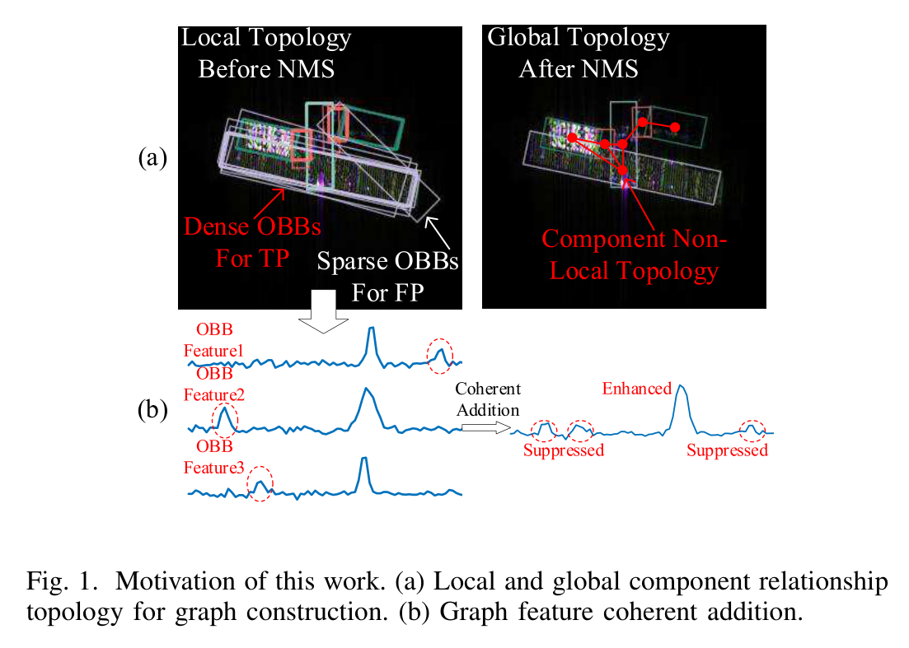{ width="75%" loading=lazy }

> **读图：** (a) 展示同一部件的多个冗余框（局部关系）和同类部件之间（全局关系）怎样连成图；(b) 说明通过图聚合，同类部件的特征可以相干增强。

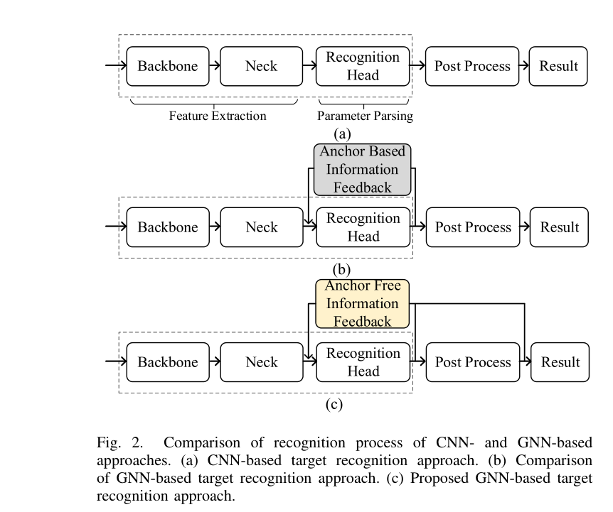{ width="70%" loading=lazy }

> **读图：** (a) 是常规 CNN 检测流程；(b)(c) 在检测头后加入图推理与信息反馈。DCA-Net 属于 (c) 的无锚框反馈方式。

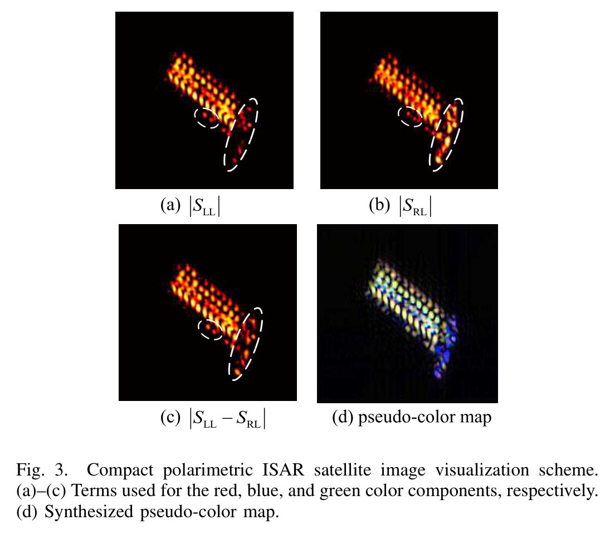

## 13.3 方法分步讲解

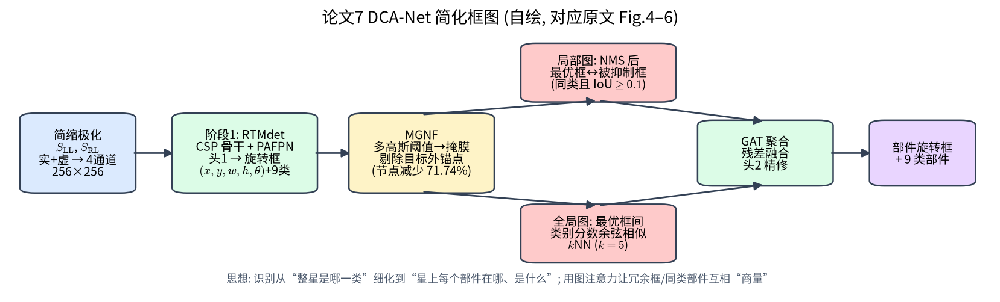

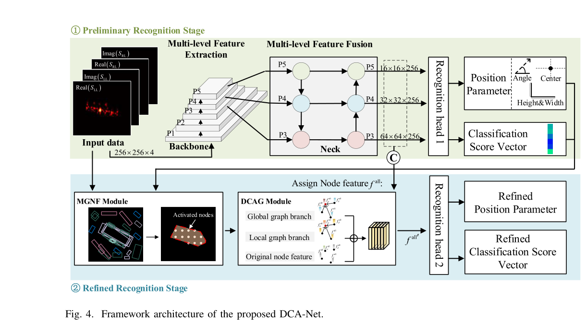

### 输入

!!! note "基础回链"

    一句话：简缩极化的两个复通道拆成实部、虚部，共 4 个实数通道（$S_{LL}$、$S_{RL}$ 的含义与手算见例题 3.4）。

$I = [\mathrm{Re}\,S_{LL}, \mathrm{Im}\,S_{LL}, \mathrm{Re}\,S_{RL}, \mathrm{Im}\,S_{RL}]$，4×256×256（原文式 (3)）。注意这里保留了复数信息（以实部/虚部双通道的方式）。

### 阶段 1：RTMdet 基础检测器（无锚框 anchor-free）

!!! note "基础回链"

    一句话：一个现成的旋转框检测器，在每个位置预测“这里有没有部件、框多大、转了多少度”。卷积/BN/激活见第 5 章。

- 骨干：CSP 块 + 5×5 深度卷积，输出 P1–P5；
- 颈部：PAFPN，融合 P3–P5 三个层级；
- 检测头 1：2 个卷积块（3×3 卷积 + BN + SiLU）+ 3 个 1×1 卷积 → 框参数 $\{x, y, h, w\}$、角度 $\theta$、9 类分数。

### 阶段 2：精修（原文 Table I 给出伪代码）

!!! note "基础回链"

    一句话：先用简单的图像阈值去掉大部分背景候选（MGNF），再用两个图注意力分支让候选框之间互相参考（DCAG，GAT 见第 6.2 节）。旋转 IoU 的含义见第 6.7 节。

**(1) 拼接所有层级的锚点特征** $f_{all}$（原文式 (4)）。

**(2) MGNF 多高斯节点过滤（原文 Fig. 5）**——无监督地去掉背景锚点：

- 在 5×5 窗口内做**高斯加权自适应阈值** → 二值图；
- 用 marching squares 提取边界 → 凸包 → 目标掩膜；
- 分别对 $|S_{LL}|$、$|S_{RL}|$、$|S_{LL}-S_{RL}|$ 三种特征做，再**取并集（OR）**（原文式 (5)）；
- 中心落在掩膜外的锚点被剔除。

效果：图节点数从 $16^2+32^2+64^2 = 5376$ 降到平均 1519（**减少 71.74%**），在 oall 子集上训练时间从 3.62 h 降到 2.31 h（**减少 36.19%**）。

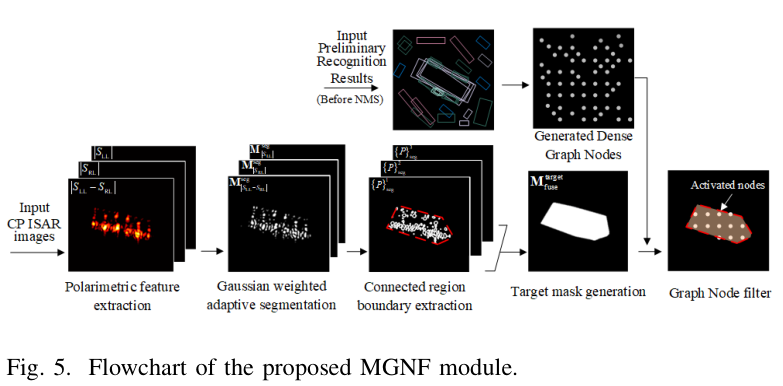{ width="85%" loading=lazy }

> **读图：** 从左到右：提取锚点特征 → 估计多高斯分布 → 过滤背景节点 → 得到稀疏的目标节点，用于后续构图。

**(3) DCAG 双分支相关聚合图（原文 Fig. 6）**

- **局部分支**：NMS 把候选框分为“最优框”与“被抑制框”；计算两者的旋转 IoU（原文式 (6)–(7)）；**同类且 IoU ≥ k = 0.1** 时连边；用 GAT 聚合（注意力打分采用 $\mathrm{LeakyReLU}(z_1+z_2)$ 的加和形式，原文式 (8)–(10)）——让冗余框把信息“汇报”给最优框；
- **全局分支**：在最优框之间，用类别分数向量的**余弦相似度**（原文式 (11)）建 kNN 图（k = 5 最好），GAT 聚合时以 IoU 为边属性（原文式 (12)–(14)）——让相似部件互相“参考”；
- **残差融合**：5 个卷积块（3×3 卷积 + SiLU）（原文式 (15)）。

**(4) 检测头 2** 输出精修后的框与类别。

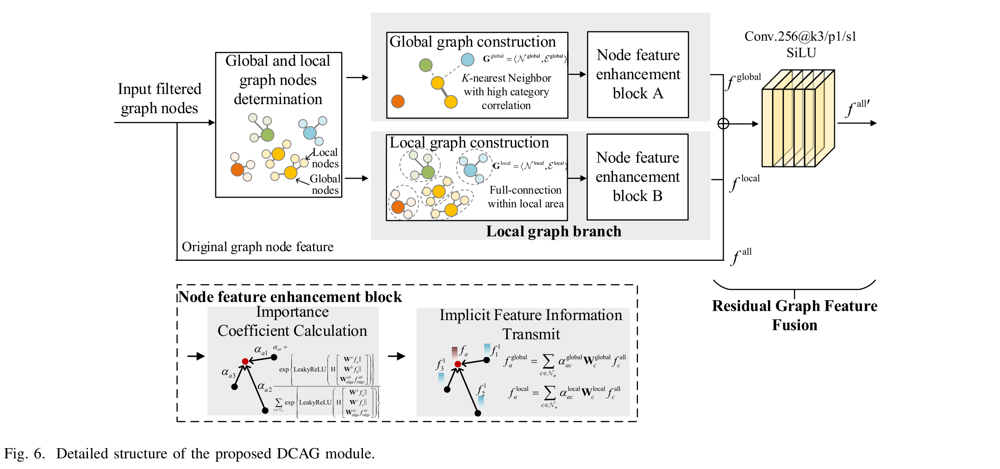{ width="90%" loading=lazy }

> **读图：** 上半是全局图构建，下半是局部图构建，两路图特征最后融合。对应正文的“双分支相关聚合”。

### 损失

!!! note "基础回链"

    一句话：分类损失 + 框回归损失；$-\log(\mathrm{IoU})$ 在框完全重合时为 0，重合越少越大。

$L = \sum_s \alpha_s(L_{cls} + \lambda_s L_{reg})$，$\alpha = \lambda = 2$；回归损失 $L_{reg} = -\log(\mathrm{IoU})$（原文式 (17)）；分类用 Quality Focal Loss（原文式 (18)–(19)）。

## 13.4 数据集

| 项目 | 内容（原文 Sec. IV-A、Tables II–III） |
|---|---|
| 卫星 | 6 颗：HISEA-1, Radarsat-2, Capella, QPS-SAR, Worldview-4, StarLink（精细 CAD 模型，原文 Fig. 7） |
| 电磁计算 | FEKO，DCP 模式（LL、RL） |
| 观测 | 成像中心方位 0–90°（步长 1°），俯仰角 40°、45°、50°；极坐标格式算法（PFA）成像 |
| 雷达参数 | 中心频率 16 GHz（Ku 波段），带宽 2 GHz，积累角 5°，256×256 |
| 规模 | 共 1638 帧（= 6 × 91 × 3），9 类部件共 16577 个标注 |
| 标注方法 | 在三维点云上标注部件，考虑遮挡后投影到成像平面（原文 Fig. 8） |
| 划分 | 按俯仰角分为 o40、o45、o50、oall 四个子集，各按 8:1:1 划分 |

**9 类部件的标注数量（原文 Table III）**

| 部件 | 数量 | 部件 | 数量 | 部件 | 数量 |
|---|---|---|---|---|---|
| 长方体本体 | 455 | 多边形本体 | 819 | 板状本体 | 273 |
| 太阳翼 | 4299 | 抛物面天线 | 1365 | 平板天线 | 546 |
| 板状附件 | 7183 | 杆状附件 | 1364 | 光学镜头 | 273 |

作者称这是首个包含 5 类以上部件的简缩极化 ISAR 卫星数据集。

**实验协议**：在 4 个子集上分别训练，在 3 个俯仰角测试集上测试，共 12 种组合，报告平均值。对比方法：O-FCOS、PSC、O-RTMdet、O-ATSS、S2A-Net、O-FRCNN、O-RRCNN（基于 GNN）。平台：mmrotate；4 × A800；Adam，权重衰减 0.05；100 epoch；前 5 个 epoch 学习率从 1e-5 预热到 1e-3，后半程余弦衰减。

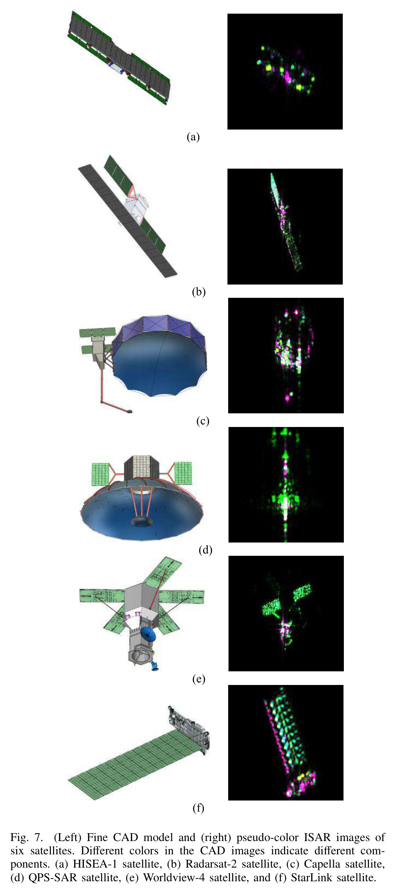{ width="45%" loading=lazy }

> **读图：** CAD 图中不同颜色代表不同部件类别；右侧是对应的简缩极化伪彩色 ISAR 像，可以对照看每类部件在 ISAR 像里大致是什么样。

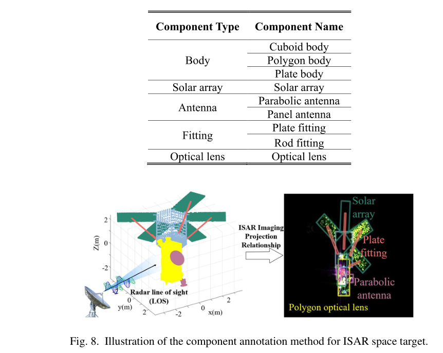{ width="80%" loading=lazy }

> **读图：** 左上表列出部件类型（本体、太阳翼、天线、附件、光学镜头等），下方演示在三维模型上标注后投影到成像平面得到旋转框。

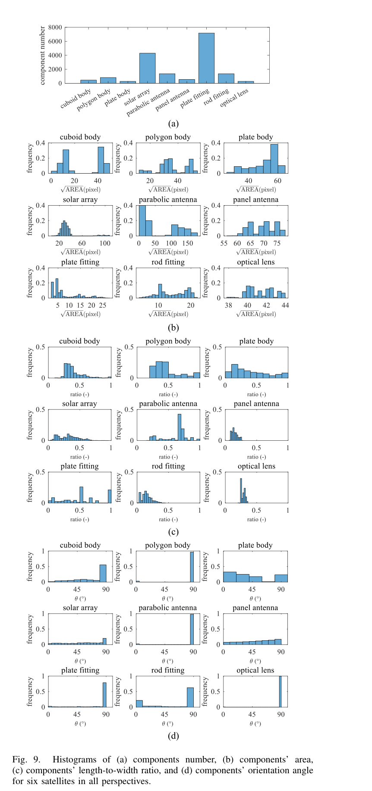{ width="50%" loading=lazy }

> **读图：** 这张图说明部件尺度、长宽比差异很大，对应背景中的“困难”一条。

## 13.5 实验结果

**表 13-1 平均检测性能（12 种训练/测试组合的均值，%）与计算量（原文 Table XI，输入 4×256×256）**

| 方法 | Precision | Recall | F1 | mAP50 | GFLOPs |
|---|---|---|---|---|---|
| O-FCOS | 70.32 | 67.08 | 68.25 | 64.17 | 13.367 |
| PSC | 64.78 | 64.74 | 64.47 | 59.88 | 13.382 |
| O-RTMdet | 79.09 | 68.14 | 71.23 | 66.55 | 12.839 |
| O-ATSS | 74.20 | 67.21 | 69.71 | 65.03 | 13.433 |
| S2A-Net | 61.94 | 52.06 | 54.99 | 50.02 | 13.579 |
| O-FRCNN | 62.47 | 68.96 | 64.58 | 65.69 | 40.600 |
| O-RRCNN | 70.00 | 69.93 | 69.27 | 66.57 | 73.171 |
| **DCA-Net** | **80.52** | **74.35** | **76.61** | **71.78** | 16.635 |

解读：相比 O-RTMdet（其基础检测器），P / R / F1 / mAP50 分别提升 1.43 / 6.21 / 5.38 / 5.23 个百分点——**提升主要来自召回率**，即找回了更多原本漏检的部件；相比同为图方法的 O-RRCNN，mAP50 高 5.21，而计算量只有其约 1/4.4。

**表 13-2 跨俯仰角 mAP50（%，行：训练集；列：测试俯仰角 40° / 45° / 50°）**

| 训练集 | DCA-Net | O-RTMdet |
|---|---|---|
| o40 | 86.20 / 69.40 / 52.60 | 70.20 / 62.60 / 48.30 |
| o45 | 70.70 / 77.40 / 60.90 | 68.10 / 67.20 / 58.40 |
| o50 | 59.20 / 66.60 / 76.70 | 52.80 / 63.00 / 68.70 |
| oall | 82.70 / 79.60 / 79.30 | 81.90 / 79.50 / 77.90 |

解读：**俯仰角一变，性能明显下降**（例如 o40 训练，在 50° 测试只有 52.60），说明部件识别对观测几何非常敏感；用全部俯仰角训练（oall）最稳。

**表 13-3 消融实验（原文 Tables VIII–X，%，P / R / F1 / mAP50）**

| 配置 | P | R | F1 | mAP50 |
|---|---|---|---|---|
| 无 DCAG（即 O-RTMdet） | 79.09 | 68.14 | 71.23 | 66.55 |
| 仅局部分支 | 81.06 | 73.28 | 76.23 | 70.19 |
| 仅全局分支 | 81.39 | 73.02 | 76.15 | 70.03 |
| 双分支（DCA-Net） | 80.52 | 74.35 | 76.61 | 71.78 |
| 图层数 = 2 | 82.65 | 72.85 | 76.39 | 70.53 |
| 图层数 = 3 | 81.50 | 71.99 | 75.43 | 70.02 |
| kNN k = 3 | 80.34 | 73.99 | 76.37 | 71.05 |
| kNN k = 7 | 81.75 | 73.30 | 76.39 | 70.86 |
| kNN k = 9 | 81.22 | 73.32 | 76.23 | 70.53 |

（DCA-Net 默认 1 层图、k = 5。）

**其他分析**：原文 Fig. 11 的混淆矩阵显示，板状附件的召回率比 O-RTMdet 高 30.52 个百分点，杆状附件比 O-RRCNN 高 3.66 个百分点，但**所有方法对附件类的召回率都偏低**；Fig. 12 统计每个最优框平均约有 6 个冗余框；Fig. 15、17 给出 Spearman 相关分析：局部图的平均相关系数为 0.855（类别概率）和 0.811（IoU），全局图约 0.5。

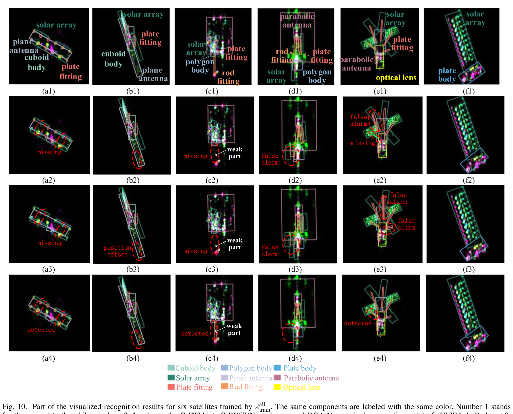

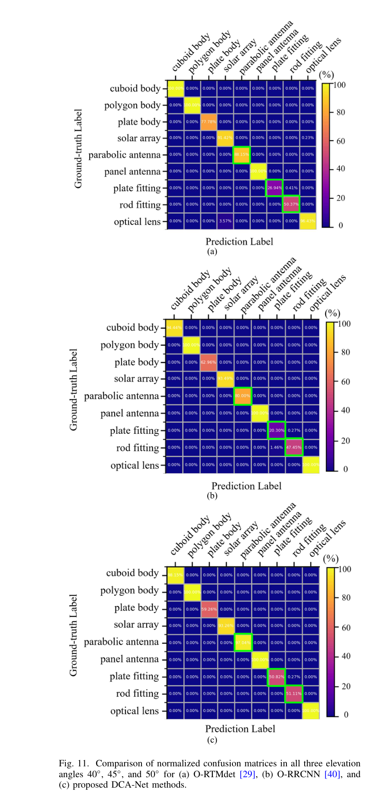{ width="50%" loading=lazy }

> **读图：** 对角线是各部件类别的召回率，重点看板状附件、杆状附件两行，对应正文“其他分析”里的召回率提升。

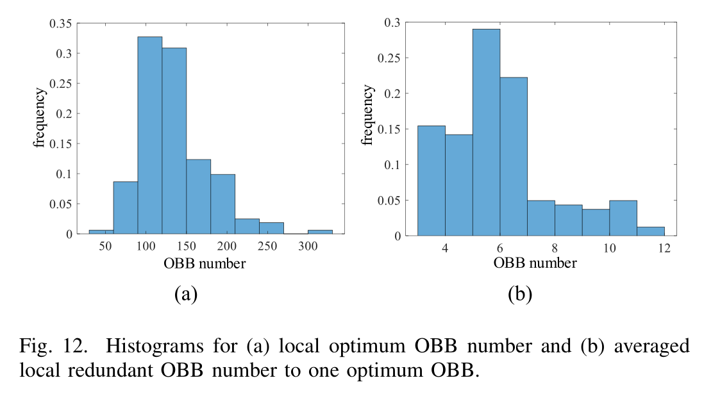{ width="70%" loading=lazy }

> **读图：** 说明每个部件周围常有多个冗余候选框，这是局部构图的依据。

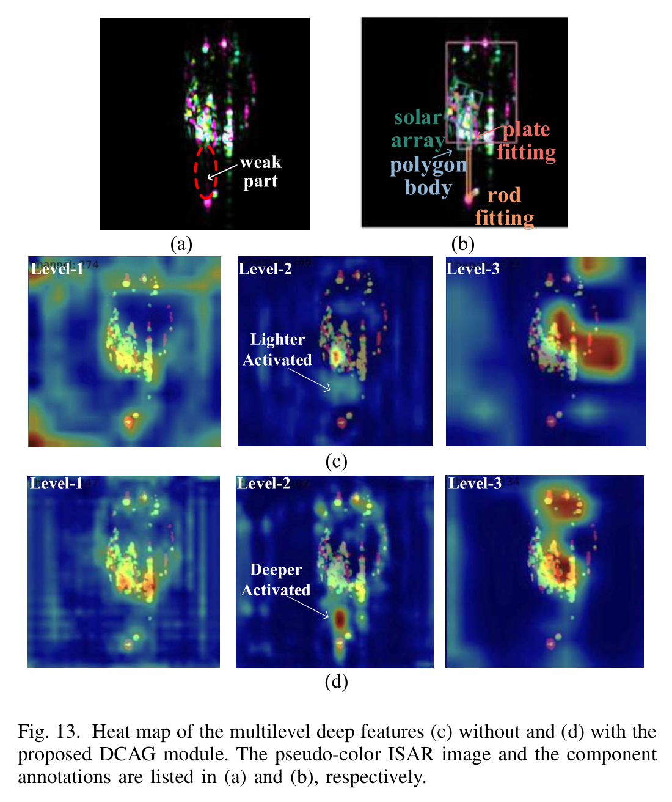{ width="70%" loading=lazy }

> **读图：** 比较 (c)(d)：加入 DCAG 后，热区是否更贴合标注的部件位置，尤其是弱散射部件。

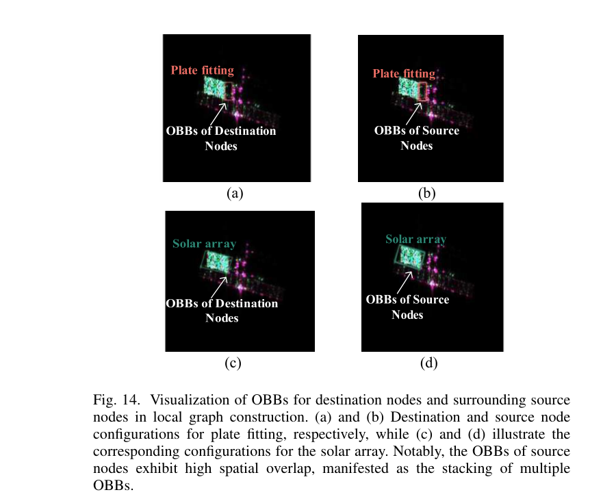{ width="70%" loading=lazy }

> **读图：** 图中显示局部图里哪些候选框被连到同一个目标节点上，帮助理解“同一部件的冗余框互相支撑”。

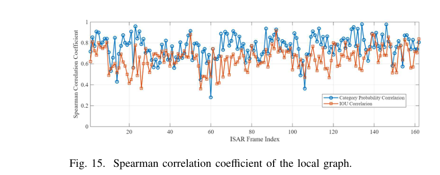{ width="75%" loading=lazy }

> **读图：** 衡量局部图中节点特征之间的相关程度，可与 Fig. 17 的全局图对照。

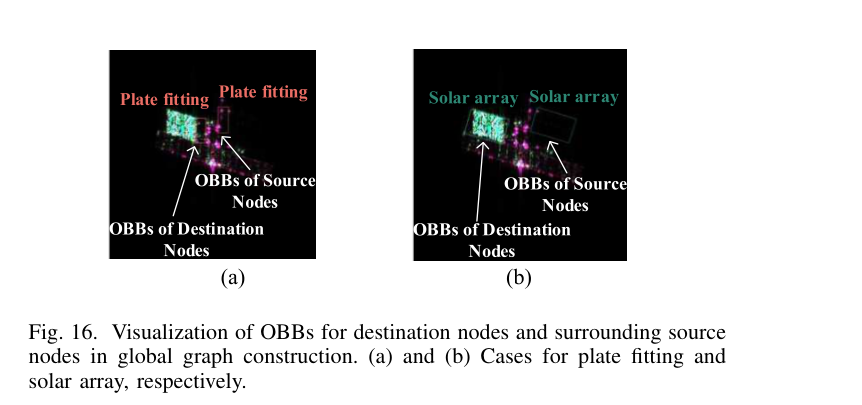{ width="70%" loading=lazy }

> **读图：** 与 Fig. 14 对照：全局图把同类但不相邻的部件也连了起来。

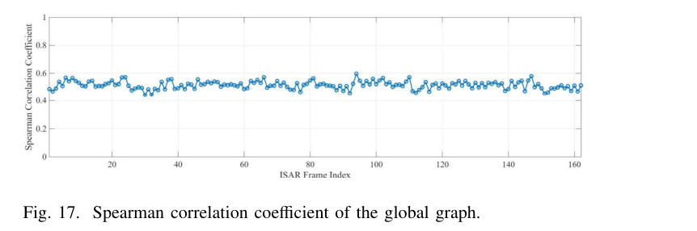{ width="75%" loading=lazy }

> **读图：** 与 Fig. 15 对照，比较局部图与全局图的相关性特点；具体结论以原文讨论为准。

## 13.6 优点与局限

**优点**：

- 任务新：首次在简缩极化 ISAR 上做 9 类部件的旋转框识别，数据集标注方法（三维点云投影 + 遮挡）严谨；
- 图结构设计贴合检测问题：局部图整合冗余框，全局图利用同类部件；MGNF 无监督去背景，显著降低计算；
- 计算量适中（16.635 GFLOPs），远低于两阶段 O-RRCNN。

**局限**：

- 纯仿真数据，只有 6 颗卫星；跨俯仰角泛化差；
- 附件类（小、弱）召回仍低；
- 极化信息仅以实部/虚部通道输入，网络中没有显式利用极化物理（作者也表示伪彩色中各颜色的物理意义将在后续研究）。

## 13.7 可以动手复现什么

- 用 `isar_core.compact_pol_from_linear` 对仿真目标生成 $S_{LL}$、$S_{RL}$ 并合成伪彩色（第 3 章图 3-2 已演示）；
- 安装 mmrotate，用 DOTA 格式标注少量仿真 ISAR 像中的“本体/太阳翼”旋转框，训练 RTMdet-R 基线——这是进入检测方向的最佳入口；
- 复现 MGNF：`skimage.filters.threshold_local(method='gaussian')` + `skimage.measure.find_contours` + 凸包，统计锚点过滤比例。

## 13.8 自测题

1. 部件级识别与目标级分类相比，输出、标注、评价指标分别有什么不同？
2. 为什么在互易条件下 $S_{RL}$ 等于 Pauli 的奇次散射分量？
3. MGNF 为什么要对三种特征的掩膜取“并集”而不是“交集”？
4. 局部图与全局图的边分别是怎么定义的？它们各自解决什么问题？
5. 根据表 13-2，如果实际雷达的俯仰角与训练数据不同，你会怎样改进训练策略？

!!! abstract "小结"

    DCA-Net 把 ISAR 识别推进到“部件级”，并展示了图注意力在检测精修中的作用。它与 DB-SSIT 一起构成“极化 ISAR 识别”方向：DB-SSIT 用全极化做目标分类，DCA-Net 用简缩极化做部件检测。
