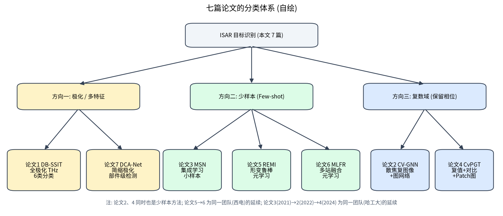

# 第 14 章 横向对比：七篇论文的分类、关系与研究趋势

!!! tip "本章目标"

    1. 建立七篇论文的分类体系，理解它们之间的继承关系；
    2. 用一张表横向对比输入、难点、方法、数据、任务与指标；
    3. 总结 ISAR 目标识别的研究趋势与开放问题。

## 14.1 分类体系

- **方向一：极化 / 多特征**——论文 1（全极化、目标分类）、论文 7（简缩极化、部件检测）。核心问题：如何把极化散射机理变成网络能用的特征。
- **方向二：少样本**——论文 3（集成学习，“小样本”）、论文 5（形变鲁棒 + 稀疏图推理）、论文 6（多站融合）。核心问题：如何在极少样本、存在形变时得到鲁棒、可区分的嵌入。
- **方向三：复数域**——论文 2（散焦复图像 + 复值 GNN）、论文 4（复值对比学习 + patch 图 Transformer）。核心问题：如何利用被丢弃的相位信息。论文 2、4 同时也属于少样本方法。

**团队脉络**：

- 哈工大（张云、李宏博、袁浩轩等）：论文 3（2021，Stacking）→ 论文 2（2022，复值 GNN）→ 论文 4（2024，复值 PGT），从集成学习走向“复值 + 图 + 对比学习”；
- 西电（白雪茹、周峰等）：论文 5（2024/2025，REMI）→ 论文 6（2025，MLFR），从单站形变鲁棒走向多站融合，两篇使用相同的 7 颗卫星数据与基类/新类划分；
- 上海理工（李银伟、朱亦鸣等）：论文 1，太赫兹全极化；
- 国防科大（陈思伟等）：论文 7，简缩极化部件识别。

## 14.2 横向对比表

| 论文 | 输入 | 主要难点 | 核心方法 | 数据 | 任务 | 关键指标（原文） |
|---|---|---|---|---|---|---|
| 1 DB-SSIT | 全极化 HH/HV/VV → 6 维特征，128×128 | 极化与空间特征融合 | 双分支（极化散射 + 空间）+ 局部–全局 Transformer | 自建 220 GHz 太赫兹，6 类 × 28 幅（扩增至 3024） | 6 类分类 | OA 99.38%，Kappa 0.9925，1.91 M 参数 |
| 2 CV-GNN | 单极化复数散焦像，128×128 | 散焦、少样本 | 复值 CNN + 复值 GNN | 8 类仿真（5.4 GHz，240 MHz）+ 高分三号空间站实测 | 少样本分类 | 9 列平均比 RV-GNN 高约 11.2% |
| 3 MSN | 幅度像（预处理后） | 小样本过拟合 | ResNet50+RAM、GCN、RN + 自适应加权 XGBoost Stacking | 5 类仿真（5.52 GHz，300 MHz），每类 200 幅；Tiangong-1 实测 | 小样本分类（K/N 0.2–1.2） | OA 82.44 / 91.34 / 99.78% |
| 4 CvPGT | 单极化复数像，224×224 | 少样本、大姿态变化、散焦 | 复值对比学习 + patch 图 Transformer + GNN | 8 类仿真（10 GHz，5 GHz），每类 30 幅；实验室实测 3 类 | 3-way 1/5-shot | 仿真 Task 1：78.74 / 96.47%；实测 70.07 / 76.27% |
| 5 REMI | 单极化幅度像，128×128 | 未知形变、少样本 | MH-STN + GEN + MG-GAT | 7 颗卫星（17 GHz，PO），4 个场景；实测飞机 | 3-way 1/5-shot | 场景 IV：66.99 / 74.92%；飞机 77.62 / 89.56% |
| 6 MLFR | 3 站单极化幅度像，128×128 | 类内差异大、类间区分小、融合困难 | ISFR（对齐 + 重建）+ ICFR + 混合损失 | 7 颗卫星 × 3 站（17 GHz，PO） | 3-way 1/5-shot | 77.13 / 89.33%，468 K 参数 |
| 7 DCA-Net | 简缩极化 $S_{LL}$、$S_{RL}$ 实虚部 4 通道，256×256 | 部件弱小、多尺度 | RTMdet + MGNF + 双分支图注意力 | 6 颗卫星（16 GHz，2 GHz，FEKO），1638 帧，16577 个部件 | 9 类部件旋转框检测 | mAP50 71.78%，F1 76.61% |

!!! note "说明"

    **注意不可横向比较精度！** 七篇论文的数据集、类别数、任务设置完全不同，表中精度只能在各自论文内部比较。例如论文 1 的 99.38% 与论文 5 的 66.99% 不能说明前者方法“更好”——前者是 6 类全监督分类（且训练/测试姿态范围很窄），后者是新类 3-way 1-shot，且训练/测试俯仰角、方位范围、成像参数都不同。

## 14.3 一个统一的视角：识别 = 输入表示 × 特征提取 × 学习范式

| 维度 | 选项 | 对应论文 |
|---|---|---|
| **输入表示** | 幅度 / 复数 / 全极化 / 简缩极化 / 多站 | 3、5 / 2、4 / 1 / 7 / 6 |
| **几何校正** | 旋转注意力 / 约束 STN / 站间仿射对齐 | 3 / 5 / 6 |
| **特征提取** | CNN / Transformer / patch 图 / 样本图 / 检测框图 | 全部 / 1、4、6 / 4 / 2、3、4、5 / 7 |
| **学习范式** | 全监督 / Stacking 集成 / episode 元学习 / 对比预训练 | 1、7 / 3 / 2、4、5、6 / 4（6 的 $L_{CR}$ 为有监督对比） |
| **任务粒度** | 目标级 / 部件级 | 1–6 / 7 |

## 14.4 研究趋势

1. **从“图像识别”走向“物理引导的识别”**：网络结构越来越多地嵌入雷达物理——极化分解（论文 1）、无剪切仿射（论文 5、6）、成像参数增强（论文 4）、复数运算（论文 2、4）。
2. **从单一信息源走向多源融合**：单极化 → 全极化 / 简缩极化；单站 → 多站；作者们在展望中都提到了序列观测（多帧）与多极化 / 多站融合（论文 5、6 的展望）。
3. **从目标级走向部件级、结构级**：论文 7 开始识别部件；下一步可能是三维结构重建与功能 / 状态推断。
4. **少样本设置越来越严格**：从“训练样本少”（论文 3）到“新类 1-shot”（论文 4、5、6），再到“训练 / 测试成像条件不同”（论文 5 场景 IV）与“仿真基类 → 实测新类”（论文 5 飞机实验）。
5. **太赫兹 ISAR**：更高分辨率能揭示更细的结构（论文 1），但也带来更强的微动敏感性和数据稀缺问题；论文 1 的展望正是“结合极化特征的少样本识别”。

## 14.5 开放问题（适合作为研究选题）

- **仿真–实测差距**：几乎所有训练数据来自仿真，实测精度明显下降（论文 4：仿真 5-shot 约 96%，实测约 76%）。域自适应、物理一致的数据生成仍是难题；
- **严格、公开的基准**：缺乏公开的 ISAR 识别数据集与统一协议，论文之间难以比较；
- **可解释性**：网络是否真的用到了极化 / 相位的物理信息？可以用 Grad-CAM 之外的方法（如通道消融、物理特征替换）去验证；
- **散焦与识别的联合优化**：论文 2 绕开重聚焦，能否把自聚焦与识别端到端联合训练？
- **太赫兹 + 少样本 + 极化**：把论文 1 的极化特征与论文 5、6 的少样本框架结合，是很自然的下一步。

!!! abstract "小结"

    七篇论文可以概括为“三条主线 + 一个升级”：极化、少样本、复数域三条主线，以及从目标级到部件级的任务升级。它们共同的趋势是**把雷达物理写进网络、把多源信息对齐后再融合、把实验设置做得更接近实际**。
