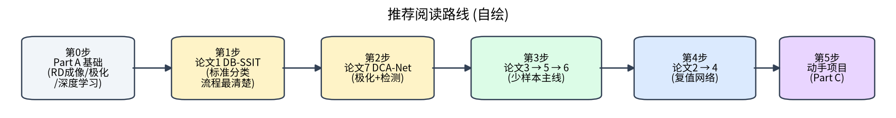

# 第 15 章 阅读路线与入门项目

!!! tip "本章目标"

    1. 给出循序渐进的阅读路线与每一步的“读什么、抓什么”；
    2. 提供两个可以直接运行的入门项目及扩展方向；
    3. 给出一个面向课题组太赫兹数据的复现计划。

## 15.1 推荐阅读路线



| 步骤 | 读什么 | 重点抓住 | 预计用时 |
|---|---|---|---|
| 0 | Part A（第 0–6 章） | $\rho_r=c/2B$、$\rho_a=\lambda/2\Delta\theta$；Pauli；N-way K-shot | 1–2 周 |
| 1 | DB-SSIT DB-SSIT | 一个“标准”分类论文的完整结构：数据 → 网络 → 对比 → 消融 | 3–4 天 |
| 2 | DCA-Net DCA-Net | 极化的另一种用法；检测任务与指标 | 4–5 天 |
| 3 | MSN → REMI → MLFR | 少样本的演进：集成 → 形变鲁棒元学习 → 多站融合 | 1–2 周 |
| 4 | CV-GNN → CvPGT | 复值网络：从散焦复图像 GNN 到复值对比学习 + Transformer | 1 周 |
| 5 | 动手项目 | 下面两个项目 | 2–4 周 |

**读论文的“三遍法”**：第一遍只读摘要、引言最后一段（贡献）、图表和结论；第二遍读方法，自己画框图（可对照本文的自绘框图）；第三遍读实验设置，思考“如果我来做，会怎样设计对比和消融”。

## 15.2 项目 1：点散射体 RD 仿真 + ResNet18 分类

**目标**：亲手走完“仿真数据 → 训练 → 评估”的全流程，体会姿态变化对识别的影响。

```bash
cd code
python project1_rd_dataset.py --classes 6 --per_class 100   # 生成 6 类 × 100 幅 64×64 RD 像
python project1_train_resnet18.py --epochs 8                 # 随机划分
python project1_train_resnet18.py --epochs 8 --flip           # 随机划分 + 随机横向翻转
python project1_train_resnet18.py --epochs 8 --split azimuth --train_az_max 90 --test_az_min 180
                                       # 按方位划分：0–90° 训练，180–360° 测试（测试姿态从未见过）
```

**本机实测结果**（CPU，8 个 epoch，详见附录 A 表 A-1）：随机划分时测试精度 100%，因为测试姿态在训练集中都有“近邻”；0–90° 训练、180–360° 测试时只有 15.21%，与随机猜测（16.7%）相当。测试姿态完全没见过，精度就会崩溃——这就是第 4 章“姿态敏感”的直接体现。

**扩展实验**：

1. 改变带宽或积累角（`isar_core.simulate_image` 的 `B`、`dtheta`），训练和测试用不同参数，观察“形变”带来的性能下降（对应 REMI 场景 II）；
2. 加入非匀速转动（`alpha_ratio`），观察散焦的影响（对应 CV-GNN）；
3. 把输入换成 [实部, 虚部] 双通道（对应 CV-GNN、CvPGT 的动机）；
4. 用 `--train_per_class 5` 等观察小样本下的过拟合（对应 MSN）。

## 15.3 项目 2：原型网络少样本识别

```bash
python project2_protonet.py --way 5 --shot 1 --episodes 1000 --per_class 40
python project2_protonet.py --way 5 --shot 5 --episodes 1000 --per_class 40
```

- 基类：`random_target(0..19)` 共 20 类参数化“卫星”；新类：`random_target(100..109)` 共 10 类，训练时从未出现；
- 每个 episode：N-way K-shot，每类 10 个查询；测试报告均值 ± 95% 置信区间（与 REMI、MLFR 的协议一致）。

**扩展实验**：

1. 在 Conv4 前加约束 STN（第 11.7 节），测试“训练 Δθ=4°、测试 Δθ=6°”的跨参数场景；
2. 用物理参数随机化做对比预训练（第 10.7 节）；
3. 把原型距离换成关系网络（RelationNet）或 GNN（第 6.2 节）。

## 15.4 项目 3（进阶）：在课题组太赫兹数据上复现 DB-SSIT

`code/dbssit_lite.py` 是 DB-SSIT 思想的**教学简化版**（非官方实现）。建议步骤：

1. **数据准备**：把每个样本的 HH、HV、VV 复数像读入，用 `pol_features_torch` 计算 6 维特征，统一裁剪 / 缩放到 128×128；
2. **严格划分**：先按原始样本（不同方位 / 俯仰）划分训练 / 验证 / 测试，**再只对训练集扩增**；
3. **基线**：ResNet18（输入为 HH/HV/VV 幅度 3 通道）与 `DBSSITLite`（输入 6 维特征）；
4. **消融**：去掉极化分支 / 去掉空间分支 / 把 6 维特征换成 3 通道幅度，比较 OA、AA、Kappa；
5. **泛化**：训练用一部分方位角、测试用另一部分；若有不同俯仰角数据，做跨俯仰角测试。

预期收获：理解原文 99.38% 背后的实验条件，并得到一个在更严格协议下的可靠结果——这可以直接成为毕业设计或科研小项目的起点。

!!! abstract "小结"

    先建立物理直觉（Part A + 仿真），再按“标准分类 → 极化检测 → 少样本 → 复值”的顺序读论文，最后用仿真项目和真实数据复现核心结论。动手验证论文中的一个关键结论，比读十篇论文更能加深理解。
